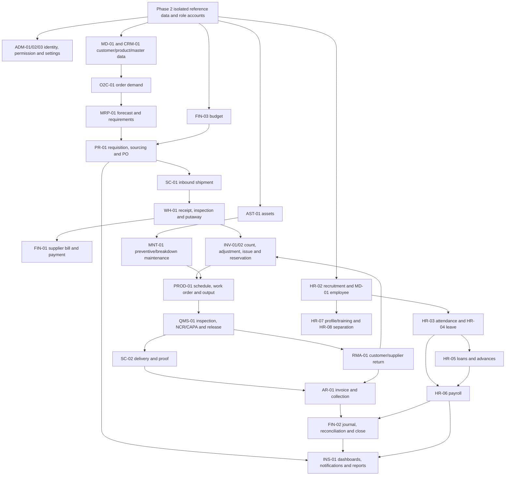

# Phase 1 — Process catalog and coverage plan

**Status:** approved by owner; implementation in progress. `PR01-DIRECT-PO-UNDER-THRESHOLD` stopped at its missing Finance notice; the current batch is exercising inventory journeys.  
**Source baseline:** repository snapshot documented in [00-discovery.md](00-discovery.md).  
**Scope count:** 31 process specifications; 199 planned journey variants. The count is this catalog's planned test inventory, not proof that the UI supports every variant. Any UI/API-only or unresolved workflow is explicitly marked with a gap.

## How to read this catalog

The 31 specifications below group records/routes into user-visible end-to-end processes. Each spec names the menu path, actors, ordered path, inputs, expected source-defined status/action, side effects, variants, and denied actors. A step marked **verify source path** means the exact allowed button/state or recipient has not been behaviorally proven; it is a requirement for the later implementation review, never permission to guess or bypass the UI.

Abbreviations: `SA` system_admin; `HR` hr_officer; `FIN` finance_officer; `VP` vice_president; `CS` customer_service_officer; `SO` sales_officer; `PM` production_manager; `PPC` ppc_head; `BUY` purchasing_officer; `WH` warehouse_staff; `QC` qc_inspector; `MT` maintenance_tech; `MS` maintenance_supervisor; `IM` impex_officer; `DH` department_head; `EMP` employee; `DRV` driver; `CUS` customer portal actor; `SUP` supplier portal actor. Full role slugs are in 00.

Side-effect tags: `DOC` linked record and document number; `AUD` audit actor; `WF` workflow/inbox/badge; `INV` stock/reservation/ledger; `FIN` accounting/budget; `MSG` recipient-specific notification/email; `RT` second-viewer live update; `FILE` PDF/export; `OPS` production/quality/maintenance/asset effect; `PEOPLE` HR/time/payroll effect; `ASYNC` queue/scheduler/outbox effect. Every implemented step must assert applicable tags with UI plus read-only API/DB/mail checks. No transactional create/update/approve is permitted outside its role's UI session.

### Cross-cutting step contract

- The actor named in the step performs the action through the named SPA/menu page using that actor's own session. The next actor locates the work through its real inbox, notification, badge, or linked in-app record.
- Expected actions: creator can perform only the state-appropriate create/edit/submit/cancel actions exposed by the component and policy; an assigned approver can approve/reject only the current step; receiving/inspection/dispatch/finance actors can perform only their step's action after predecessor status. Prior actors and other roles are read-only unless the route/policy explicitly gives an action. Exact disabled/hidden affordance and API 403/422/409 are recorded per permission/transition matrix below and must be confirmed against current component/controller code before test implementation.
- Each spec's common side effects identify the event families to assert; record-specific numeric recipients, totals and ledger accounts remain source-derived and business-rule questions are listed at the end.
- UI path abbreviations use the labels/URLs in `spa/src/components/layout/Sidebar.tsx` and route modules. Public, portal and mobile/floor views are called out separately. In-app navigation is required in execution.

## 1. Process specifications

### ADM-01 — Identity, login and account lifecycle (3 variants)

**Modules:** Auth, Admin, HR. **Purpose/end:** provision the right identity and end in a valid, revoked, locked, or inactive state. **Baseline:** 17 role accounts, one scoped user per seeded role plus a negative/scope identity; those are Phase 2 E2E accounts, not demo accounts. **Actors:** SA, HR, EMP, all internal roles.

| # | Actor; UI path | Input/action | Expected state/actions after step | Effects |
|---|---|---|---|---|
| 1 | HR → Human Resources → Employees / SA → Administration → Users | Select employee, invite/provision portal login | Invitation pending/sent; HR can revoke/resend if shown; invitee cannot access before acceptance | DOC, AUD, MSG, ASYNC |
| 2 | Invitee → Login / invitation page | Accept one-time invite, set password, login through SPA | Authenticated session; accessible landing/sidebar derived from role | AUD, PEOPLE |
| 3 | SA → Administration → Users | Edit role/status or revoke access with reason | Active/inactive/locked per Admin status; sessions/tokens rejected on disable per backend | AUD, MSG, RT |
| 4 | Target user → Login | Login with active, inactive, locked, expired-password, or invalid credentials | Success only for eligible account; login history outcome recorded | AUD |

**Variants:** `ADM01-HAPPY` invite/activate/login; `ADM01-REVOKE` deactivate and prove session denial; `ADM01-LOCK` lockout and recovery. **Negative:** non-admin cannot change another user's account/role; disabled account cannot authenticate. **Effects:** login audit/status and account lifecycle. **Source:** `api/app/Modules/Auth`, `api/app/Modules/Admin`, HR invite routes, `Auth/Admin` route modules.

### ADM-02 — Roles, permissions, delegation and segregation of duties (5 variants)

**Modules:** Admin, Auth, Approvals. **Purpose/end:** allow a bounded temporary delegate or correct role grant while preserving maker/checker separation. **Actors:** SA, delegator, delegate, assigned checker.

| # | Actor; UI path | Input/action | Expected state/actions after step | Effects |
|---|---|---|---|---|
| 1 | SA → Administration → Roles & Permissions | Inspect role/permission catalog; change a test-only grant if UI supports | Permission assignment saved and visible to affected identity | AUD, RT |
| 2 | User → profile/Delegations (self-service) | Create delegate, workflow scope and time window | Delegation active only inside interval and permitted scope | DOC, AUD, MSG |
| 3 | Delegate → Overview → Approval Queue | Find assigned item through queue and act within delegated window | Only eligible assigned step can be acted | WF, AUD, RT |
| 4 | SA → Administration → Delegations / SoD | Revoke/expire delegation; inspect conflict report | Delegate loses authority; self-approval/maker-checker conflict rejected | AUD, WF |

**Variants:** `ADM02-DELEGATE`, `ADM02-EXPIRED`, `ADM02-REVOKED`, `ADM02-SELF-APPROVAL`, `ADM02-SCOPE`. **Negative:** non-owner cannot edit another user's delegation without `admin.delegations.manage_any`; role without a slug cannot access corresponding UI/API; requester cannot approve own record unless source provides an explicit override (payroll has a special admin override). **Source:** RolePermissionSeeder; Admin routes/policies; ApprovalService and SoD code.

### ADM-03 — Settings, audit, backups, imports and scheduled exports (4 variants)

**Modules:** Admin, Auth, Accounting/HR configuration. **Purpose/end:** administer configuration and review/produce operational artifacts. **Actors:** SA; scoped HR/FIN users for government tables/settings.

| # | Actor; UI path | Input/action | Expected state/actions after step | Effects |
|---|---|---|---|---|
| 1 | SA → Administration → Settings / Business Policies | Change reversible E2E-only setting, save | Setting persists and consumer shows new value | AUD, RT |
| 2 | SA → Administration → Imports / Government Tables | Upload valid CSV then invalid/duplicate CSV | Valid import reports accepted rows; invalid rows rejected without partial silent mutation | FILE, AUD |
| 3 | SA → Administration → Audit Logs / Activity | Filter by run ID, actor, action | Exact action, entity, timestamp and actor visible | AUD |
| 4 | SA → Administration → Scheduled Exports / Backups | Request export/backup and download/read result if UI supports | Job status and artifact link available | FILE, ASYNC, AUD |

**Variants:** `ADM03-SETTING`, `ADM03-IMPORT-VALIDATION`, `ADM03-EXPORT`, `ADM03-BACKUP`. **Negative:** only permission holder can change settings/import/export/backup; no destructive restore test without an isolated disposable snapshot and explicit owner-approved data. **Source:** Admin and Payroll routes/permissions; queue/console commands.

### INS-01 — Dashboards, action center, alerts and decision recommendations (5 variants)

**Modules:** Dashboard, DSS, Notifications, all operational modules. **Purpose/end:** show each role its permitted work and open the correct underlying record from a signal. **Actors:** every role with dashboard/DSS/notification permission.

| # | Actor; UI path | Input/action | Expected state/actions after step | Effects |
|---|---|---|---|---|
| 1 | Role → Overview → Dashboard | Open role dashboard | Role-specific dashboard selected through dispatch; no cross-scope data | RT |
| 2 | Role → Action Center / Approval Queue | Open a seeded/created actionable item from badge/list | Destination filter and linked record match item | WF, MSG |
| 3 | Role → Notifications | Read, dismiss, follow deep link | Unread badge decrements; linked record opens with allowed actions | MSG, RT |
| 4 | Eligible role → Decision Center | Accept, dismiss or snooze recommendation | Recommendation transitions to source-supported status | AUD, MSG, RT |

**Variants:** `INS01-DASHBOARD-SCOPE`, `INS01-BADGE-COUNT`, `INS01-NOTIFICATION-LINK`, `INS01-DSS-ACTION`, `INS01-REALTIME`. **Negative:** a role cannot view another department/customer's private signal; notification reaches only intended recipient. **Source:** Dashboard/DSS routes, Sidebar badge mappings, Notification API.

### PUB-01 — Public inquiry, newsletter and careers intake (4 variants)

**Modules:** Landing, HR, CRM. **Purpose/end:** accept public submissions and hand them to authenticated owners. **Actors:** visitor, HR, CS/SO.

| # | Actor; UI path | Input/action | Expected state/actions after step | Effects |
|---|---|---|---|---|
| 1 | Visitor → public Contact/Careers page | Submit valid inquiry/application | Inquiry `new`; application `new` | DOC, MSG, ASYNC |
| 2 | CS/HR → CRM Inquiries / Recruitment | Find intake through work list; triage | Inquiry `in_progress`; application `screening` | AUD, WF |
| 3 | Visitor → Newsletter page | Subscribe/unsubscribe with valid address | subscribed/unsubscribed | MSG, AUD |

**Variants:** `PUB01-CONTACT`, `PUB01-CAREERS`, `PUB01-NEWSLETTER`, `PUB01-SPAM-VALIDATION`. **Negative:** public visitor cannot read another submission; internal role needed to triage. **Source:** Landing and Careers routes/controllers; `ContactInquiryStatus`, `NewsletterStatus`, Recruitment state machine.

### MD-01 — HR organizational and employee master records (3 variants)

**Modules:** HR, Admin. **Purpose/end:** maintain department, position and employee master data used downstream. **Actors:** HR; department head and employee as scoped viewers.

| # | Actor; UI path | Input/action | Expected state/actions after step | Effects |
|---|---|---|---|---|
| 1 | HR → Human Resources → Departments / Positions | Create or edit E2E-only master row | Row active and selectable only to authorized scope | DOC, AUD |
| 2 | HR → Employees | Create employee with department, position, rate, start date | `active`, employee number assigned | DOC, AUD, PEOPLE |
| 3 | Department Head/EMP → directory/self-service | View own department or own profile | Scope limited to policy | RT |

**Variants:** `MD01-EMPLOYEE`, `MD01-SCOPE`, `MD01-REQUIRED-VALIDATION`. **Negative:** non-HR cannot create/edit employee master; employee cannot read another employee's sensitive pay/bank data. **Source:** HR routes, EmployeeStatus, permissions.

### CRM-01 — Customer, product, pricing, agreements and complaint intake (6 variants)

**Modules:** CRM, Accounting, B2B, ReturnManagement. **Purpose/end:** establish a customer/product relationship and resolve a complaint or price request. **Actors:** SO, CS, FIN, customer portal actor.

| # | Actor; UI path | Input/action | Expected state/actions after step | Effects |
|---|---|---|---|---|
| 1 | SO/FIN → Sales & CRM → Customers / Products | Create/select master customer and product; set portal access as allowed | Customer/product visible only in authorized scope | DOC, AUD |
| 2 | SO → Price Agreements | Propose agreement/price; FIN/authorized checker reviews | Requested/pending/offered/accepted or rejected per `PriceRequestStatus` | DOC, WF, MSG |
| 3 | Customer/CS → portal/Customer Complaints | Submit complaint; CS investigates and resolves | complaint `open` → `investigating` → `resolved`/`closed` | DOC, AUD, MSG, RT |

**Variants:** `CRM01-NEW-CUSTOMER`, `CRM01-PRICE-APPROVAL`, `CRM01-PRICE-REJECT-RESUBMIT`, `CRM01-COMPLAINT`, `CRM01-CUSTOMER-SCOPE`, `CRM01-DUPLICATE`. **Negative:** customer tenant cannot see another tenant's customer/order; CS cannot approve finance-only price. **Source:** CRM/B2B routes; `PriceRequestStatus`, `ComplaintStatus`, SalesOrderResponseStatus.

### PR-01 — Procurement sourcing and purchase approval (8 variants)

**Modules:** Purchasing, MRP, Inventory, B2B/supplier portal, Accounting. **Purpose/end:** source and approve a requirement, produce a supplier-acknowledged PO. **Actors:** DH or BUY (PR creator), BUY (source/convert/send), FIN, VP at/above threshold, supplier portal actor.

| # | Actor; UI path | Input/action | Expected state/actions after step | Effects |
|---|---|---|---|---|
| 1 | DH/BUY → Procurement → Purchase Requests → New PR | Select priority, sourcing method, owning department, need date, reason, item/quantity; save | draft; creator can submit/edit/cancel within policy; other roles cannot submit or edit | DOC, AUD |
| 2 | Same creator → PR detail | Submit; Direct PO runs Finance → VP at ≥ ₱50,000; RFQ approves the need on submit and defers spend approval to PO | Direct: draft → pending; RFQ: draft → approved. Under threshold VP record is skipped. Creator can cancel pending; cannot approve own PR | WF, AUD, MSG, RT |
| 3 | FIN then VP if required → Approval Queue → linked PR detail | Find current task in inbox; approve/reject; rejection may be revised/resubmitted per current policy | pending → approved/rejected; only current assigned role can decide. Approved Direct PO PR exposes Convert to PO; RFQ PR exposes Start RFQ | WF, AUD, MSG, RT |
| 4 | BUY → PR detail → Convert to PO, or Supplier RFQs for RFQ path | Assign each line to a qualified supplier; on RFQ path invite/receive/compare/award | Direct conversion creates a draft PO and updates PR conversion status; RFQ lifecycle is draft/open/awarded and quotes submitted/awarded | DOC, AUD, FILE |
| 5 | BUY → linked Purchase Order detail | Submit the draft PO into Finance → VP at ≥ ₱50,000 approval | draft → pending_approval → approved/rejected; buyer cannot approve own PO; skipped VP step is recorded below threshold | DOC, WF, AUD, MSG, RT |
| 6 | FIN then VP if required → Approval Queue → linked PO detail | Find and decide current approval task | pending_approval → approved/rejected; approval enables buyer's Mark as sent action | WF, AUD, MSG, RT |
| 7 | Approved PO → supplier dispatch listener; BUY handles only a manual-required fallback | With an active supplier portal recipient, approval publishes the PO to the portal and queues vendor email, then confirms the dispatch and marks the PO sent. Without a portal recipient, buyer follows the dispatch's manual transmission action. | approved → sent with dispatch `confirmed` on the E2E portal path; alternate manual path remains approved/manual_required until buyer confirms. Expected GRN is staged by the outbox. | MSG, ASYNC, RT, FILE |
| 8 | SUP → supplier portal → Purchase Orders → linked PO | Follow supplier portal notification/list hand-off; accept, propose changes, or decline | sent → acknowledged / supplier_proposed / supplier_declined; supplier may act only on its tenant's PO | MSG, ASYNC, RT |

**Code-derived actor correction (2026-11-03):** PR creation is available to `purchasing_officer` and `department_head` (`purchasing.pr.create` in `RolePermissionSeeder`, with the department-scope rule in `PurchaseRequestService`). `ppc_head` and `production_manager` can view purchasing records but do not hold the PR-create permission; they are removed as PR creators from this spec. E2E actor `department_head__hr` supplies an own-department request, while the purchasing officer sources/converts it. The E2E baseline includes a qualified/preferred `RM-001` ↔ `E2E Supplier Ltd.` reference link; it does not create any purchase transaction.

**Variants:** `PR01-PR-PO-HAPPY`, `PR01-REJECT-RESUBMIT`, `PR01-RFQ-MULTIQUOTE`, `PR01-DIRECT-PO`, `PR01-UNDER-THRESHOLD`, `PR01-OVER-THRESHOLD`, `PR01-NO-APPROVER`, `PR01-SUPPLIER-RESPONSE`. **Negative/out of order:** unapproved PR cannot be converted when approval is required; non-BUY cannot create/send PO; requester cannot self-approve; portal supplier cannot access another supplier's RFQ/PO. **Source:** Purchasing routes/status enums, WorkflowSeeder, ApprovalService, Supplier portal routes.

### WH-01 — Goods receiving, incoming quality and putaway (6 variants)

**Modules:** Inventory, Purchasing, Quality, Accounting. **Purpose/end:** turn an approved PO shipment into accepted stock and a traceable receipt. **Actors:** WH, QC, BUY, FIN.

| # | Actor; UI path | Input/action | Expected state/actions after step | Effects |
|---|---|---|---|---|
| 1 | WH → Warehouse → Goods Receipts (GRN) | Select sent/acknowledged PO; enter received quantities, lot, delivery docs | GRN draft/pending_qc; PO partial/received as applicable | DOC, INV, AUD, MSG |
| 2 | QC → Quality → Quality Inspections / WH → MRB | Inspect lot against spec; record measurements/disposition | Inspection in_progress → passed/failed; GRN accepted/partial_accepted/rejected; MRB as needed | OPS, INV, AUD, RT |
| 3 | WH → Warehouse Map / Stock Levels | Put away accepted quantity to location | On-hand/lot/ledger updated only for accepted disposition | INV, DOC, RT |
| 4 | FIN/BUY → AP Bills | Review auto-created/linked supplier bill and match | Bill draft/unpaid or match exception; no duplicate bill | FIN, AUD, MSG |

**Variants:** `WH01-FULL-ACCEPT`, `WH01-PARTIAL`, `WH01-OVER-RECEIPT`, `WH01-QC-REJECT`, `WH01-RECEIVE-BEFORE-APPROVED`, `WH01-DUPLICATE-GRN`. **Negative:** WH cannot receive before valid PO state; QC cannot accept outside spec without allowed disposition; rejected quantity does not inflate available stock. **Source:** Inventory GRN/QC routes, `GrnStatus`, `IncomingQcHandoffStatus`, Quality Inspection and MRB code.

### FIN-01 — Accounts payable, match exceptions and supplier payment (7 variants)

**Modules:** Accounting, Purchasing, Inventory. **Purpose/end:** validate liability, approve payment, disburse and post balanced entry. **Actors:** FIN maker, FIN/VP checker, BUY/WH source reviewers.

| # | Actor; UI path | Input/action | Expected state/actions after step | Effects |
|---|---|---|---|---|
| 1 | FIN → Finance → Bills | Review supplier invoice against PO/GRN; attach invoice | bill draft/unpaid; matched values agree or exception is explicit | DOC, FIN, AUD |
| 2 | FIN → Bills / payment action | Submit payment; attach amount/date/reference | payment pending_approval when configured | WF, MSG, AUD |
| 3 | VP/eligible checker → Approval Queue | Approve/reject; FIN reworks rejection | approved/posted or rejected; bill partial/paid as amount permits | WF, FIN, AUD, RT |
| 4 | FIN → Journal/Accounting | Verify balanced AP/cash journal and bill ledger | posted journal; audit identifies actor and source link | FIN, DOC |

**Variants:** `FIN01-THREE-WAY`, `FIN01-PARTIAL-PAYMENT`, `FIN01-PRICE-QUANTITY-VARIANCE`, `FIN01-REJECT-RESUBMIT`, `FIN01-DUPLICATE-INVOICE`, `FIN01-OVER-THRESHOLD`, `FIN01-CLOSED-PERIOD`. **Negative:** non-FIN cannot pay/post; payment cannot exceed payable/valid amount; no posting in closed period; duplicate supplier invoice is blocked. **Source:** Accounting bills/payment/period/journal routes/statuses; Purchasing/Inventory linkage.

### INV-01 — Stock adjustments, counts and transfers (11 variants)

**Modules:** Inventory, Accounting. **Purpose/end:** reconcile physical stock while preserving maker/checker and ledger correctness. **Actors:** WH maker/counter plus a distinct WH variance checker and a third WH session finisher; FIN checker on high-value adjustments; QC where hold status is involved.

| # | Actor; UI path | Input/action | Expected state/actions after step | Effects |
|---|---|---|---|---|
| 1 | WH → Stock Adjustments or Warehouse Map → Stock Count | Create adjustment/count with reason, item, location and observed quantity | adjustment at/below the configured threshold posts immediately as approved; above-threshold adjustment is pending with stock unchanged; count in_progress/counted | DOC, INV, AUD; low-value adjustment has no approval notice, high-value adjustment notifies eligible approvers |
| 2 | Independent WH variance checker → Warehouse Map → Stock Count → selected count | Verify above-tolerance count line | line verified; counter cannot verify their own variance | AUD, RT |
| 3 | Third WH session finisher → selected count | Complete session and reconcile | session completed; line adjusted; exactly one stock movement posted | INV, AUD, RT |
| 4 | FIN/authorized checker → Approval Queue | Approve/reject threshold adjustment | adjustment approved/rejected; only approved movement posts | FIN, INV, AUD |
| 5 | WH → Inventory Transfers | Maker creates a transfer; a different Warehouse user finds it from the list and executes it, or the maker cancels while pending | create → pending; pending → transferred or cancelled. Execute moves balances once; cancellation leaves balances unchanged. The creator cannot execute. There is no separate destination-receive step; the legacy `completed` enum value has no UI/service transition (GAP-STATE-02). | DOC, INV, AUD, RT; transfer movement has GL handoff `not_required`; no transfer notification is dispatched |

**Variants:** `INV01-LOW-ADJUST`, `INV01-HIGH-VALUE-APPROVAL`, `INV01-HIGH-REJECT-RESUBMIT`, `INV01-HIGH-WITHDRAW`, `INV01-COUNT-VARIANCE`, `INV01-COUNT-CANCEL`, `INV01-TRANSFER`, `INV01-TRANSFER-CANCEL`, `INV01-NEGATIVE-STOCK`, `INV01-DUPLICATE-SUBMIT`, `INV01-SCOPE`. **Negative:** maker cannot approve own high-value change or execute own transfer; unauthorized location/department cannot count/transfer; no negative stock or double movement; transferred/cancelled records cannot be acted on again. `INV01-SCOPE` is blocked by GAP-PERM-01 because current user/seed data has no warehouse or location assignment boundary. **Source:** `Inventory/Services/StockAdjustmentService.php`, `Inventory/Services/TransferOrderService.php`, adjustment/count/transfer routes and statuses.

### INV-02 — Reservation, picking, production issue and unused return (5 variants)

**Modules:** Inventory, MRP, Production. **Purpose/end:** reserve planned material, hand it to production, reconcile unused quantity. **Actors:** PPC/PM, WH, production operator.

| # | Actor; UI path | Input/action | Expected state/actions after step | Effects |
|---|---|---|---|---|
| 1 | PPC/PM → Production Work Orders / MRP Plans | Select confirmed work order and required BOM quantities | reservation reserved; shortages visible | OPS, INV, AUD |
| 2 | WH → Warehouse → Material Handover / Material Issues | Pick and issue quantity against work order | issue draft → issued; reservation issued/consumed | INV, DOC, RT |
| 3 | Operator/WH → Factory/Material Return UI | Return unused material with quantities/lot | return movement reconciles usable stock and work order balance | INV, OPS, AUD |

**Variants:** `INV02-FULL-ISSUE`, `INV02-PARTIAL-SHORTAGE`, `INV02-LOT-TRACE`, `INV02-UNUSED-RETURN`, `INV02-OUT-OF-ORDER`. **Negative:** cannot issue more than reserved/available or issue before WO release; other department cannot see restricted work. **Source:** Inventory reservation/issue/return request routes; Production work order states.

### MRP-01 — Forecasting, MRP and replenishment/planning (5 variants)

**Modules:** Forecasting, MRP, CRM, Purchasing, Production. **Purpose/end:** turn confirmed demand and supply facts into a traceable shortage/capacity plan and linked work. **Actors:** Sales Officer, PPC Head, Purchasing Officer, Production Manager, queue worker. **Baseline:** active customer, active product, a price agreement valid on the requested delivery date, active BOM, seeded PPC/Purchasing accounts and stock levels. A requested delivery date outside the price agreement is rejected by the UI/API pricing check.

| # | Actor; UI path | Input/action | Expected state/actions after step | Effects |
|---|---|---|---|---|
| 1 | Sales Officer → Sales & CRM → Sales Orders → New sales order → Save as draft | Select eligible customer/product, quantity and a delivery date within its agreement; create a draft | SO `draft`; Sales may edit, confirm or cancel; PPC may view but cannot confirm | Unique SO number, order/line totals and create audit; no MRP plan or stock movement yet |
| 2 | PPC Head → Sales & CRM → Sales Orders → search generated SO → detail | Find the saved draft from the list in PPC's own session | SO remains `draft`; confirm action absent for PPC | Read-only observation; second viewer remains open for live status change |
| 3 | Sales Officer → Sales order detail → Confirm order → Confirm & Start Chain | Confirm the draft as its owner | SO `confirmed`; confirm action disappears; PPC observer updates without refresh | Confirmation audit/outbox event; queues automatic MRP; `chain.so_confirmed` notice to eligible PPC; customer email or explicit email-failure notice; no direct stock issue |
| 4 | Queue worker → automatic MRP; PPC Head → Work → Notifications → MRP planning completed → linked MRP Plan | Wait for queue completion, follow the result notice and review the linked plan | MRP run `completed`; plan `active`; shortages and planned WO visible; generated PR is draft | Shortage alert; plan, auto-generated draft PR and planned WO; intended MRP result notice only to users with both plan/run access. **Runtime finding:** notification is suppressed because `MrpRun` is absent from `NotificationSubjectAccessRegistry::supports()` (GAP-MRP-01 / FND-MRP-001); this journey blocks at the missing hand-off. A generic active-plan sidebar badge is visible but is not used to bypass this check. |
| 5 | Purchasing Officer → Procurement → Purchase Requests → search generated PR → detail | Find the MRP-created draft through Purchasing's own list | PR remains `draft`, `is_auto_generated`; Submit action belongs to Purchasing; no approval/PO yet | PPC-department PR linked to MRP plan and shortage items; audit/notifications occur only if Purchasing submits it, which belongs to PR-01 |

**Variants:** `MRP01-NORMAL`, `MRP01-SHORTAGE`, `MRP01-CAPACITY`, `MRP01-PARTIAL-PLAN`, `MRP01-STALE/FAILED-RUN`. **Negative:** PPC cannot confirm a sales order; a user without plan/run access cannot open or mutate MRP plans; no duplicate automatic plan/PR from duplicate confirmation; a failed/stale plan cannot be represented as current; downstream Purchasing work is blocked until the real MRP hand-off is available. **Source:** `api/app/Modules/MRP/Listeners/QueueMrpOnSalesOrderConfirmed.php`, `api/app/Modules/MRP/Jobs/RunAutomaticMrpJob.php`, `api/app/Modules/MRP/Services/MrpAutomationService.php`, `api/app/Modules/MRP/Services/MrpEngineService.php`, `api/app/Common/Support/NotificationSubjectAccessRegistry.php`, and the CRM/MRP/Purchasing routes. The code creates auto-PR/WO records during planning; there is no “convert proposal” action on the plan.

### PROD-01 — Production schedule, work order and output (8 variants)

**Modules:** Production, MRP, Inventory, Quality, Maintenance, Attendance. **Purpose/end:** execute released work and receive conforming finished goods. **Actors:** PPC Head, Production Manager, Warehouse Staff, QC Inspector, assigned Production Employee, HR Officer (shift setup). **Role derivation note:** `WorkOrderAssignmentService::productionEmployees()` and `employeeOption()` require an active Production-department employee linked to the `employee` role. The Production Manager confirms and assigns that employee as crew/output recorder. The employee follows the crew notification and records startup and regular output through `/self-service/work-orders`; the Employee role does not have `production.operator.access`, which guards the standalone `/factory` PWA. The Production Manager retains schedule, start, routing, and completion actions. The PWA is not used as an in-app hand-off because its standalone shell has no module sidebar.

| # | Actor; UI path | Input/action | Expected state/actions after step | Effects |
|---|---|---|---|---|
| 1 | PPC Head → Production → Work Orders → New stock production | Choose eligible product, positive whole-piece quantity and future planning deadline; plan stock work | WO `planned`; PPC can view/cancel, PM can review; if BOM shortage exists, a linked draft PR is created | WO/document number, BOM material plan, optional shortage PR, audit/real-time event |
| 2 | Production Manager → Production → Work Orders → Planned work order signal/list → detail → Confirm | Review suggested machine, mold, crew and slot; assign the active Production employee as crew member and output recorder; confirm | WO `confirmed`; PPC/PM can view, lifecycle actions become available; assigned employee receives crew hand-off | Production schedule and crew, material reservation, audit, crew assignment notice to the employee, real-time observer update |
| 3 | Production Manager → Production → Work Orders → detail → Start / Operations; assigned Employee → Notifications → assigned WO → My Work Orders → Record output | Confirm current crew presence if prompted; start at a valid schedule, have the assigned employee record the startup sample and pass the automatically created in-process QC through Quality before regular output | WO `in_progress`; process inspection `draft/in_progress → passed`; operation statuses follow routing; each employee-recorded output creates its own batch and receipt hand-off | Resource acquisition, material issues/lot lineage, batch number, mold shots, production log/output attributed to employee, finished-goods stock ledger receipt, outgoing QC queue/notice, audit and real-time updates to the PM's open detail |
| 4 | QC Inspector → Quality → Inspections → To inspect → linked inspection | Inspect the output batch, submit evidence and complete independent review if maker/checker rules require it | outgoing inspection `draft/in_progress → awaiting_review → passed` (or failed); lot is released only after required review | Inspection evidence, stock quality-hold release, notice to intended production/quality actors, possible CoC document, real-time update |
| 5 | Production Manager → Production → Work Orders → same WO detail → Complete / Close | Complete after quantity, issue, receipt, operation and outgoing QC checks settle; close only after all inspection/NCR gates settle | WO `in_progress → completed → closed` (close can be automatic when all guards settle); invalid early completion/close is rejected | Resources and schedule released, status audit/outbox, final traceable stock and batch totals; downstream plan/customer chain updated when linked |

**Variants:** `PROD01-HAPPY`, `PROD01-SCHEDULE-CHANGE`, `PROD01-SHORTAGE`, `PROD01-PAUSE-RESUME`, `PROD01-SCRAP`, `PROD01-QC-REJECT`, `PROD01-CANCEL`, `PROD01-LATE-CORRECTION`. **Negative:** no execution before confirmation/material checks; operator cannot alter routing/master data; no close with unexplained quantity variance. **Source:** `api/app/Modules/Production/Services/WorkOrderAssignmentService.php`, `api/app/Modules/Production/Services/AssignedWorkerAccount.php`, `api/database/seeders/E2EAccountSeeder.php`, `api/database/seeders/RolePermissionSeeder.php`, `spa/src/pages/self-service/work-orders.tsx`, `spa/src/routes/factoryRoutes.tsx`, Production routes/status state machine, Inventory and Quality linkage.

### QMS-01 — Inspection, NCR/CAPA, calibration and PPAP (9 variants)

**Modules:** Quality, Inventory, Production, CRM, Purchasing. **Purpose/end:** inspect product/process, contain nonconformance, prove corrective action/effectiveness and maintain calibrated equipment. **Actors:** QC, PM, BUY, CS, customer/supplier actors as available.

| # | Actor; UI path | Input/action | Expected state/actions after step | Effects |
|---|---|---|---|---|
| 1 | QC → Quality → Inspections | Create incoming/in-process/outgoing inspection from linked lot/order | draft → in_progress → awaiting_review/passed/failed | DOC, OPS, INV, AUD |
| 2 | QC/authorized reviewer → NCRs/MRB | Create NCR, containment and MRB disposition | NCR open → in_progress → closed/cancelled; lot held/released/scrapped/returned | OPS, INV, WF |
| 3 | Owner/QC → corrective action/effectiveness | Record root cause, action, evidence and verify | effectiveness pending_verification → effective/ineffective/not_applicable | DOC, AUD, MSG |
| 4 | QC → Calibration | Record calibration outcome/due date; retire when appropriate | active/due/overdue/retired | OPS, ASYNC, MSG |
| 5 | QC → PPAP (route/page absent) | No SPA page found despite API/status model | **Blocked at UI discovery**; do not create/advance by API | GAP-UI-01 |

**Variants:** `QMS01-INCOMING-PASS`, `QMS01-FAIL-MRB`, `QMS01-IN-PROCESS`, `QMS01-OUTGOING`, `QMS01-NCR-CAPA`, `QMS01-INEFFECTIVE-REOPEN`, `QMS01-CALIBRATION-DUE`, `QMS01-CUSTOMER-COMPLAINT-LINK`, `QMS01-PPAP-BLOCKED`. **Negative:** non-QC cannot alter inspection result; failed lot cannot ship; closed NCR/effectiveness cannot advance except a defined reopen path. **Source:** Quality routes/state machines; PPAP endpoints/status enums but no SPA route.

### SC-01 — Inbound shipment, customs and receipt (5 variants)

**Modules:** SupplyChain, Purchasing, Inventory. **Purpose/end:** track imported/inbound freight from order through cleared receipt. **Actors:** IM, BUY, WH.

| # | Actor; UI path | Input/action | Expected state/actions after step | Effects |
|---|---|---|---|---|
| 1 | IM → Supply Chain → Inbound Shipments | Create/link shipment, PO, carrier/container and documents | ordered | DOC, MSG |
| 2 | IM → same detail | Record ship/departure, transit and customs milestone | shipped → in_transit → customs → cleared | AUD, MSG, RT |
| 3 | WH/IM → shipment receipt handoff | Record cleared/received quantity and link GRN | received; inventory only changes through GRN receiving step | INV, DOC |

**Variants:** `SC01-INBOUND-HAPPY`, `SC01-CUSTOMS-HOLD`, `SC01-PARTIAL-RECEIPT`, `SC01-CANCEL`, `SC01-INVALID-ORDER`. **Negative:** cannot clear out of order; non-IM cannot edit customs milestone; shipment alone cannot create stock. **Source:** SupplyChain routes, `ShipmentStatus`, Inventory GRN.

### SC-02 — Outbound delivery, driver proof and customer confirmation (7 variants)

**Modules:** SupplyChain, Inventory, CRM, Accounting, Quality. **Purpose/end:** dispatch an order and complete proof/confirmation with correct stock and document handoffs. **Actors:** WH, DRV, CS/customer, SO, FIN, QC.

| # | Actor; UI path | Input/action | Expected state/actions after step | Effects |
|---|---|---|---|---|
| 1 | WH/SO → Supply Chain → Outbound Deliveries | Schedule eligible order/quantities and vehicle | scheduled; reservation recorded | DOC, INV, MSG |
| 2 | WH → delivery detail | Load and dispatch | scheduled → loading → in_transit | INV, OPS, AUD |
| 3 | DRV → My Deliveries (`/driver`) | Confirm route/status and upload proof | delivered or return_pending; proof linked | DOC, MSG, RT |
| 4 | Customer/CS → portal/linked order | Confirm or report discrepancy/return | delivered → confirmed, or discrepancy/return path | AUD, MSG, RT |
| 5 | SO/FIN/QC → delivery detail / invoice | Generate CoC/invoice/cost handoffs as supported | handoff generated/manual_required/not_required; invoice matches delivered quantity | FILE, FIN, ASYNC |

**Variants:** `SC02-FULL-DELIVERY`, `SC02-PARTIAL`, `SC02-DISCREPANCY`, `SC02-RETURN-PENDING`, `SC02-CANCEL-BEFORE-DISPATCH`, `SC02-CANCEL-AFTER-DISPATCH`, `SC02-DRIVER-SCOPE`. **Negative:** driver sees only assigned runs; cannot confirm before proof/valid status; stock isn't consumed twice; undelivered qty is not invoiced. **Source:** SupplyChain routes/status/handoff enums, Driver route, CRM/Accounting invoice flows.

### RMA-01 — Customer/supplier returns and problem reports (8 variants)

**Modules:** ReturnManagement, B2B, SupplyChain, Quality, Inventory, Accounting. **Purpose/end:** disposition a complaint/returned lot with traceability and correct stock/credit outcome. **Actors:** CUS or CS, SUP or BUY, DH, PM, FIN, WH, QC.

| # | Actor; UI path | Input/action | Expected state/actions after step | Effects |
|---|---|---|---|---|
| 1 | CUS → Customer Portal → Returns, or CS/BUY → Returns (RMA) | Create request from source invoice/order/delivery or internal supplier return | draft/pending approval; source and quantity allocation retained | DOC, AUD, MSG |
| 2 | DH → Approval Queue; PM/FIN where flow requires | Review/approve or reject | pending_approval → approved/rejected; assigned-step controls only | WF, MSG, RT |
| 3 | WH → Returns detail | Receive return quantity and lot | received; returned stock is not sellable before inspection | INV, AUD |
| 4 | QC → inspection / RMA detail | Inspect and choose allowed disposition | inspected; accepted/restock, rework, scrap or supplier/customer credit path | OPS, INV, FIN |
| 5 | FIN/CS/BUY → linked credit/complete action | Complete case/request, notify intended party | completed/resolved; linked credit/refund/return records as implemented | FIN, DOC, MSG, ASYNC |
| 6 | SUP → Supplier Portal problem reports | Submit/respond to problem report if that is the exposed supplier capability | case status via case flow; no supplier portal RMA request page currently found | GAP-RMA-01 |

**Variants:** `RMA01-CUSTOMER-PORTAL`, `RMA01-CUSTOMER-INTERNAL`, `RMA01-SUPPLIER-INTERNAL`, `RMA01-SUPPLIER-PORTAL-GAP`, `RMA01-REJECT`, `RMA01-PARTIAL-RETURN`, `RMA01-DISPOSITION`, `RMA01-CANCEL-WITHDRAW`. **Negative:** customer/supplier tenant isolation; cannot receive before approval; no credit/refund for unaccepted quantity; finance-only approval assigned to FIN; returned stock remains quarantined until disposition. **Source:** ReturnManagement routes/service/state machine/notification observers and B2B customer return routes/resources.

### O2C-01 — Sales order through demand, production and delivery (8 variants)

**Modules:** CRM, MRP, Purchasing, Production, Inventory, Quality, SupplyChain. **Purpose/end:** fulfill a customer order using stock or newly planned manufacture/supply. **Actors:** CUS/SO, CS, FIN, PPC, BUY, PM, operator, WH, QC, DRV.

| # | Actor; UI path | Input/action | Expected state/actions after step | Effects |
|---|---|---|---|---|
| 1 | CUS → Customer Portal or SO → Sales Orders | Submit order/lines, delivery and pricing data | draft/awaiting_confirmation/delivery_negotiation per source workflow | DOC, AUD, MSG |
| 2 | SO/FIN/CS → Sales Orders | Confirm/reject/renegotiate; check customer and credit/availability behavior | confirmed or returned to negotiation; enforce configured credit policy | WF, FIN, MSG |
| 3 | PPC → MRP Plans / Production Schedule | Trace auto/manual demand plan, PR/WO proposal | in_production where defined; linked demand/procurement visible | OPS, DOC, INV |
| 4 | Continue via PR-01, INV-02, PROD-01, WH-01, QMS-01 and SC-02 | Execute dependencies through owning actors, not a shortcut | partial/delivered/invoiced/paid/closed according to actual progression | all applicable |

**Variants:** `O2C01-STOCK-HAPPY`, `O2C01-MAKE-TO-ORDER`, `O2C01-AUTO-PR`, `O2C01-SHORTAGE`, `O2C01-PARTIAL-DELIVERY`, `O2C01-CREDIT-OVERLIMIT`, `O2C01-AMEND-CANCEL`, `O2C01-CUSTOMER-PORTAL`. **Negative:** no ship before confirmed order/available accepted stock; role/tenant boundaries; no duplicate conversion or over-allocation. **Dependencies:** PR-01 → WH-01 → PROD-01/QMS-01 → SC-02 → AR-01. **Source:** CRM SalesOrderService/state machine, B2B routes, MRP/Inventory/Production/SupplyChain.

### AR-01 — Accounts receivable, collection and credit note (7 variants)

**Modules:** Accounting, CRM, SupplyChain, ReturnManagement. **Purpose/end:** issue receivable from delivered goods, record verified collection and resolve valid credit. **Actors:** SO, FIN, customer portal, CS/QC for return source.

| # | Actor; UI path | Input/action | Expected state/actions after step | Effects |
|---|---|---|---|---|
| 1 | SO/FIN → Finance → Invoices or delivery handoff | Generate/verify invoice from confirmed delivered quantity | draft → finalized; values tie to delivery/order | DOC, FIN, FILE |
| 2 | Customer → portal payment proof; FIN → Invoices | Submit proof and verify collection | payment pending/verified/rejected; invoice partial/paid | FIN, AUD, MSG |
| 3 | CS/SO/FIN → Returns/Credit Notes | Link approved return/price correction and issue credit | draft → finalized → applied/void as supported | FIN, DOC, AUD |

**Variants:** `AR01-FULL-COLLECTION`, `AR01-PARTIAL`, `AR01-REJECTED-PROOF`, `AR01-DUPLICATE-PAYMENT`, `AR01-OVERPAYMENT`, `AR01-RETURN-CREDIT`, `AR01-CLOSED-PERIOD`. **Negative:** customer can only submit own payment proof; no duplicate/unmatched receipt; no credit without valid source/authorization. **Source:** Accounting Invoice/InvoicePaymentSubmission/CreditNote status and routes.

### FIN-02 — Journals, reconciliation and period close (7 variants)

**Modules:** Accounting, all posting modules. **Purpose/end:** reconcile module handoffs and close a period without unbalanced or late postings. **Actors:** FIN; source-module maker; VP where permission/approval applies.

| # | Actor; UI path | Input/action | Expected state/actions after step | Effects |
|---|---|---|---|---|
| 1 | FIN → Finance → Journals / GL | Review draft journal/source handoff and debit-credit totals | draft balanced; actor/source audit retained | FIN, AUD |
| 2 | FIN → journal detail | Post/reverse permitted entry with reason | draft → posted → reversed only through explicit reversal | FIN, DOC |
| 3 | FIN → Accounting Periods / Statements | Reconcile subledgers, close period, export statement | open → closed; reopening requires permitted action and reason | FIN, FILE, AUD |

**Variants:** `FIN02-AUTO-POST`, `FIN02-MANUAL-JOURNAL`, `FIN02-REVERSAL`, `FIN02-UNBALANCED`, `FIN02-CLOSE`, `FIN02-LATE-POST`, `FIN02-REOPEN`. **Negative:** no unbalanced posting; non-FIN cannot close/reopen; posting in closed period rejected without side effects. **Source:** Accounting routes, `JournalEntryStateMachine`, AccountingPeriodStatus.

### FIN-03 — Budget lifecycle and transfers (5 variants)

**Modules:** Accounting/Budgeting, Purchasing, Admin. **Purpose/end:** establish authorized budget, transfer limits and expose over-budget consumption. **Actors:** department owner, FIN, VP, BUY.

| # | Actor; UI path | Input/action | Expected state/actions after step | Effects |
|---|---|---|---|---|
| 1 | FIN/department owner → Finance → Budgets | Create/submit budget by period/account/department | draft → submitted | DOC, AUD |
| 2 | FIN/VP → Approval Queue / Budget detail | Approve/reject and activate | approved → active; only active budget applies | WF, FIN, MSG |
| 3 | FIN → Budget Transfers | Request/approve/reject transfer | pending → approved/rejected | DOC, WF, FIN |

**Variants:** `FIN03-APPROVE`, `FIN03-REJECT`, `FIN03-TRANSFER`, `FIN03-OVER-BUDGET`, `FIN03-PERIOD-CLOSED`. **Negative:** maker cannot approve own transfer; scope/account mismatch or closed budget blocks spend. **Source:** Accounting budget statuses and `budgeting.*` permissions.

### HR-02 — Recruitment, offer, hire and onboarding (7 variants)

**Modules:** HR, Auth, Assets/Inventory. **Purpose/end:** turn an approved applicant into a provisioned employee with onboarding records. **Actors:** HR, hiring manager/department head, applicant, warehouse/maintenance for issued property.

| # | Actor; UI path | Input/action | Expected state/actions after step | Effects |
|---|---|---|---|---|
| 1 | HR → Human Resources → Recruitment/Job Postings | Create/open requisition/posting | draft → open | DOC, MSG |
| 2 | Applicant → Careers / HR → Applications | Submit application and attachments | new → screening → interview → offer | DOC, AUD, MSG |
| 3 | HR/authorized checker → application | Record decision, offer and acceptance | offer → hired or rejected | WF, PEOPLE |
| 4 | HR → Employees; warehouse/employee → property/onboarding | Create employee and issue property/account invite | active; asset/property issued, user invite tracked | DOC, PEOPLE, INV, AUD |

**Variants:** `HR02-HAPPY`, `HR02-REJECT-EACH-STAGE`, `HR02-OFFER-DECLINE`, `HR02-DUPLICATE-APPLICATION`, `HR02-REOPEN-POSTING`, `HR02-ONBOARDING-PROPERTY`, `HR02-ACCOUNT-INVITE`. **Negative:** applicant cannot see another applicant; non-HR cannot hire/provision employee; no hired applicant without accepted offer. **Source:** HR routes/recruitment state machines, Auth invite, property routes.

### HR-03 — Attendance, DTR, schedule, overtime and exception handling (6 variants)

**Modules:** Attendance, HR, Payroll. **Purpose/end:** capture time, resolve exceptions and approve overtime that flows to payroll. **Actors:** EMP, HR, DH, FIN, supervisor.

| # | Actor; UI path | Input/action | Expected state/actions after step | Effects |
|---|---|---|---|---|
| 1 | HR → Attendance → Shifts/Holidays | Configure approved schedule/calendar | schedule/holiday available for period | AUD, PEOPLE |
| 2 | EMP/floor kiosk → Time In/Out | Punch or submit permitted correction | present/late/absent/halfday/on_leave/holiday/rest_day; audit location when enabled | PEOPLE, AUD |
| 3 | EMP → Profile menu → Overtime; DH → Dashboard → Pending Approvals → linked Overtime row | Submit OT request/hours; DH/authorized checker opens the linked item and approves/rejects | pending → approved/rejected; requester can cancel while pending | Create request/audit; notify only eligible approver and requester; update approval badge and dashboard; verify no attendance/payroll effect before the required payroll stage; observe open peer status in real time |
| 4 | HR → Attendance report | Resolve missing punch/CSV import exception | corrected DTR with source audit | FILE, PEOPLE, AUD |

**Variants:** `HR03-PUNCH`, `HR03-MISSING-PUNCH`, `HR03-OVERTIME-APPROVE`, `HR03-OVERTIME-REJECT`, `HR03-CSV-VALIDATION`, `HR03-PAYROLL-CUTOFF`. **Negative:** employee cannot edit another's DTR; requester cannot self-approve OT; no unapproved OT in payroll. **Source:** Attendance routes/enums, Payroll calculator/jobs.

**Execution observation (2026-11-04):** After Employee submission, the Department Head dashboard exposes an accessible Human Resources badge summary and a Pending Approvals row linking to the overtime detail. Attempt 02 reached `approved` through the two correct UI sessions and verified the open Employee update, but stopped at a read-only badge API 401 in the test helper. Attempts 03/04 submitted through the Employee UI but failed before Department Head approval while looking for the nested sidebar signal control; both left that approval step unperformed. The next attempt follows the dashboard-linked row and rechecks the corrected read-only badge helper. No product gap is assigned from the sidebar locator failure while this dashboard hand-off remains available.

**Overtime approval observation (2026-11-04):** Full run (attempt 06) passed from a fresh baseline. Employee submitted 0.5 hours through self-service; Department Head followed Dashboard → Pending Approvals → the linked record and approved through the confirmation dialog. Read-only checks passed for `pending → approved`, audit actors, exact notice recipients/links, no email or attendance effect, zero final badge, and clean page diagnostics. The already-open Employee list updated to Approved without refresh. Screenshot 003 was captured after the Approved assertion and shows the final state; TST-HR-042 is resolved.

**Missing-punch observation (2026-11-04):** Attempt 07 passed HR correction and the Employee open-DTR update but failed its global Mailpit comparison on 12 unrelated emails; reload was blocked. Attempt 08 scoped the no-email invariant to the two journey actors and passed correction, live update, reload, and final checks. The Employee DTR displayed 14:00 and 7.5 hours without refresh and retained the values after reload. A related cache-invalidation application change is present in the shared worktree without Phase 7 approval. FND-HR-002 and GAP-HR-03-01 remain open pending user review; the run verifies the listed path on the changed worktree, not a fix accepted under the mission's approval gate. The 1.654-second step-bound interval is one sample, not p95.

**Catalog delta discovered after Phase 1 approval (not counted in the approved 198 variants):** Current Attendance/HR source permits Employee cancellation while an overtime request is pending, stores that action with status `rejected` plus `cancelled_by`, `cancelled_at`, and `rejection_reason`, and exposes a separate Employee restore action that returns an employee-cancelled request to `pending`. Candidate journeys are `HR03-OVERTIME-CANCEL` and `HR03-OVERTIME-RESTORE`. No test journey has been written or run for this delta pending user review of the catalog addition.

### HR-04 — Leave request, approval and payroll/attendance consumption (7 variants)

**Modules:** Leave, HR, Attendance, Payroll. **Purpose/end:** approve a leave balance request and reflect absence/accrual consistently. **Actors:** EMP, DH, HR.

| # | Actor; UI path | Input/action | Expected state/actions after step | Effects |
|---|---|---|---|---|
| 1 | EMP → Profile menu → Leaves → New request | Submit an eligible date range, leave type and reason | `pending_dept`; Employee can cancel; no approval action for requester; eligible DH sees actionable work | Create request/number and two approval rows; notify eligible DH audience only; update badge/dashboard; audit submission; no balance or attendance change |
| 2 | DH → Dashboard → Human Resources → Leave Management signal → Awaiting my action | Review current request, approve or reject | Approval advances to `pending_hr` (request leaves DH inbox; HR action becomes available) or `rejected`; DH action is removed | Record DH approver/action and audit; notify eligible HR on approval or Employee on rejection; refresh badges and open Employee view; no balance/attendance change while pending |
| 3 | HR → Dashboard → Human Resources → Leave Management signal → Awaiting my action | Review the HR-stage request, approve or reject | `approved` or `rejected`; no further approval action; owner cancellation remains available while approved | On approval consume balance and mark applicable attendance `on_leave`; on rejection do not consume balance or mark attendance; record HR actor/audit, notify Employee, update badges and open viewers |
| 4 | EMP → Profile menu → Leaves → request detail | Cancel while `pending_dept`, `pending_hr`, or `approved` | `cancelled`; owner has no further request action; pending approval row(s) are retired | Record cancelling Employee/time and audit; pending cancellation does not change balance/attendance; cancellation after approval restores allocated leave balance and removes the leave attendance row; verify notification and live-view effects |

**Variants:** `HR04-APPROVE`, `HR04-REJECT-DEPT`, `HR04-REJECT-HR`, `HR04-CANCEL-PENDING-HR`, `HR04-CANCEL-APPROVED`, and `HR04-INSUFFICIENT-BALANCE` (complete); `HR04-CANCEL-PENDING-DEPT` (attempted, blocked by runtime defect FND-HR-001). Cancellation is split by stage because the service retires pending approvals for the first two and reverses balance/attendance only for an approved request. The insufficient-balance variant uses a UI-submitted 16-day request against 15.0 seeded days; the service returns HTTP 422 before creating the leave record or approval rows. **Negative:** employee cannot approve own leave; another employee cannot cancel; no attendance/payroll effect before approval; overlapping/out-of-policy leave is blocked; early HR approval and wrong-department DH action must be rejected. Direct API denial and invalid-transition checks remain Phase 4 work. **Source:** Leave routes/state enum, `LeaveApprovalPolicy`, `LeaveRequestService::submit()` / `cancel()`, `LeaveRequestResource`, and active WorkflowSeeder chain.

**Execution observation (2026-11-04):** Employee leave entry is reached through Profile menu → Leaves. Employee detail and both approval queues rendered “Pending dept” / “Pending hr”; the enum/resource labels are “Pending department head” / “Pending HR approval.” The source-level wording difference is logged as UX-HR-003. After Department Head approval the request leaves that actor's `awaiting_my_approval` queue and remains pending for HR. HR approval moved the request to `approved`, consumed one Vacation Leave day, and marked the business date `on_leave`. The Department Head rejection path moved `pending_dept → rejected` and skipped the HR row; the HR rejection path moved `pending_dept → pending_hr → rejected`. Both rejection runs verified the reason and rejecting actor, exact notification audiences, unchanged balance/attendance, zero final approval badges, and live Employee detail. Employee cancellation after DH approval moved `pending_hr → cancelled`, retired the HR row, preserved balance/attendance, and updated the open Employee/HR details live. Pending-DH cancellation failed with HTTP 500 under FND-HR-001; the transaction rolled back. The insufficient-balance run submitted 16 working days against 15.0 Vacation Leave days through the Employee UI; the API returned 422, the transaction was absent, balance and attendance were unchanged, and no approval, audit, notice or email was produced. UX-HR-004 records that the UI displayed a generic failure toast instead of the returned balance explanation. The sidebar must be reopened immediately before each signal lookup because its temporary expansion can close after a dashboard update. Approved-stage cancellation passed; negative authorization and payroll-consumption variants remain outstanding.

**Runtime finding (2026-11-04):** `HR04-CANCEL-PENDING-DEPT` reached the Employee's UI confirmation, but the cancel request returned HTTP 500. The transaction rolled back: the request remained `pending_dept`, its two approval rows remained pending/current, and no cancellation notice was written. `SalaryAdjustmentApprovalRecordRealtimeObserver` attempts to lazy-load `ApprovalRecord.approvable` while `LeaveRequestService::cancel()` supersedes the pending rows. The test remains enabled and failing; see [FND-HR-001](FINDINGS.md#fnd-hr-001--leave-cancellation-500s-when-retiring-pending-approval-records), gap `GAP-HR-04-01`, and [attempt report](runs/2026-11-04-HR04-CANCEL-PENDING-DEPT-attempt-01.md). Cancellation from `pending_hr` and `approved` both passed their separate fresh-baseline variants; approved cancellation restored the balance and soft-deleted the leave-created attendance row.

### HR-05 — Loans and cash advances (8 variants)

**Modules:** Loans, HR, Finance, Payroll. **Purpose/end:** approve employee financing, record repayment and handle write-off through maker/checker. **Actors:** EMP, DH, HR, FIN, VP.

| # | Actor; UI path | Input/action | Expected state/actions after step | Effects |
|---|---|---|---|---|
| 1 | EMP → self-service Loans | Request loan/cash advance amount, purpose and schedule | pending | DOC, WF, MSG, PEOPLE, AUD, ASYNC |
| 2 | DH → Approval Queue; HR/FIN/VP per chain and threshold | Review sequentially and approve/reject | pending → active or rejected; current step only | WF, MSG, AUD |
| 3 | FIN/HR → Payroll or Loans UI | Record a payroll deduction or manual repayment | partial payment keeps `active` and reduces balance; full repayment moves to `paid` | Payroll deductions update the payment ledger and loan aggregates; manual payments should post balanced cash/receivable journals; live loan/detail update |
| 4 | FIN → Write-off | Request and separately approve write-off | write_off_pending → written_off | WF, FIN, AUD |

**Variants:** `HR05-CASH-ADVANCE`, `HR05-LOAN-UNDER-THRESHOLD`, `HR05-LOAN-AT-THRESHOLD`, `HR05-LOAN-OVER-THRESHOLD`, `HR05-REJECT`, `HR05-PARTIAL-PAYMENT`, `HR05-WRITE-OFF`, `HR05-SELF-APPROVAL`. `ApprovalService::submit()` skips a threshold step only when `Money::lt(amount, threshold)` is true, so exactly ₱50,000 follows the VP path. An E2E-only Employee reference actor with ₱60,000 monthly salary enables the boundary cases while the ordinary Employee remains at the ₱30,000 baseline. **Negative:** requester cannot approve own; insufficient authority cannot write off; paid cannot reopen except controlled ledger reversal. **Source:** Loans routes/LoanStateMachine, ApprovalService, WorkflowSeeder, Payroll, and E2EAccountSeeder.

**Execution observation (2026-11-04/05):** `HR05-LOAN-UNDER-THRESHOLD` completed from a fresh baseline: Employee submitted ₱29,999.99, Department Head found the request in Approval Queue, HR and Finance followed their step-specific in-app notices, and Finance posted the balanced disbursement journal. Source behavior was confirmed: submission sends Finance FYI only, so Department Head's first hand-off is the Approval Queue; VP is stored as `skipped` at creation; only the next eligible approver receives an action notice; Employee's open self-service row updated live to Active. The dedicated higher-salary E2E reference Employee then submitted exactly ₱50,000.00 and ₱50,000.01 in separate journeys; both followed DH → HR → Finance → VP, posted balanced journals by VP, notified only the intended recipients, and updated the Employee row live. Both final VP pages then lost read access after the status became active under FND-HR-006. The three paths add no new LoanStatus edge. [Under-threshold walkthrough](runs/2026-11-04-HR05-LOAN-UNDER-THRESHOLD-attempt-07-full-run.md), [exact-threshold report](runs/2026-11-05-HR05-LOAN-AT-THRESHOLD-attempt-01-final-approver-read-scope.md), and [above-threshold report](runs/2026-11-05-HR05-LOAN-OVER-THRESHOLD-attempt-01-final-approver-read-scope.md).
**Execution observation (2026-11-04/05):** `HR05-LOAN-UNDER-THRESHOLD` completed from a fresh baseline: Employee submitted ₱29,999.99, Department Head found the request in Approval Queue, HR and Finance followed their step-specific in-app notices, and Finance posted the balanced disbursement journal. Source behavior was confirmed: submission sends Finance FYI only, so Department Head's first hand-off is the Approval Queue; VP is stored as `skipped` at creation; only the next eligible approver receives an action notice; Employee's open self-service row updated live to Active. The dedicated higher-salary E2E reference Employee then submitted exactly ₱50,000.00 and ₱50,000.01 in separate journeys; both followed DH → HR → Finance → VP, posted balanced journals by VP, notified only the intended recipients, and updated the Employee row live. Both final VP pages then lost read access after the status became active under FND-HR-006. The three paths add no new LoanStatus edge. [Under-threshold walkthrough](runs/2026-11-04-HR05-LOAN-UNDER-THRESHOLD-attempt-07-full-run.md), [exact-threshold report](runs/2026-11-05-HR05-LOAN-AT-THRESHOLD-attempt-01-final-approver-read-scope.md), and [above-threshold report](runs/2026-11-05-HR05-LOAN-OVER-THRESHOLD-attempt-01-final-approver-read-scope.md).

**Source/UI gap confirmed (2026-11-05):** `POST /api/v1/loans/{loan}/payments`, `LoanService::recordPayment()`, and the Finance/HR `loans.write_off` permission support manual repayment, including a cash/receivable journal. The Loans SPA detail only displays payment history and has no repayment action or form. `HR05-PARTIAL-PAYMENT` completed loan origination and the DH → HR → Finance approval chain through the UI, then Finance navigated through the sidebar to the active loan. The detail showed no payment rows and no manual repayment action; the journey stopped with `test.fixme` / GAP-HR-05-03. No API payment was fabricated. [Browser report and annotated walkthrough](runs/2026-11-05-HR05-PARTIAL-PAYMENT-attempt-02-blocked-manual-repayment-ui.md). Payroll deductions are a separate route through payroll and remain untested under HR-06.

`HR05-REJECT` used a fresh baseline. Employee submitted a cash advance through Self-service Loans; the Department Head found it through Approval Queue and used the required-reason rejection modal. The reject PATCH returned HTTP 500 when the shared approval service marked later Finance/VP rows skipped. A globally registered salary-adjustment observer lazy-loaded the generic approval subject and raised `LazyLoadingViolationException`; the transaction rolled back to loan `pending` with all three approval rows pending. `pending → rejected`, later-row `pending → skipped`, the outcome notices, and the rejected-state live views remain unobserved under FND-HR-007 / GAP-HR-05-02. Attempts 01 and 02 were respectively a test locator issue (TST-HR-065, resolved) and a runner interruption (ENV-E2E-002). [Attempt 03 report and sanitized artifacts](runs/2026-11-04-HR05-REJECT-attempt-03-rejection-http-500.md).

### HR-06 — Payroll processing, adjustments, outputs and statutory artifacts (8 variants)

**Modules:** Payroll, HR, Attendance, Leave, Loans, Accounting, Admin. **Purpose/end:** compute, independently review, finalize and disburse a period. **Actors:** HR maker, FIN checker, VP/SA only for explicit override, EMP payslip reader.

| # | Actor; UI path | Input/action | Expected state/actions after step | Effects |
|---|---|---|---|---|
| 1 | HR → Payroll → Periods | Create/select period; review employee/attendance/leave/OT/loan inputs | draft → processing → computed | DOC, PEOPLE, ASYNC |
| 2 | HR/FIN → Payroll adjustments | Create and separately approve/reject adjustment | pending → approved/rejected → applied | WF, PEOPLE, AUD |
| 3 | FIN → Payroll period review | Review totals, anomalies and maker-checker; approve/correct | computed → approved or correction requested | WF, FIN, MSG |
| 4 | HR/FIN → Period | Finalize, post GL, generate bank/statutory exports, record disbursement | finalized → disbursed; GL/bank handoff statuses reflect outcome | FIN, FILE, ASYNC |
| 5 | EMP → own payslip | Download payslip; compare net pay and period | own-period only | FILE, PEOPLE |

**Variants:** `HR06-HAPPY`, `HR06-REJECT-ADJUSTMENT`, `HR06-CORRECTION`, `HR06-MAKER-CHECKER`, `HR06-SELF-APPROVE-OVERRIDE`, `HR06-BANK-FILE`, `HR06-STATUTORY-EXPORT`, `HR06-CANCEL-VOID`. **Negative:** EMP cannot access other payslips; HR compute-maker cannot approve absent explicit authorized override; no export to roles without company-wide PII grant; no finalization with unresolved errors/closed period. **Source:** Payroll routes/enums, WorkflowSeeder reserved payroll entry, payroll commands/jobs and permissions.

### HR-07 — Profile changes, salary adjustments, training and sensitive-data access (8 catalog variants)

**Modules:** HR, Payroll, Admin. **Purpose/end:** manage employee self-service changes and competency records with sensitive-field checks. **Actors:** EMP, HR, FIN, PM, VP, supervisor.

| # | Actor; UI path | Input/action | Expected state/actions after step | Effects |
|---|---|---|---|---|
| 1 | EMP → Profile → Contact or Bank account | Request an ordinary mobile/contact change or bank-sensitive profile change | ordinary change: pending for HR only; bank change: pending for HR; Employee source fields remain unchanged | DOC, PEOPLE, MSG |
| 2 | HR/FIN → Profile Changes | HR reviews ordinary changes; bank change advances to the separate Finance review after HR approval | ordinary change: approved/rejected by HR; bank change: pending_finance, then approved/rejected by Finance; source Employee fields update only on approval | WF, AUD, RT |
| 3 | HR → Employees → employee detail/Edit; PM/VP → Salary Adjustments | HR requests a change, then PM checks and VP approves/rejects; effective date controls when live pay fields update | Request stays pending through PM approval; VP approval makes it approved, writes salary/employment history, and applies live pay only when effective; rejection at either step leaves pay unchanged. HR initiation is blocked because no SPA request form/action exists (GAP-UI-02). | WF, AUD, PEOPLE, PAY, MSG, BADGE, RT, ASYNC |
| 4 | HR/supervisor/EMP → Training and sensitive-data views | Schedule/complete training; verify employee access to their own data and role-limited sensitive fields | training scheduled/completed/expired; employee data access follows current permission gates | PEOPLE, ASYNC, RBAC |

**Variants:** `HR07-PROFILE-ORDINARY`, `HR07-BANK-CHANGE`, `HR07-REJECT-RESUBMIT`, `HR07-SALARY-APPROVAL`, `HR07-TRAINING-COMPLETE`, `HR07-TRAINING-EXPIRED`, `HR07-REVIEW`, `HR07-SENSITIVE-DATA`. **Negative:** employee cannot change pay directly; bank data hidden without sensitive permission; requester cannot self-approve salary change. **Source:** HR profile/salary/training routes and statuses. `HR07-REVIEW` is retained as a source-discovery exemption only: migration `0457_drop_performance_review_tables.php` intentionally removed review tables and feature code; the current HR route group is empty. It is tracked under GAP-HR-07-02 pending business-owner confirmation and is not an active UI process in this revision.

**Execution observation (2026-11-04):** The employee can submit a bank update in Self-service, and HR's already-open Profile Change Requests queue receives the pending row and badge count live. The badge menu opens the queue but currently omits `?signal=awaiting_my_action`; the row remains visible/actionable. This is recorded as UX-HR-001 and does not block the process journey. No email or standard notification is sent by the profile-request service; scoped Reverb refresh events and sidebar badges are the handoff surfaces to assert.

**Ordinary-change observation (2026-11-04):** Employee submitted a mobile change through Profile. HR found it from the actionable badge and approved it in HR's own session. The request followed `pending → approved` with `requires_finance = false`; Employee's open Profile updated without refresh, the HR row lost its actions, and Finance's queue remained empty. Read-only checks confirmed Employee/HR audit actors, zero request notifications/emails, and zero final actionable badges. [Full run and walkthrough](runs/2026-11-04-HR07-PROFILE-ORDINARY-full-run.md).

### HR-08 — Separation, clearance, property return and final pay (5 variants)

**Modules:** HR, Inventory/Assets, Maintenance, Finance, Payroll. **Purpose/end:** separate employee, resolve clearance obligations, deactivate access and settle final pay. **Actors:** HR, employee, the employee's Department Head, Warehouse Staff, Maintenance Technician, Finance Officer; HR fallback for checklist tasks whose owning department actor cannot see the employee's clearance under current row scope.

| # | Actor; UI path | Input/action | Expected state/actions after step | Effects |
|---|---|---|---|---|
| 1 | HR → Employees → Employee detail → Separate | Initiate with reason, effective date, remarks | clearance `in_progress`; employee becomes `on_leave`; account remains active; HR can sign all configured items, Finance can view company clearances and sign Finance items, and each scoped department can sign its own items | clearance number, employment history, audit, queued Finance/HR notification and email only for opted-in recipients |
| 2 | DH / WH / MT / FIN / HR → Separation Clearance | Find the clearance from the actionable sidebar signal and sign each configured checklist item as its owner | remains `in_progress` until the last item; every item records its signer/time; the last signature changes clearance to `completed` and queues account deactivation; HR is the explicit fallback signer for all departments | audit per update, clearance realtime event, badge count, recipient notification and account-deactivation queue event |
| 3 | HR → Separation Clearance | Compute final pay, then Finalize and confirm | compute records a breakdown but creates no journal; finalize changes clearance to `finalized`, employee to the terminal status mapped from the reason, and posts the balanced final-pay journal; account was already deactivated at `completed` | final-pay audit, employment-history entry, posted journal, clearance realtime update |

**Variants:** `HR08-VOLUNTARY`, `HR08-TERMINATION`, `HR08-PROPERTY-MISSING`, `HR08-CLEARANCE-BLOCKED`, `HR08-CANCEL-REOPEN`. For `HR08-CANCEL-REOPEN`, cancellation means canceling an in-progress clearance and starting a new separation through the Employee UI; reopening the cancelled document is not a source-supported transition. The cancellation journey is blocked at the missing SPA action under `GAP-HR-08-02`. **Negative:** no HR finalize while required clearance unresolved; employee account cannot remain active after finalization; each department cannot sign another's controlled step. **Source:** HR clearance/separation routes/statuses; reserved generic workflow entry is not assumed active.

**Source-derived role scope note:** `hr.clearance.sign` is a per-item permission, and `hr.clearance.work_company` lets Warehouse/Maintenance see their owned clearance tasks company-wide. Finance and HR have `hr.separation.view_all`. A Department Head without `view_all` is scoped to clearances for employees in that Department. Therefore `department_head__it` cannot see an IT checklist item on a Production employee's clearance; HR is the implemented fallback signer. This is tracked as `GAP-HR-08-01`. **Sources:** `api/app/Modules/HR/Services/SeparationService.php` (`scopeClearances`, `visibleChecklistItems`, `canSignChecklistItem`, `assertMaySignItem`); `api/database/seeders/RolePermissionSeeder.php`; `api/database/migrations/2026_10_02_000003_align_role_clearance_and_payroll_access.php`; `api/database/seeders/E2EAccountSeeder.php`.

### MNT-01 — Preventive and breakdown maintenance (7 variants)

**Modules:** Maintenance, Assets, MRP/Production, Inventory. **Purpose/end:** plan, assign and complete maintenance with equipment availability and downtime trace. **Actors:** operator/PM requestor, MS, MT, WH.

| # | Actor; UI path | Input/action | Expected state/actions after step | Effects |
|---|---|---|---|---|
| 1 | MS → Maintenance → Schedules/Work Orders | Generate preventive WO or submit breakdown request | open; PM schedule due/overdue calculation as configured | DOC, OPS, ASYNC |
| 2 | MS → Work Orders | Assign qualified technician and required parts | assigned; asset/machine state maintenance | WF, OPS, INV |
| 3 | MT → Maintenance Mobile / assigned work | Start, record diagnosis, labor/parts, complete | in_progress → completed; permitted verification step | OPS, INV, AUD, RT |
| 4 | MS → Work Orders | Verify/reopen/cancel if allowed; close loop | completed or cancelled; schedule re-anchored per source rule | DOC, OPS, MSG |

**Variants:** `MNT01-PREVENTIVE`, `MNT01-BREAKDOWN`, `MNT01-UNASSIGNED`, `MNT01-REASSIGN`, `MNT01-PARTS`, `MNT01-VERIFY`, `MNT01-OVERDUE`. **Negative:** technician cannot complete unassigned work; unqualified role cannot act; production cannot schedule unavailable equipment. **Source:** Maintenance routes/mobile pages/state machine/console schedule commands.

### AST-01 — Asset acquisition, custody, transfer, depreciation and disposal (7 variants)

**Modules:** Assets, Accounting, HR, Maintenance. **Purpose/end:** maintain auditable asset custody and book value through transfer, service and retirement. **Actors:** FIN, HR/department custodian, MS/MT, VP.

| # | Actor; UI path | Input/action | Expected state/actions after step | Effects |
|---|---|---|---|---|
| 1 | FIN/SA → Assets → Register | Create asset with category, cost, useful life, location and custodian | active; asset tag/number unique | DOC, FIN, AUD |
| 2 | Custodian/HR → Asset detail | Issue/return property or request transfer | pending → approved/rejected → completed | DOC, WF, PEOPLE |
| 3 | FIN → Assets/Depreciation | Run period depreciation in open period | book value and balanced GL journal update once | FIN, ASYNC |
| 4 | FIN → Disposal | Request, finance/VP approve, record proceeds/gain-loss | under_maintenance/active → disposed only on approved completion | WF, FIN, AUD |

**Variants:** `AST01-ACQUISITION`, `AST01-CUSTODY`, `AST01-TRANSFER`, `AST01-MAINTENANCE`, `AST01-DEPRECIATION`, `AST01-DISPOSAL`, `AST01-CLOSED-PERIOD`. **Negative:** non-FIN cannot run disposal/depreciation; maker cannot approve own disposal; no duplicate depreciation or disposal of already disposed item. **Source:** Assets routes/statuses, WorkflowSeeder, Accounting periods.

## 2. Coverage artifacts

### 2.1 Process × variant × role matrix

For compactness, each row lists every journey ID in that process specification and the roles that execute the workflow. The actor set applies to the listed variants unless called out. At each handoff the next actor is a separate logged-in role/session; the observing role is a second context. Variants that are blocked at a UI gap retain their source-supported actors and explicitly stop at that step.

| Process | Journey variants | Acting roles by variant group |
|---|---|---|
| ADM-01 | ADM01-HAPPY; ADM01-REVOKE; ADM01-LOCK | HR, SA, affected role (EMP or seeded role) |
| ADM-02 | ADM02-DELEGATE; ADM02-EXPIRED; ADM02-REVOKED; ADM02-SELF-APPROVAL; ADM02-SCOPE | SA, delegator, delegate, assigned checker; self-approval uses requester and designated checker |
| ADM-03 | ADM03-SETTING; ADM03-IMPORT-VALIDATION; ADM03-EXPORT; ADM03-BACKUP | SA; HR/FIN for their government/config tables |
| INS-01 | INS01-DASHBOARD-SCOPE; INS01-BADGE-COUNT; INS01-NOTIFICATION-LINK; INS01-DSS-ACTION; INS01-REALTIME | every seeded role with the relevant permission; recommendation owner; second-viewer role |
| PUB-01 | PUB01-CONTACT; PUB01-CAREERS; PUB01-NEWSLETTER; PUB01-SPAM-VALIDATION | public visitor, CS or HR intake owner |
| MD-01 | MD01-EMPLOYEE; MD01-SCOPE; MD01-REQUIRED-VALIDATION | HR, department head, employee |
| CRM-01 | CRM01-NEW-CUSTOMER; CRM01-PRICE-APPROVAL; CRM01-PRICE-REJECT-RESUBMIT; CRM01-COMPLAINT; CRM01-CUSTOMER-SCOPE; CRM01-DUPLICATE | SO, CS, FIN/assigned checker, CUS |
| PR-01 | PR01-PR-PO-HAPPY; PR01-REJECT-RESUBMIT; PR01-RFQ-MULTIQUOTE; PR01-DIRECT-PO; PR01-UNDER-THRESHOLD; PR01-OVER-THRESHOLD; PR01-NO-APPROVER; PR01-SUPPLIER-RESPONSE | DH or BUY creates; BUY sources/converts/sends; FIN; VP at/above configured threshold; SUP responds |
| WH-01 | WH01-FULL-ACCEPT; WH01-PARTIAL; WH01-OVER-RECEIPT; WH01-QC-REJECT; WH01-RECEIVE-BEFORE-APPROVED; WH01-DUPLICATE-GRN | WH, QC, BUY/FIN for AP follow-up |
| FIN-01 | FIN01-THREE-WAY; FIN01-PARTIAL-PAYMENT; FIN01-PRICE-QUANTITY-VARIANCE; FIN01-REJECT-RESUBMIT; FIN01-DUPLICATE-INVOICE; FIN01-OVER-THRESHOLD; FIN01-CLOSED-PERIOD | FIN maker, VP/assigned checker, BUY/WH read-only source owners |
| INV-01 | INV01-LOW-ADJUST; INV01-HIGH-VALUE-APPROVAL; INV01-HIGH-REJECT-RESUBMIT; INV01-HIGH-WITHDRAW; INV01-COUNT-VARIANCE; INV01-COUNT-CANCEL; INV01-TRANSFER; INV01-TRANSFER-CANCEL; INV01-NEGATIVE-STOCK; INV01-DUPLICATE-SUBMIT; INV01-SCOPE | WH maker/counter and independent checker; FIN/assigned approver for high value; QC for quarantine |
| INV-02 | INV02-FULL-ISSUE; INV02-PARTIAL-SHORTAGE; INV02-LOT-TRACE; INV02-UNUSED-RETURN; INV02-OUT-OF-ORDER | PPC/PM, WH, production operator |
| MRP-01 | MRP01-NORMAL; MRP01-SHORTAGE; MRP01-CAPACITY; MRP01-PARTIAL-PLAN; MRP01-STALE/FAILED-RUN | SO, PPC, BUY, PM; automatic worker |
| PROD-01 | PROD01-HAPPY; PROD01-SCHEDULE-CHANGE; PROD01-SHORTAGE; PROD01-PAUSE-RESUME; PROD01-SCRAP; PROD01-QC-REJECT; PROD01-CANCEL; PROD01-LATE-CORRECTION | PPC/PM lifecycle; assigned EMP output via My Work Orders; WH; QC; HR shift setup where presence gating applies |
| QMS-01 | QMS01-INCOMING-PASS; QMS01-FAIL-MRB; QMS01-IN-PROCESS; QMS01-OUTGOING; QMS01-NCR-CAPA; QMS01-INEFFECTIVE-REOPEN; QMS01-CALIBRATION-DUE; QMS01-CUSTOMER-COMPLAINT-LINK; QMS01-PPAP-BLOCKED | QC, PM/BUY/CS as source owner, WH; PPAP stops at missing UI (GAP-UI-01) |
| SC-01 | SC01-INBOUND-HAPPY; SC01-CUSTOMS-HOLD; SC01-PARTIAL-RECEIPT; SC01-CANCEL; SC01-INVALID-ORDER | IM, BUY, WH |
| SC-02 | SC02-FULL-DELIVERY; SC02-PARTIAL; SC02-DISCREPANCY; SC02-RETURN-PENDING; SC02-CANCEL-BEFORE-DISPATCH; SC02-CANCEL-AFTER-DISPATCH; SC02-DRIVER-SCOPE | WH, DRV, customer/CS, SO, FIN/QC for handoffs |
| RMA-01 | RMA01-CUSTOMER-PORTAL; RMA01-CUSTOMER-INTERNAL; RMA01-SUPPLIER-INTERNAL; RMA01-SUPPLIER-PORTAL-GAP; RMA01-REJECT; RMA01-PARTIAL-RETURN; RMA01-DISPOSITION; RMA01-CANCEL-WITHDRAW | CUS/CS or BUY, DH, PM or FIN by configured path, WH, QC; supplier UI gap stops at intake |
| O2C-01 | O2C01-STOCK-HAPPY; O2C01-MAKE-TO-ORDER; O2C01-AUTO-PR; O2C01-SHORTAGE; O2C01-PARTIAL-DELIVERY; O2C01-CREDIT-OVERLIMIT; O2C01-AMEND-CANCEL; O2C01-CUSTOMER-PORTAL | CUS/SO, CS/FIN, PPC, BUY, PM, operator, WH, QC, DRV; exact route-specific actor follows dependency specs |
| AR-01 | AR01-FULL-COLLECTION; AR01-PARTIAL; AR01-REJECTED-PROOF; AR01-DUPLICATE-PAYMENT; AR01-OVERPAYMENT; AR01-RETURN-CREDIT; AR01-CLOSED-PERIOD | SO/FIN, CUS, CS/QC when credit is return-linked |
| FIN-02 | FIN02-AUTO-POST; FIN02-MANUAL-JOURNAL; FIN02-REVERSAL; FIN02-UNBALANCED; FIN02-CLOSE; FIN02-LATE-POST; FIN02-REOPEN | FIN, source-module maker, VP if configured |
| FIN-03 | FIN03-APPROVE; FIN03-REJECT; FIN03-TRANSFER; FIN03-OVER-BUDGET; FIN03-PERIOD-CLOSED | department owner, FIN, VP/assigned checker, BUY as consumer |
| HR-02 | HR02-HAPPY; HR02-REJECT-EACH-STAGE; HR02-OFFER-DECLINE; HR02-DUPLICATE-APPLICATION; HR02-REOPEN-POSTING; HR02-ONBOARDING-PROPERTY; HR02-ACCOUNT-INVITE | applicant, HR, department head/hiring manager, WH/MT as property owner |
| HR-03 | HR03-PUNCH; HR03-MISSING-PUNCH; HR03-OVERTIME-APPROVE; HR03-OVERTIME-REJECT; HR03-CSV-VALIDATION; HR03-PAYROLL-CUTOFF | EMP, HR, DH/supervisor, payroll consumer |
| HR-04 | HR04-APPROVE; HR04-REJECT-DEPT; HR04-REJECT-HR; HR04-INSUFFICIENT-BALANCE; HR04-CANCEL-PENDING-DEPT; HR04-CANCEL-PENDING-HR; HR04-CANCEL-APPROVED | EMP, DH, HR |
| HR-05 | HR05-CASH-ADVANCE; HR05-LOAN-UNDER-THRESHOLD; HR05-LOAN-AT-THRESHOLD; HR05-LOAN-OVER-THRESHOLD; HR05-REJECT; HR05-PARTIAL-PAYMENT; HR05-WRITE-OFF; HR05-SELF-APPROVAL | EMP, DH, HR, FIN, VP as applicable |
| HR-06 | HR06-HAPPY; HR06-REJECT-ADJUSTMENT; HR06-CORRECTION; HR06-MAKER-CHECKER; HR06-SELF-APPROVE-OVERRIDE; HR06-BANK-FILE; HR06-STATUTORY-EXPORT; HR06-CANCEL-VOID | HR maker, FIN checker, VP/SA only when explicit override route authorizes, EMP self-payslip |
| HR-07 | HR07-PROFILE-ORDINARY; HR07-BANK-CHANGE; HR07-REJECT-RESUBMIT; HR07-SALARY-APPROVAL; HR07-TRAINING-COMPLETE; HR07-TRAINING-EXPIRED; HR07-REVIEW; HR07-SENSITIVE-DATA | EMP, HR, FIN, PM/VP, supervisor |
| HR-08 | HR08-VOLUNTARY; HR08-TERMINATION; HR08-PROPERTY-MISSING; HR08-CLEARANCE-BLOCKED; HR08-CANCEL-REOPEN | HR, DH, WH, MT, FIN, employee |
| MNT-01 | MNT01-PREVENTIVE; MNT01-BREAKDOWN; MNT01-UNASSIGNED; MNT01-REASSIGN; MNT01-PARTS; MNT01-VERIFY; MNT01-OVERDUE | requestor/PM, MS, assigned MT, WH |
| AST-01 | AST01-ACQUISITION; AST01-CUSTODY; AST01-TRANSFER; AST01-MAINTENANCE; AST01-DEPRECIATION; AST01-DISPOSAL; AST01-CLOSED-PERIOD | FIN, custodian/HR, MT/MS, VP for disposal approval |

**Role participation accounting:** all 17 seeded internal roles participate as actors above. `employee` participates in self-service and own records; `driver` has its assigned delivery route; `system_admin` is limited to identity/configuration/audit and explicit admin override scenarios. CUS/SUP are separate external portal actors, not counted as seeded internal roles. Any permission not practically exercised by these journeys is called out in §2.4 rather than silently declared covered.

#### Execution overlay (as of 2026-11-05)

| Process | Variant(s) actually exercised | Actors observed in the journey | Result |
|---|---|---|---|
| PR-01 | Under-threshold direct-PO approval hand-off | department head; Finance approver as pending recipient | Submission reached pending, but the expected Finance notification was missing; downstream steps blocked by FND-PR-001. |
| MRP-01 | `MRP01-SHORTAGE` | Sales Officer; PPC Head observer; automatic MRP queue worker; Purchasing Officer not reached | Draft → confirmed succeeded through the Sales UI; PPC observed the live confirmation. Automatic run completed with active shortage plan, one PPC draft auto-PR and one planned WO. The expected MRP completion notice was suppressed; step 4 failed at GAP-MRP-01 / FND-MRP-001, and the Purchasing hand-off step was blocked. [Run report and trace](runs/2026-11-04-MRP01-SHORTAGE-first-run.md). |
| MNT-01 | `MNT01-BREAKDOWN` | HR Officer, Maintenance Technician, Production Manager observer, Maintenance Supervisor, assigned Technician | **Complete in attempt 25:** HR assigned current Manila shift coverage through the HR UI; the Technician created an open MWO, and its queued assignment-needed notice reached the intended Supervisor. Production Manager observed the live record. Supervisor found the work through the notification, assigned the Technician and confirmed physical presence. Technician started, recorded the finding/action/result, and completed the order through its own session. Read-only checks confirmed `open → assigned → in_progress → completed`, audit actors, exact notification audience, machine `maintenance → idle`, downtime opened/closed, and live observer updates. [Full report and annotated walkthrough](runs/2026-11-05-MNT01-BREAKDOWN-attempt-25-full-run.md). |
| HR-08 | `HR08-VOLUNTARY` | HR Officer, Finance Officer, Production Department Head, Warehouse Staff, Maintenance Technician; IT Department Head scope check; System Administrator observer | **Complete in attempt 06:** all 16 ordered UI steps passed through separate actor sessions. Verified Finance notification hand-off; all 11 item signatures; IT scope check with HR fallback; live observer; clearance `in_progress → completed → finalized`; employee `active → on_leave → resigned`; account deactivation; final-pay breakdown and amount; audit/history; balanced posted journal. `GAP-HR-08-01` remains pending business confirmation. [Full report and screenshots](runs/2026-11-05-HR08-VOLUNTARY-attempt-06-full-run.md). |
| HR-08 | `HR08-CLEARANCE-BLOCKED` | HR Officer | **Complete in attempt 03:** HR created the clearance through the UI, navigated through the sidebar, confirmed Finalize was absent, and attempted finalization with HR’s own session. The API returned the source-defined 422; read-only assertions confirmed all 11 items, employee/account/final-pay/journal/audit/history state, and the full notification snapshot were unchanged. [Full report and screenshots](runs/2026-11-05-HR08-CLEARANCE-BLOCKED-attempt-03-full-run.md). |
| HR-08 | `HR08-TERMINATION` | HR Officer, Finance Officer, System Administrator observer, Production Department Head, Warehouse Staff, Maintenance Technician; HR fallback for IT-owned items | **Attempt 01 interrupted:** all 16 step contexts record passed UI actions and read-only assertions, including final-pay posting; the host PHP-test monitor terminated the outer invocation with exit 91 before a Playwright summary was emitted. **Attempt 02 interrupted:** baseline seeding received SIGTERM before Playwright; no business step ran. **Attempt 03 interrupted:** five steps passed, Warehouse step 6 failed to find the expected clearance-list heading, and the host-test guard detected a concurrent PHP test and stopped E2E; the result is inconclusive under overlap.  **Attempt 04 interrupted:** the host-test guard detected a concurrent Laravel test after baseline/actor seeding but before TypeScript preflight; no browser or business step ran.  **Attempt 05 interrupted:** after baseline/actor seeding, a concurrent PHP test was detected during Playwright preflight; no browser login or business step ran. Not counted complete; all five runner attempts need a clean result. [Attempt 01](runs/2026-11-05-HR08-TERMINATION-attempt-01-host-test-interruption.md), [attempt 02](runs/2026-11-05-HR08-TERMINATION-attempt-02-seed-interruption.md), [attempt 03](runs/2026-11-05-HR08-TERMINATION-attempt-03-host-test-interruption.md), [attempt 04](runs/2026-11-05-HR08-TERMINATION-attempt-04-host-test-interruption.md), [attempt 05](runs/2026-11-05-HR08-TERMINATION-attempt-05-host-test-interruption.md). |
| HR-04 | `HR04-APPROVE` | Employee, Department Head, HR Officer in separate UI sessions | **Complete:** UI-created leave passed `pending_dept → pending_hr → approved`; exact notification audiences, approval/audit actors, badge hand-offs, Employee live updates, unchanged-before/final-after balance and attendance effects, and absence of email were verified. Other variants remain planned. [Full report and walkthrough](runs/2026-11-04-HR04-APPROVE-full-run.md). |
| HR-04 | `HR04-REJECT-DEPT` | Employee and Department Head; HR observer | **Complete:** UI-created request was rejected by Department Head through its badge-driven queue; the HR step was skipped, only the Employee received the rejection notice, and reason, actor, balance and attendance assertions passed. [Full report and walkthrough](runs/2026-11-04-HR04-REJECT-DEPT-full-run.md). |
| HR-04 | `HR04-REJECT-HR` | Employee, Department Head, HR Officer in separate UI sessions | **Complete:** Employee submitted; Department Head approved; HR rejected through its badge-driven queue. Read-only assertions confirmed `pending_dept → pending_hr → rejected`, both approval-step actors, exact audiences for submission/pending-HR/rejection notifications, no balance or attendance effect, zero final badges, unchanged Mailpit IDs, and live Employee detail with the reason. [Full report and walkthrough](runs/2026-11-04-HR04-REJECT-HR-full-run.md). Attempt 01 exposed a collapsed-sidebar test locator and is archived under TST-HR-023. |
| HR-03 | `HR03-PUNCH` | Employee and HR Officer in separate UI sessions | **Complete:** Employee recorded time-in/time-out through Self-service Time Clock; the HR Attendance & DTR row updated without refresh. Read-only checks confirmed `present`, local 06:00–14:00 punches, 7.50 regular hours, two geofenced punches, four Employee audit entries, zero notifications/emails, and the same Employee DTR. [Full report and walkthrough](runs/2026-11-04-HR03-PUNCH-full-run.md). |
| HR-03 | `HR03-OVERTIME-APPROVE` | Employee and Department Head in separate UI sessions | **Complete:** Employee submitted in the UI; Department Head followed the dashboard-linked approval row and approved in the UI. Live status, audit actors, notification audiences, no-email/attendance effects, zero final badge, and page diagnostics passed. Screenshot 003 was captured after the successful live assertion and shows Approved; TST-HR-042 is resolved. [Full run and walkthrough](runs/2026-11-04-HR03-OVERTIME-APPROVE-full-run.md). Earlier locator and API attempts are linked in the report. |
| HR-03 | `HR03-OVERTIME-REJECT` | Employee and Department Head in separate UI sessions | **Complete:** Employee submitted in the UI; Department Head followed the dashboard-linked approval row and rejected with a required reason. Read-only checks confirmed `pending → rejected`, reason, decision/audit actor, intended notification recipients and links, no journey-actor email or attendance effect, zero final badge, clean diagnostics, and live Employee status/reason without refresh. [Full run and walkthrough](runs/2026-11-04-HR03-OVERTIME-REJECT-full-run.md). |
| HR-03 | `HR03-MISSING-PUNCH` | Employee; HR Officer in separate UI sessions | **Complete:** Employee recorded time-in, HR corrected the missing time-out, and the already-open Employee DTR displayed 14:00 and 7.5 hours without reload; reload retained the correction. Read-only checks confirmed present status, local 06:00–14:00, 7.50 regular hours and HR audit attribution. Attempt 08 passed; the 1.654-second step-bound interval is one sample, not p95. [Run report and artifacts](runs/2026-11-04-HR03-MISSING-PUNCH-attempt-08.md). |
| HR-03 | `HR03-CSV-VALIDATION` | HR Officer; Employee observer | **Blocked by FND-HR-003 / GAP-HR-03-02:** the UI returned total 2, imported 0, skipped 2. The valid day-shift row was reported with a prior-day time-out; the unknown employee row was correctly identified. Read-only DB verification found no attendance row. Live-update and reload steps were blocked; no state transition was exercised. [Attempt report, trace and screenshots](runs/2026-11-04-HR03-CSV-VALIDATION-attempt-01.md). |
| HR-04 | `HR04-CANCEL-PENDING-DEPT` | Employee; Department Head as live observer | **Stopped at runtime defect:** Employee submitted and confirmed cancellation through the UI. The API returned HTTP 500 when the service retired pending approval rows; the DB transaction rolled back and no cancellation side effect persisted. The test remains enabled and failing under FND-HR-001 / GAP-HR-04-01. [Attempt report, trace and API log](runs/2026-11-04-HR04-CANCEL-PENDING-DEPT-attempt-01.md). |
| HR-04 | `HR04-CANCEL-PENDING-HR` | Employee; Department Head approver; HR live observer | **Complete:** Employee submitted, DH approved, HR found the work by badge, and Employee cancelled at `pending_hr`. HR's pending approval row was superseded; balance/attendance remained unchanged; Employee and HR views updated live. [Full report and walkthrough](runs/2026-11-04-HR04-CANCEL-PENDING-HR-full-run.md). |
| HR-04 | `HR04-CANCEL-APPROVED` | Employee; Department Head and HR approvers; HR live observer | **Complete:** Employee submitted, DH and HR approved, then Employee cancelled. Balance was restored, the exact leave-created attendance row was soft-deleted, no active leave attendance remained, and the open Employee/HR views updated live. [Full report and walkthrough](runs/2026-11-04-HR04-CANCEL-APPROVED-full-run.md). |
| HR-04 | `HR04-INSUFFICIENT-BALANCE` | Employee; Department Head and HR as separate observers | **Complete:** Employee submitted 16 working days against 15.0 remaining. The API returned 422 and created no leave request, approval, audit, attendance, notification or email; balance stayed unchanged and the DH/HR badges stayed at zero. The UI displayed a generic error toast despite receiving a specific balance message (UX-HR-004). [Full run and annotated screenshot](runs/2026-11-04-HR04-INSUFFICIENT-BALANCE-full-run.md). |
| HR-05 | `HR05-CASH-ADVANCE` | Employee; Department Head; both Finance Officer accounts; Vice President; HR observer | **Stopped at FND-HR-006 after all four UI steps, attempt 14:** Employee submission and exact queued Finance FYI passed; Department Head found the request through Approval Queue; Finance and VP followed in-app hand-offs; all approvals, audit actors, `pending → active`, live Employee/HR updates, exact Employee-only `loans.approved`, Mailpit absence, and balanced posted journal passed. Final diagnostics failed because the VP detail returned HTTP 403 after the VP's own final approval. Owner confirmation is needed on read-only access after the decision; proposed default is historical read access for the actor who approved it. TST-HR-064 is resolved; FND-HR-006 and ENV-E2E-002 remain open. Attempts 11–13 were environment interruptions before a reportable journey result. [Attempt 11](runs/2026-11-04-HR05-CASH-ADVANCE-attempt-11-runner-interruption.md), [attempt 12](runs/2026-11-04-HR05-CASH-ADVANCE-attempt-12-compose-restart-interruption.md), [attempt 13](runs/2026-11-04-HR05-CASH-ADVANCE-attempt-13-playwright-interruption.md), [attempt 14 and artifacts](runs/2026-11-04-HR05-CASH-ADVANCE-attempt-14-final-approver-read-scope.md). Earlier partial attempts: [03](runs/2026-11-04-HR05-CASH-ADVANCE-attempt-03-role-recipient-expectation.md), [04](runs/2026-11-04-HR05-CASH-ADVANCE-attempt-04-initial-approval-notification.md), [05](runs/2026-11-04-HR05-CASH-ADVANCE-attempt-05-environment-interruption.md), [06](runs/2026-11-04-HR05-CASH-ADVANCE-attempt-06-queued-notification-race.md), [07](runs/2026-11-04-HR05-CASH-ADVANCE-attempt-07-approval-queue-audit-reader.md), [08](runs/2026-11-04-HR05-CASH-ADVANCE-attempt-08-final-live-view-locator.md), [09](runs/2026-11-04-HR05-CASH-ADVANCE-attempt-09-journal-query-grouping.md), [10](runs/2026-11-04-HR05-CASH-ADVANCE-attempt-10-final-notification-type.md). |
| HR-05 | `HR05-CASH-ADVANCE` | Employee; Department Head; both Finance Officer accounts; Vice President; HR observer | **Stopped at FND-HR-006 after all four UI steps, attempt 14:** Employee submission and exact queued Finance FYI passed; Department Head found the request through Approval Queue; Finance and VP followed in-app hand-offs; all approvals, audit actors, `pending → active`, live Employee/HR updates, exact Employee-only `loans.approved`, Mailpit absence, and balanced posted journal passed. Final diagnostics failed because the VP detail returned HTTP 403 after the VP's own final approval. Owner confirmation is needed on read-only access after the decision; proposed default is historical read access for the actor who approved it. Attempts 11–13 were environment interruptions before attempt 14. [Attempt 14 report and artifacts](runs/2026-11-04-HR05-CASH-ADVANCE-attempt-14-final-approver-read-scope.md). |
| HR-05 | `HR05-REJECT` | Employee; Department Head; HR observer; both Finance accounts as submission-notice recipients | **Blocked at Department Head rejection:** Employee submission, pending approvals, Finance FYI recipients, live HR record, Approval Queue hand-off, and required-reason validation passed. Department Head's reject PATCH returned HTTP 500 while marking later approval rows skipped; the transaction rolled back, leaving the loan and all three rows pending. No rejection notice, DH approval audit, or journal was created. FND-HR-007 / GAP-HR-05-02. TST-HR-065 is resolved; attempt 02 is an environment interruption under ENV-E2E-002. [Attempt 01 test issue](runs/2026-11-04-HR05-REJECT-attempt-01-test-locator.md), [attempt 02 interruption](runs/2026-11-04-HR05-REJECT-attempt-02-runner-interruption.md), [attempt 03 report and artifacts](runs/2026-11-04-HR05-REJECT-attempt-03-rejection-http-500.md), [account-seed preflight interruption](runs/2026-11-04-HR05-REJECT-preflight-baseline-interruption.md). |
| HR-06 | `HR06-HAPPY` | HR Officer maker; Finance Officer checker; Finance Officer 2 finalizer; Employee payslip owner | **Blocked at Compute / GAP-HR-06-01:** HR created a Production-scoped Draft period through Payroll Processing. The detail GET returned 200 with `available_actions.compute=true` and `permissions.compute=true`, but the rendered detail had no Compute button. Four eligible employees were present; no payroll rows or downstream approval/finalization/disbursement ran in the retained attempt. An earlier partial run advanced the queued calculation to `computed`, so the UI/API availability is inconsistent; no retry was used to erase the failure. `FND-HR-009`. [Attempt report and sanitized evidence](runs/2026-11-05-HR06-HAPPY-attempt-01-blocked-compute-action.md). |
| HR-07 | `HR07-BANK-CHANGE` | Employee; HR Officer; Finance Officer | Completed from a fresh baseline. Employee submitted through Profile, HR approved from its queue, and Finance independently approved from Bank Account Changes. Read-only checks confirmed request `pending → pending_finance → approved`, both reviewer identities, changed employee bank fields, request and Employee audit actors/keys, zero request notifications/emails, zero final badges, live updates, and a masked account display. [Full report and walkthrough screenshots](runs/2026-11-04-HR07-BANK-CHANGE-full-run.md). |
| HR-07 | `HR07-TRAINING-COMPLETE` | HR Officer; Department Head as observer | **Blocked at assignment:** HR created the course through Training Programs, then submitted the employee assignment through Employee detail → Trainings. The POST returned HTTP 500 because `EmployeeTrainingService` mass-assigns `status`, which `EmployeeTraining::$fillable` excludes. The transaction left no assignment row; Department Head hand-off and completion are blocked by FND-HR-004 / GAP-HR-07-01. [Attempt 11 report and artifacts](runs/2026-11-04-HR07-TRAINING-COMPLETE-attempt-11.md). |
| HR-07 | `HR07-REVIEW` | HR; employee; supervisor | **Source-confirmed retired feature / exempt from UI execution:** the schema drop migration deliberately removes `review_cycles`, `performance_reviews`, and `review_templates`; the HR route group contains no review route, and the review UI/service/model code is absent. The orphaned `ReviewStatus` enum alone is not a reachable process. GAP-HR-07-02 records the mismatch and owner decision. |
| HR-07 | `HR07-REJECT-RESUBMIT` | Employee; HR Officer; Finance Officer | Completed from a fresh baseline. HR rejected the first UI-created request; Employee saw the rejection live and submitted a new request. HR and Finance approved the replacement through their own sessions. Read-only checks confirmed `pending → rejected`, replacement `pending → pending_finance → approved`, correct reviewers and audit actors, zero request notifications/emails, applied replacement bank fields, masked account, and zero final badges. [Full report and walkthrough screenshots](runs/2026-11-04-HR07-REJECT-RESUBMIT-full-run.md). |
| HR-07 | `HR07-PROFILE-ORDINARY` | Employee; HR Officer; Finance Officer with no expected action | Completed from a fresh baseline. Employee submitted a mobile change; HR found it from the actionable badge and approved it. Read-only checks confirmed `pending → approved`, `requires_finance = false`, the Employee update and HR reviewer/audit actors, no Finance queue item, zero notifications/emails, live Employee/HR updates, and zero final badges. [Full report and walkthrough screenshots](runs/2026-11-04-HR07-PROFILE-ORDINARY-full-run.md). |
| INV-01 | `INV01-LOW-ADJUST` | Warehouse maker; Finance live observer | Completed. |
| INV-01 | `INV01-HIGH-VALUE-APPROVAL`; `INV01-HIGH-REJECT-RESUBMIT`; `INV01-HIGH-WITHDRAW` | Warehouse requester; Finance approver; Warehouse or Finance observer | Completed. |
| INV-01 | `INV01-COUNT-CANCEL` | Warehouse maker; system administrator observer | Completed. |
| INV-01 | `INV01-COUNT-VARIANCE` | Warehouse maker/counter; two independent Warehouse actors for verify and completion; system administrator observer | Completed; [run report](runs/2026-11-04-INV01-COUNT-VARIANCE-full-run.md). |
| INV-01 | `INV01-TRANSFER` | Warehouse maker; independent Warehouse executor; system administrator observer | Completed; [run report](runs/2026-11-04-INV01-TRANSFER-full-run.md). |
| INV-01 | `INV01-TRANSFER-CANCEL` | Warehouse maker/canceller; system administrator observer | Completed; [run report](runs/2026-11-04-INV01-TRANSFER-CANCEL-full-run.md). |
| INV-01 | `INV01-NEGATIVE-STOCK` | Warehouse maker; Finance live observer | Completed. UI blocked 1.001 kg outbound with 1.000 kg available; read-only checks confirmed no attempted record or side effects; [run report](runs/2026-11-04-INV01-NEGATIVE-STOCK-full-run.md). |
| INV-01 | `INV01-DUPLICATE-SUBMIT` | Warehouse maker; Finance live observer | Completed. Double-click shared the same idempotency key and produced exactly one record and one stock movement; [run report](runs/2026-11-04-INV01-DUPLICATE-SUBMIT-full-run.md). |
| INV-01 | `INV01-SCOPE` | Warehouse role(s) would need distinct assigned location scopes | Blocked before UI action by GAP-PERM-01: application/seeder has no user-to-warehouse/location assignment and the baseline contains one warehouse; [gap report](runs/2026-11-04-INV01-SCOPE-blocked.md). |
| HR-05 | `HR05-LOAN-UNDER-THRESHOLD` | Employee; Department Head; HR Officer; Finance Officer; Vice President observer | **Complete:** Employee submitted ₱29,999.99. VP row was skipped at creation; Department Head used Approval Queue, HR and Finance followed the real next-step notices, and Finance completed the loan with a balanced journal. Exact recipients, audit actors, no email, and Employee's live status update passed. [Full walkthrough](runs/2026-11-04-HR05-LOAN-UNDER-THRESHOLD-attempt-07-full-run.md). |
| HR-05 | `HR05-LOAN-AT-THRESHOLD` | Threshold Employee; Department Head; HR Officer; Finance Officer; Vice President | **Blocked at final diagnostics by FND-HR-006:** all five UI steps and business assertions passed for ₱50,000.00; VP approved the pending fourth row and posted the balanced journal. The still-open VP detail then received repeated HTTP 403s after the loan became active. [Report, trace, screenshots and walkthrough](runs/2026-11-05-HR05-LOAN-AT-THRESHOLD-attempt-01-final-approver-read-scope.md). |
| HR-05 | `HR05-LOAN-OVER-THRESHOLD` | Threshold Employee; Department Head; HR Officer; Finance Officer; Vice President | **Blocked at final diagnostics by FND-HR-006:** all five UI steps and business assertions passed for ₱50,000.01; VP approved the pending fourth row and posted the balanced journal. The VP detail then received HTTP 403 after the loan became active. This confirms the same row-scope defect above the configured threshold. [Report, trace, screenshots and walkthrough](runs/2026-11-05-HR05-LOAN-OVER-THRESHOLD-attempt-01-final-approver-read-scope.md). |
| HR-05 | `HR05-PARTIAL-PAYMENT` | Employee; Department Head; HR Officer; Finance Officer | **Blocked at manual repayment UI:** loan creation and all three owner approvals passed; Finance navigated to the active loan via the sidebar. It displayed zero payments and no “Record payment” / “Make payment” control. The journey stopped with `test.fixme` / GAP-HR-05-03; no payment API or transaction was used. [Report, context and six screenshots](runs/2026-11-05-HR05-PARTIAL-PAYMENT-attempt-02-blocked-manual-repayment-ui.md). |

Of the 199 named variants, **25 are fully exercised, 14 have been stopped at product findings or gaps, 1 is source-confirmed retired, and 160 have not yet been attempted**. The 14 blocked variants are PR-01, MRP01-SHORTAGE, INV01-SCOPE, HR07-SALARY-APPROVAL, HR04-CANCEL-PENDING-DEPT, HR03-CSV-VALIDATION, HR07-TRAINING-COMPLETE, HR02-HAPPY, HR05-CASH-ADVANCE, HR05-REJECT, HR05-LOAN-AT-THRESHOLD, HR05-LOAN-OVER-THRESHOLD, HR05-PARTIAL-PAYMENT, and HR06-HAPPY. `HR07-REVIEW` remains source-confirmed retired under GAP-HR-07-02. `HR06-HAPPY` reached UI-created `draft`; a prior partial execution observed `draft → processing → computed`, while the retained attempt found no Compute button despite the detail API advertising it (GAP-HR-06-01 / FND-HR-009). `HR05-LOAN-UNDER-THRESHOLD` completed all approvals through Finance with VP skipped at creation. Exact and above-threshold variants completed business actions but failed final VP detail reads under FND-HR-006. `HR05-PARTIAL-PAYMENT` stopped at Finance's missing repayment action; `HR03-OVERTIME-APPROVE` and `HR03-OVERTIME-REJECT` passed their UI and final assertions in fresh baselines. HR07-SALARY-APPROVAL lacks initiation UI; HR07-TRAINING-COMPLETE returned HTTP 500; HR05-REJECT returned HTTP 500 and rolled back. `HR03-MISSING-PUNCH` passed on the changed shared worktree; FND-HR-002 remains open pending Phase 7 approval. Earlier partial attempts are archived separately.

### 2.2 State-machine coverage matrix

All current PHP enum cases in `api/app/Modules/*/Enums` were scanned and grouped below by lifecycle type. “Status set → journeys” maps every discovered state to its intended exercise. For explicit state-machine transition edges, the next table lists edges. For enum-backed workflows whose edge is in a service/controller instead of a centralized state machine, the status is assigned to its process but the exact edge inventory remains **GAP-STATE-02** until each mutation method is traced. Enum values used only as form types/classifications (for example `CivilStatus`, `PaymentMethod`, `StockMovementType`, inspection input types) are form-validation data, not entity lifecycle transitions; they are exercised as inputs in their owning process, not reported as status transitions.

| Module / entity and source enum | All lifecycle/status values | Journey mapping |
|---|---|---|
| Accounting: AccountingPeriodStatus | open, closed, reopened | FIN-02, FIN01-CLOSED-PERIOD, FIN03-PERIOD-CLOSED, AST01-CLOSED-PERIOD |
| Accounting: BillPaymentStatus; BillStatus | pending_approval, rejected, posted, voided; draft, unpaid, partial, paid, cancelled | FIN-01 variants |
| Accounting: BudgetStatus; BudgetTransferStatus | draft, submitted, approved, active, closed; pending, approved, rejected | FIN-03 variants |
| Accounting: CreditNoteStatus; InvoicePaymentSubmissionStatus; InvoiceStatus | draft, finalized, applied, void; pending, verified, rejected; draft, finalized, partial, paid, cancelled | AR-01 variants, RMA01-DISPOSITION |
| Accounting: JournalEntryStatus | draft, posted, reversed | FIN-02 variants |
| Admin: AdminUserStatus; LoginHistoryStatus | active, inactive, locked; success, failed_credentials, failed_locked, failed_inactive, failed_password_expired | ADM-01 variants |
| Admin: ActivitySeverity/ActivityType; SodSeverity | info, success, warning, danger; transaction, approval, automation, alert, auth; low, medium, high | ADM-02/03 and INS-01 read-only/audit checks; not transactional workflow state |
| Assets: AssetStatus; TransferStatus | active, under_maintenance, disposed; pending, approved, rejected, completed | AST-01, MNT-01 |
| Attendance: AttendanceStatus; OvertimeStatus; DtrImportRowOutcome | present, absent, late, halfday, on_leave, holiday, rest_day; pending, approved, rejected; imported, noop, skipped_manual | HR-03, HR-04, HR-06; `HR03-PUNCH` observed an attendance row created as `present`; `HR03-OVERTIME-APPROVE` observed `pending → approved`; `HR03-OVERTIME-REJECT` observed `pending → rejected` with a persisted reason. Other attendance outcomes remain planned. |
| B2B: DeliveryScheduleStatus | submitted, acknowledged, rejected, cancelled | SC-02, O2C-01 |
| CRM: ComplaintNcrHandoffStatus; ComplaintStatus; PriceRequestStatus; SalesOrderResponseStatus; SalesOrderStatus | not_started, generated, manual_required; open, investigating, resolved, closed, cancelled; requested, pending_finance, offered, accepted, rejected, withdrawn, expired; pending, accepted, rejected, superseded; draft, awaiting_confirmation, delivery_negotiation, confirmed, in_production, partially_delivered, delivered, invoiced, paid, closed, cancelled | CRM-01, O2C-01, QMS-01, SC-02, AR-01 |
| DSS: RecommendationStatus | open, in_progress, accepted, dismissed, snoozed, expired, executed, resolved | INS-01-DSS-ACTION and timed scenarios |
| Dashboard: KpiStatus | on_target, warning, off_target | INS-01-DASHBOARD-SCOPE (read-only classification; no transition) |
| HR: ApplicationStage; JobPostingStatus; EmployeeStatus | new, screening, interview, offer, hired, rejected; draft, open, closed, filled; active, on_leave, suspended, resigned, terminated, retired | PUB-01, HR-02, HR-08. `HR08-VOLUNTARY` attempt 06 observed employee `active → on_leave → resigned`. |
| HR: ClearanceStatus; EmployeeTrainingStatus; PropertyStatus; ProfileUpdateStatus; ReviewStatus; SalaryAdjustmentStatus; TrainingMatrixStatus | pending, in_progress, completed, finalized, cancelled; scheduled, completed, expired, cancelled; issued, returned, lost; pending, pending_finance, approved, rejected; pending, in_progress, submitted, acknowledged; pending, approved, rejected; trained, expired, gap | HR-07, HR-08, HR-02. `HR08-VOLUNTARY` attempt 06 observed clearance `in_progress → completed → finalized`; service-supported cancellation is UI-unreachable under GAP-HR-08-02. SalaryAdjustment transitions are blocked before creation by GAP-UI-02. `ReviewStatus` remains as an orphaned enum after the intentional feature removal in migration 0457; no review table or active route accepts these statuses (GAP-HR-07-02). |
| Inventory: GrnStatus; IncomingQcHandoffStatus; ItemCostReviewStatus; MaterialIssueStatus | draft, pending_qc, accepted, partial_accepted, rejected; not_started, generated, manual_required, not_required; pending, approved, rejected; draft, issued, cancelled | WH-01, INV-02, FIN-01 |
| Inventory: MovementGlHandoffStatus; MrbStatus; ReservationStatus; StockAdjustmentStatus | not_started, generated, manual_required, not_required; held, released, scrapped, returned; reserved, issued, released; pending, approved, rejected, withdrawn | WH-01, INV-01, INV-02, FIN-02 |
| Inventory: StockCountItemStatus; StockCountSessionStatus; StockStatus; TransferOrderStatus | pending, counted, verified, adjusted; draft, in_progress, completed, cancelled; critical, low, ok; pending, transferred, `completed` (legacy; unreachable via current UI/service; GAP-STATE-02), cancelled | INV-01, INS-01 |
| Landing: ContactInquiryStatus; NewsletterStatus | new, in_progress, closed; subscribed, unsubscribed | PUB-01 |
| Leave: LeaveRequestStatus | `pending_dept → pending_hr → approved` (`HR04-APPROVE`); `pending_dept → rejected` (`HR04-REJECT-DEPT`); `pending_hr → rejected` (`HR04-REJECT-HR`); `pending_dept/pending_hr/approved → cancelled` (`HR04-CANCEL-PENDING-DEPT`, `HR04-CANCEL-PENDING-HR`, `HR04-CANCEL-APPROVED`) | HR-04. `pending_hr → cancelled` and `approved → cancelled` passed through the Employee UI (`HR04-CANCEL-PENDING-HR`, `HR04-CANCEL-APPROVED`). `pending_dept → cancelled` was attempted but returned HTTP 500 and rolled back under FND-HR-001 / GAP-HR-04-01; not counted as observed. |
| Loans: LoanStatus | pending, active, paid, cancelled, rejected, write_off_pending, written_off | HR-05, HR-06. `HR05-CASH-ADVANCE` attempt 14 observed `pending → active` through Employee, Department Head, Finance, and VP UI actions. `HR05-LOAN-UNDER-THRESHOLD` observed the same edge after Department Head, HR and Finance, with its fourth approval row created `skipped`. `HR05-LOAN-AT-THRESHOLD` and `HR05-LOAN-OVER-THRESHOLD` observed the same edge after each owner approved the four pending rows; both final VP details then returned HTTP 403 under FND-HR-006. `HR05-PARTIAL-PAYMENT` observed `pending → active` through Employee, DH, HR and Finance, then confirmed zero payment rows and stopped at the missing manual settlement UI (GAP-HR-05-03). These paths add no new LoanStatus edge. `HR05-REJECT` reached pending through Employee UI, then Department Head's reject PATCH returned 500 while skipping later approvers; read-only DB verification found the loan and every approval row still pending. `pending → rejected` remains unobserved under FND-HR-007 / GAP-HR-05-02. `active → active/paid` is service-managed by manual payment and payroll deduction; manual settlement has no Loans UI action under GAP-HR-05-03, while the payroll-driven edge remains planned under HR-06. Cancellation and write-off transitions remain planned. |
| MRP: MachineStatus; MoldStatus; MrpPlanStatus; MrpRunStatus | running, idle, maintenance, breakdown, offline; available, in_use, maintenance, retired; active, superseded, cancelled; running, completed, partial, failed | MRP-01, PROD-01, MNT-01. `MRP01-SHORTAGE` observed a completed automatic run, active plan, draft auto-PR and planned WO; the result-notification hand-off is blocked by GAP-MRP-01. |
| Maintenance: MaintenanceWorkOrderStatus | open, assigned, in_progress, completed, cancelled | MNT-01, HR-08 |
| Payroll: BankFileGenerationStatus; PayrollAdjustmentStatus; PayrollGlHandoffStatus; PayrollPeriodStatus | not_started, pending, manual_required, generated; pending, approved, rejected, applied; not_started, pending, manual_required, posted, not_required; draft, processing, computed, approved, finalized, disbursed, voided | HR-06, FIN-02. HR06-HAPPY created a `draft` period through the UI; a prior partial run observed `draft → processing → computed` through HR UI and the queued worker. The retained attempt confirmed the API advertises Compute while the UI renders no button (GAP-HR-06-01); `computed → approved → finalized → disbursed`, reject/correction and void edges remain unverified. |
| Production: LateProductionReportStatus; ProductionReceiptHandoffStatus; ProductionScheduleStatus; WoOperationStatus; WorkOrderStatus | pending, approved, rejected, correction; not_started, generated, manual_required, not_required; pending, confirmed, superseded, executed; pending, setup, in_progress, paused, completed, skipped; planned, confirmed, in_progress, paused, completed, closed, cancelled | PROD-01, MRP-01 |
| Purchasing: PurchaseOrderResponseStatus; PurchaseOrderStatus; PurchaseRequestConversionStatus; PurchaseRequestStatus | pending, pending_approval, accepted, rejected, superseded; draft, pending_approval, approved, sent, acknowledged, supplier_proposed, supplier_declined, partially_received, received, closed, cancelled; not_started, pending, manual_required, partial, sourcing_pending, converted; draft, pending, approved, rejected, converted, cancelled | PR-01, WH-01 |
| Purchasing: RfqInvitationStatus; RfqStatus; SupplierDispatchStatus; SupplierListingStatus; SupplierQuoteResponseStatus; SupplierQuoteStatus | invited, viewed, submitted, awarded, not_awarded; draft, open, closed, awarded, cancelled; pending, portal_available, manual_required, confirmed, failed, cancelled; pending, approved, rejected, superseded; quoted, no_quote; draft, submitted, awarded, not_awarded | PR-01 |
| Quality: CalibrationStatus; EffectivenessStatus; InspectionStatus; NcrStatus; PpapElementStatus; PpapStatus | active, due, overdue, retired; pending_verification, effective, ineffective, not_applicable; draft, in_progress, awaiting_review, passed, failed, cancelled; open, in_progress, closed, cancelled; pending, submitted, accepted, rejected, not_applicable; draft, submitted, under_review, approved, rejected, expired | QMS-01; PPAP statuses map to QMS01-PPAP-BLOCKED / GAP-UI-01 |
| ReturnManagement: ReturnCaseStatus; ReturnInspectionHandoffStatus; ReturnRequestStatus | submitted, under_review, information_needed, action_agreed, in_progress, resolved, rejected, withdrawn; not_started, generated, manual_required, not_required; draft, pending_approval, approved, received, inspected, completed, rejected, cancelled | RMA-01, SC-02 |
| SupplyChain: DeliveryCocHandoffStatus; DeliveryCostHandoffStatus; DeliveryDiscrepancyStatus; DeliveryInvoiceHandoffStatus; DeliveryStatus; DeliveryStockReservationStatus | not_started, generated, not_required, manual_required; generated, manual_required, not_required; pending, rejected; not_started, generated, manual_required, not_required; scheduled, loading, in_transit, return_pending, delivered, confirmed, returned, cancelled; reserved, consumed, released | SC-02, O2C-01, AR-01 |
| SupplyChain: ShipmentStatus; VehicleStatus | ordered, shipped, in_transit, customs, cleared, received, cancelled; available, in_use, maintenance, retired | SC-01, SC-02, MNT-01 |

**Non-lifecycle HR enum used as process input:** `CivilStatus` values are single, married, widowed, separated, divorced. These are profile form values, not transition states; input validation belongs to MD-01/HR-07.

#### Explicit state-machine edges and planned journey coverage

| State machine/source | Transitions in source | Planned exercise / unreachable note |
|---|---|---|
| StockAdjustment (`Inventory/Services/StockAdjustmentService.php`) | create at/below configured threshold → approved and movement posted; create above threshold → pending without movement; pending → approved/rejected/withdrawn; approved/rejected/withdrawn terminal | `INV01-LOW-ADJUST`, `INV01-HIGH-VALUE-APPROVAL`, `INV01-HIGH-REJECT-RESUBMIT`, and `INV01-HIGH-WITHDRAW` observed immediate posting, approval, rejection/replacement, and withdrawal respectively. |
| ProfileUpdateRequest (`HR/Services/ProfileUpdateRequestService.php`) | creation → pending; ordinary non-financial change: pending → approved by HR; bank-change pending → pending_finance after HR approval; pending_finance → approved after a distinct Finance approver; pending → rejected; pending_finance → rejected | `HR07-PROFILE-ORDINARY` completed the ordinary `pending → approved` edge with no Finance action. `HR07-BANK-CHANGE` completed creation/pending, HR approval, and separate Finance approval. `HR07-REJECT-RESUBMIT` completed HR `pending → rejected`, fresh Employee resubmission, and replacement `pending → pending_finance → approved` through each owner's UI session. Finance rejection and other terminal-state edges remain planned. |
| TransferOrder (`Inventory/Services/TransferOrderService.php`) | create → pending; pending → transferred by a different Warehouse actor or cancelled by the creator; transferred/cancelled terminal; legacy `completed` has no current UI/service incoming transition | `INV01-TRANSFER` and `INV01-TRANSFER-CANCEL` passed, including maker/checker action availability, one movement on execution, no movement on cancellation, and live observer updates. `completed` is unreachable; tracked under GAP-STATE-02. |
| JournalEntry (`Accounting/Support/JournalEntryStateMachine.php`) | draft → posted; posted → reversed; reversed terminal | FIN02-AUTO-POST, FIN02-MANUAL-JOURNAL, FIN02-REVERSAL |
| SalesOrder (`CRM/Services/SalesOrderService.php`) | confirmed → in_production/partially_delivered/delivered/invoiced; in_production → partially_delivered/delivered/invoiced; partially_delivered → delivered/invoiced/paid/closed; delivered → invoiced/paid/closed; invoiced → confirmed/partially_delivered/delivered/paid/closed; paid → partially_delivered/delivered/closed; closed/cancelled terminal; no outgoing edge declared for draft/awaiting_confirmation/delivery_negotiation in this map | O2C-01 and AR-01. Pre-confirmation service edges must be traced under GAP-STATE-02. |
| Clearance (`HR/Services/SeparationService.php`, `ClearanceStatus`) | initiation → in_progress; all checklist items cleared → completed; completed + computed final pay → finalized; pending/in_progress → cancelled | HR-08. `HR08-VOLUNTARY` attempt 06 observed `in_progress → completed → finalized`; cancellation transitions are UI-unreachable under `GAP-HR-08-02` until the SPA exposes the service-supported action. |
| Employee (`HR/Support/EmployeeStateMachine.php`) | active → active/on_leave/suspended; on_leave → on_leave/active/suspended; suspended → suspended/active/on_leave; resigned/terminated/retired terminal | HR-03/04/08. `HR08-VOLUNTARY` attempt 06 observed `active → on_leave → resigned`; other Employee edges remain planned. |
| Recruitment application (`HR/Support/RecruitmentApplicationStateMachine.php`) | new → screening/rejected; screening → interview/rejected; interview → offer/rejected; offer → hired/rejected; hired/rejected terminal | PUB-01, HR-02; rejection each stage. |
| Job posting (`HR/Support/RecruitmentPostingStateMachine.php`) | draft → open; open → closed/filled; closed → open; filled terminal | HR-02 open/reopen/fill. |
| Employee training (`HR/Support/EmployeeTrainingStateMachine.php`) | scheduled → completed/cancelled; completed → expired; expired/cancelled terminal | `HR07-TRAINING-COMPLETE` reached the UI assignment step but returned HTTP 500 before a `scheduled` record was created. No status value or transition was observed in this journey; GAP-HR-07-01 / FND-HR-004. The remaining edges and timed expiry variant remain planned. |
| Performance review (`ReviewStatus` enum only) | pending, in_progress, submitted, acknowledged; historical review-cycle lifecycle | No current table, model, service, controller, route or SPA page exists; migration 0457 deliberately drops the review subsystem. This enum is unreachable via current UI/backend and is explicitly exempted under GAP-HR-07-02 pending owner confirmation. |
| Loan (`Loans/Support/LoanStateMachine.php`) | pending → active/rejected/cancelled; active → paid/write_off_pending; write_off_pending → written_off; paid → active only by controlled ledger reversal; rejected/cancelled/written_off terminal | `HR05-CASH-ADVANCE` attempt 14 observed `pending → active` through Employee, Department Head, Finance and VP UI actions, with the final approval by VP. `pending → rejected/cancelled`, active repayment/write-off, write-off approval, controlled reversal, and invalid/out-of-order checks remain planned. |
| PayrollPeriod (`PayrollPeriodStatus` / payroll period service) | draft → processing → computed; computed → approved; approved → finalized; finalized → disbursed; cancellable periods may reach voided | `HR06-HAPPY` created a scoped `draft` period through the UI. A prior partial execution observed the Compute action and queued `draft → processing → computed`; this attempt's detail GET still reports Compute available but the UI has no button, so FND-HR-009 / GAP-HR-06-01 blocks reliable continuation. Finance approval, finalization, disbursement, void and invalid-edge checks remain planned. |
| Maintenance WO (`Maintenance/Support/MaintenanceWorkOrderStateMachine.php`) | open → assigned/in_progress/cancelled; assigned → in_progress/cancelled; in_progress → completed/cancelled; completed/cancelled terminal | MNT-01. |
| Production WO (`Production/Support/WorkOrderStateMachine.php`) | planned → confirmed/cancelled; confirmed → in_progress/cancelled; in_progress → paused/completed; paused → in_progress/cancelled; completed → closed; closed/cancelled terminal | PROD-01. |
| Inspection (`Quality/Support/InspectionStateMachine.php`) | draft → in_progress/cancelled; in_progress → awaiting_review/passed/failed/cancelled; awaiting_review → passed/failed; passed/failed/cancelled terminal | QMS-01, WH-01, PROD-01; all invalid direct edges rejected. |
| NCR effectiveness (`Quality/Support/NcrEffectivenessStateMachine.php`) | pending_verification → effective/ineffective/not_applicable; ineffective → effective/ineffective/not_applicable; effective/not_applicable terminal | QMS01-NCR-CAPA, QMS01-INEFFECTIVE-REOPEN. |
| Return request (`ReturnManagement/Support/ReturnRequestStateMachine.php`) | draft → pending_approval/approved/cancelled; pending_approval → approved/rejected/cancelled; approved → received/inspected/cancelled; received → inspected; inspected → completed/received (recovery); completed/rejected/cancelled terminal | RMA-01 approve/reject/receive/inspect/complete; recovery edge only if UI exposes it, otherwise gap. |
| Delivery (`SupplyChain/Enums/DeliveryStatus.php` + service) | scheduled → loading/cancelled; loading → in_transit/cancelled; in_transit → delivered/return_pending; return_pending → delivered/returned; delivered → confirmed; confirmed/returned/cancelled terminal | SC-02; service edge proof under GAP-STATE-02. |
| Shipment (`SupplyChain/Enums/ShipmentStatus.php` + service) | ordered → shipped/cancelled; shipped → in_transit/cancelled; in_transit → customs/cancelled; customs → cleared/cancelled; cleared → received/cancelled; received/cancelled terminal | SC-01; service edge proof under GAP-STATE-02. |

**GAP-STATE-02 (Medium):** centralized edges above are source-mapped. Service-managed transitions for the remaining status enums must be enumerated from every mutating service/controller before tests can claim transition coverage. Each such edge is planned for the owning journey in the first table; edges with no user action must be documented as automated/observer transitions and mapped to a controlled scheduler/queue check. `TransferOrderStatus::completed` is a discovered legacy enum value with no incoming service/UI transition; it is explicitly unreachable in this version. No state/transition is to be silently omitted.

### 2.3 Approval coverage matrix

The generic workflow source has 17 definitions. “Active” means the seeder includes the type in its wired list; it does not prove successful UI behavior. Each active step needs its positive actor, a separate rejecting actor at every rejectable step, the intended recipient notification, and negative API/UI assertions. Generic approval queue handoffs are navigated through Overview → Approval Queue.

| Workflow type | Seeded steps in order | State / planned journey | Coverage |
|---|---|---|---|
| leave_request — active | DH → HR | pending_dept → pending_hr → approved/rejected; HR-04 | `HR04-APPROVE` verified both approvals; `HR04-REJECT-DEPT` verified Department Head rejection and skipped HR step; `HR04-REJECT-HR` verified Department Head approval followed by HR rejection; both `HR04-CANCEL-PENDING-HR` and `HR04-CANCEL-APPROVED` verified owner cancellation at their eligible stages. `HR04-CANCEL-PENDING-DEPT` fails during approval-row retirement with FND-HR-001. Negative permission checks remain planned |
| cash_advance — active | DH → FIN → VP | pending → active/rejected; HR-05 | Approve path: attempt 14 executed DH → Finance → VP UI approvals and reached `active`; all three approval/audit actors, live Employee/HR views, exact Employee-only `loans.approved` notice, no participant email, and balanced posted journal passed. Final VP detail GET returned 403 after approval (FND-HR-006 / GAP-HR-05-01). Reject path: `HR05-REJECT` reached the Department Head's reject action through Approval Queue; the API returned 500 while marking later approvals skipped, and the transaction rolled back with all rows pending (FND-HR-007 / GAP-HR-05-02). No rejection transition is counted. Threshold variants remain untested. |
| company_loan — active | DH → HR → FIN → VP at ≥ ₱50,000 | pending → active/rejected; HR-05 | Under-threshold `HR05-LOAN-UNDER-THRESHOLD` completed all three approvals and confirmed VP `skipped` at creation. `HR05-LOAN-AT-THRESHOLD` and `HR05-LOAN-OVER-THRESHOLD` completed DH → HR → Finance → VP through the UI, confirmed VP remained pending through Finance, and posted a balanced journal. Both then failed final VP detail reads with HTTP 403 under FND-HR-006. Each rejection remains planned. |
| purchase_request — active | FIN → VP at ≥ ₱50,000 | pending → approved/rejected; PR-01 | both thresholds; reject/resubmit; creator is not an approver |
| purchase_order — active | FIN → VP at ≥ ₱50,000 | pending_approval → approved/rejected; PR-01 | both thresholds; reject/resubmit; buyer maker-checker |
| bill_payment — active | VP at ≥ ₱50,000 | pending_approval → posted/rejected; FIN-01 | below/at/above threshold and rejection |
| salary_adjustment — active | PM → VP | pending → approved/rejected; HR-07 | active backend chain; UI request stage blocked by GAP-UI-02, so PM/VP hand-offs remain untested |
| asset_disposal — active | FIN → VP | pending → approved/rejected; AST-01 | each step, self-action guard and delegation |
| return_request — active | DH → PM | pending_approval → approved/rejected; RMA-01 | customer/supplier internal return; correct role is source determined |
| finance_only_return_request — active | FIN | pending_approval → approved/rejected; RMA-01 | finance-only flow, routing predicate requires source trace |
| department_transfer — reserved/inactive | old DH → new DH | no generic wired journey; GAP-APPR-02 | explicit exemption until a submit path/UI is confirmed |
| payroll — reserved/inactive generic chain | HR → FIN | PayrollPeriod custom state flow; HR-06 | trace bespoke period action; generic approval definition must not be assumed wired |
| work_order — reserved/inactive | PM | Production custom work-order flow; PROD-01 | source shows direct lifecycle; no generic approval assumed |
| ncr — reserved/inactive | QC → VP | Quality NCR/CAPA flow; QMS-01 | source shows status/CAPA flow; generic approval not assumed |
| maintenance_request — reserved/inactive | MT | Maintenance custom assignment/WO flow; MNT-01 | generic definition has no submit path |
| separation_clearance — reserved/inactive | DH → WH → MT → FIN → HR | HR custom clearance flow; HR-08 | each clearance task as UI-owned step; generic chain not assumed wired |
| 8d_report — reserved/inactive | QC → VP | QMS-01 | no generic submit path confirmed; mark unreachable unless source trace finds one |

#### Transitions observed in executed journeys

| Entity transition | Journey | Observed result |
|---|---|---|
| Purchase request `draft → pending` | PR-01 under-threshold direct-PO attempt | Persisted through the UI; journey stopped at the missing Finance notification. |
| Sales order `draft → confirmed` | `MRP01-SHORTAGE` | Confirmed through Sales UI; PPC's open record updated without refresh. Automatic MRP completed, but the result-notification hand-off failed at GAP-MRP-01. |
| Attendance row `∅ → present`; `time_in`/`time_out` `NULL → local punch time` | `HR03-PUNCH` | Employee recorded both punches in the UI. Read-only checks confirmed 06:00 and 14:00 on the selected Manila work date, 7.50 regular hours, and an HR DTR row updated without refresh. |
| Attendance correction time-out NULL → local shift-end time; recomputed regular hours | HR03-MISSING-PUNCH | HR corrected through the UI; read-only checks confirmed 14:00, 7.50 hours and HR audit attribution. The active HR Missing time-out filter cleared, and Employee’s already-open DTR displayed the correction without reload, then retained it after reload. Attempt 08 passed in two browser contexts; one step-bound sample was 1.654 seconds, not p95. |
| Overtime request `pending → approved` | `HR03-OVERTIME-APPROVE` | Attempt 06 completed through separate Employee and Department Head UI sessions, with the Department Head following Dashboard → Pending Approvals → the linked record. Read-only checks confirmed `pending → approved`, approver role/audit actor, exact notification recipients/links, unchanged attendance, zero final badge, and no email; the open Employee list and corrected screenshot showed Approved without refresh. [Full run](runs/2026-11-04-HR03-OVERTIME-APPROVE-full-run.md). |
| Overtime request `pending → rejected` | `HR03-OVERTIME-REJECT` | Employee submitted through self-service; Department Head followed Dashboard → Pending Approvals → linked record and rejected through the UI with a required reason. Read-only checks confirmed state, reason, Department Head decision/audit attribution, exact initial/decision notification recipients and links, no journey-actor email or attendance effect, zero final badge, and live Employee status/reason. [Full run](runs/2026-11-04-HR03-OVERTIME-REJECT-full-run.md). |
| Leave request `pending_hr → cancelled`; HR approval row `pending → superseded` | `HR04-CANCEL-PENDING-HR` | Employee cancelled through the request UI after Department Head approval. HR pending row was retired; leave balance/attendance stayed unchanged; Employee and HR views updated live. |
| Leave request `approved → cancelled` | `HR04-CANCEL-APPROVED` | Employee cancelled through the request UI. Balance was restored and the exact leave-created attendance row was soft-deleted; no active leave row remained; Employee and HR views updated live. |
| Profile update request creation `∅ → pending`; `pending → pending_finance`; `pending_finance → approved` | `HR07-BANK-CHANGE` | Employee submitted through Profile; HR approved in its own session; Finance independently approved through its queue. Employee and reviewer views updated without refresh; read-only checks confirmed reviewer and audit attribution. |
| Ordinary profile request `pending → approved` (HR-only; no Finance step) | `HR07-PROFILE-ORDINARY` | Employee submitted through Profile and HR approved from the actionable badge hand-off; Employee and HR views updated without refresh. Read-only checks confirmed `requires_finance = false`, updated contact value, correct creator/reviewer/audit actors, no Finance queue item, and zero notifications/emails. |
| Stock adjustment creation at/below threshold → `approved` with movement posted | `INV01-LOW-ADJUST` | Completed; 1 kg / ₱120 movement. |
| Stock adjustment creation above threshold → `pending` | `INV01-HIGH-VALUE-APPROVAL`, `INV01-HIGH-REJECT-RESUBMIT`, `INV01-HIGH-WITHDRAW` | Completed as request creation before approval, rejection, or withdrawal branch. |
| Stock adjustment `pending → approved`, `pending → rejected`, `pending → withdrawn` | `INV01-HIGH-VALUE-APPROVAL`, `INV01-HIGH-REJECT-RESUBMIT`, `INV01-HIGH-WITHDRAW` | All three branches completed through the owning role's UI. |
| Stock count session `draft → cancelled` | `INV01-COUNT-CANCEL` | Completed; no count line or movement existed. |
| Stock count session `draft → in_progress → completed` | `INV01-COUNT-VARIANCE` | Completed with independent counter, checker, and finisher. |
| Stock count line `pending → counted → verified → adjusted` | `INV01-COUNT-VARIANCE` | Completed; one reconciliation movement posted and final on-hand matched the count. |

These are observed unique transition types, not full lifecycle coverage. Other enum values and source transitions remain mapped to planned journeys or source/UI gaps above.

#### Bespoke approval steps exercised

| Process / approval step | Actor and hand-off | Positive path | Rejection / negative path | Evidence |
|---|---|---|---|---|
| HR-07 ordinary profile change — HR review | Employee submits contact change; HR follows the actionable Profile Change Requests badge | Passed: HR moved `pending → approved`, applied the mobile change, and Finance had no action | Employee self-approval, direct API authorization denial, stale/concurrent action remain planned for Phase 4 | [HR07-PROFILE-ORDINARY full run](runs/2026-11-04-HR07-PROFILE-ORDINARY-full-run.md) |
| HR-03 overtime — Department Head decision | Employee submits self-service overtime; Department Head follows Dashboard → Pending Approvals → linked Overtime row | Both UI branches passed: `HR03-OVERTIME-APPROVE` moved the record to Approved; `HR03-OVERTIME-REJECT` moved it to Rejected with reason. Each run verified live Employee status, action removal, audit actor, expected notice recipients, no email/attendance effect, zero final badge, and page diagnostics. | Requester self-approval, wrong-department API denial, stale/concurrent action remain planned for Phase 4 | [Approval full run](runs/2026-11-04-HR03-OVERTIME-APPROVE-full-run.md); [rejection full run](runs/2026-11-04-HR03-OVERTIME-REJECT-full-run.md); earlier E2E helper issues TST-HR-039 / TST-HR-040 |
| HR-07 Employee bank change — HR review | HR Officer finds Employee's request in Profile Change Requests | Passed: `pending → pending_finance`; employee account remained unchanged and Finance received the actionable item. HR rejection `pending → rejected` and Employee resubmission also passed. | Finance rejection, self-approval, out-of-order Finance approval, and direct API denial remain planned for Phase 4 | [HR-07 full run](runs/2026-11-04-HR07-BANK-CHANGE-full-run.md); [HR rejection/resubmission full run](runs/2026-11-04-HR07-REJECT-RESUBMIT-full-run.md) |
| HR-07 Employee bank change — Finance review | Finance Officer finds the HR-approved request in Bank Account Changes | Passed: distinct Finance approver moved `pending_finance → approved` and applied the bank fields | Reject, repeated/stale action, and direct API denial remain planned for Phase 4 | [HR-07 full run](runs/2026-11-04-HR07-BANK-CHANGE-full-run.md) |

**Other bespoke approval paths to cover separately:** overtime (`HR-03`), stock adjustment/count (`INV-01`), item-cost review (`WH-01`/`FIN-01`), supplier listing (`PR-01`), customer price agreement (`CRM-01`), customer delivery schedule (`SC-02`), purchase-order supplier response (`PR-01`), payroll adjustment and period (`HR-06`), budget and transfer (`FIN-03`), return disposition (`RMA-01`), asset transfer (`AST-01`). The sensitive bank profile change (`HR-07`) happy path is now exercised; rejection, resubmission, negative authorization, stale-state, and concurrency variants remain planned. Exact resolver/threshold/step count must be traced in source. If no approval transition exists, catalog that as a plain authorization check instead of inventing a workflow.

#### Approval edge coverage

| Edge case | Planned scenario | Expected rejection/result |
|---|---|---|
| Requester/self approval | requester account attempts its own approval; repeat with admin where a special override is explicitly present | 403/422 and no state/ledger/badge change, except the separately permissioned payroll override scenario |
| No eligible approver | E2E-only workflow/role config has no active matching user | submit reports actionable error; no stranded pending record or silent auto-approval |
| Two approvers race | two eligible sessions open same item and act concurrently | at most one succeeds; second sees stale-state conflict (expected 409 or documented domain response); one audit/ledger effect |
| Stale state | approver opens detail, maker changes/cancels source, approver submits old view | stale action rejected with no partial side effects |
| Delegation | delegate acts inside window, outside window, after revocation and outside delegated scope | only active scoped delegation succeeds; others denied |
| Rejection/resubmission | reject at each step and submit a corrected revision | rejected version retained in audit; only changed resubmission re-enters correct first step |
| Inactive/reserved workflow | attempt UI action on the seven reserved definitions where any route is visible | no pretend approval; a visible unusable action becomes a gap |

### 2.4 Permission coverage matrix — all 290 seeded slugs

Source of truth: all 290 unique slugs in `api/database/seeders/RolePermissionSeeder.php`. The process ID and owning role below identify the positive scenario. For **every individual slug in each row**, use a role account that has that slug for the positive UI/API assertion and each seeded role that lacks the slug for the negative UI/API assertion; select at least one denied role per slug, plus a department/scope peer for scoped data. The role-to-slug membership is taken from the seeder, never inferred from role name. `system_admin` is excluded as a positive substitute for business actors because wildcard access masks the actual grant and workflow-step rules. Permission-only slugs with no corresponding page/action remain explicitly uncovered with their source reason after route-to-handler reconciliation.

| Namespace (slug count) | Positive role/process owner | Negative role/scope class | Every slug in namespace |
|---|---|---|---|
| accounting (33) | FIN, with VP approval in FIN-01/02/03, AR-01 | BUY/WH/EMP or any role lacking exact slug; closed-period scope | `accounting.view`, `accounting.bills.create`, `accounting.bills.exception_approve`, `accounting.bills.pay`, `accounting.bills.payment_approve`, `accounting.bills.three_way_override`, `accounting.bills.update`, `accounting.bills.view`, `accounting.bills.void_payment`, `accounting.coa.deactivate`, `accounting.coa.manage`, `accounting.coa.view`, `accounting.credit_notes.manage`, `accounting.credit_notes.view`, `accounting.customers.manage`, `accounting.customers.view`, `accounting.dashboard.view`, `accounting.invoices.collect`, `accounting.invoices.collect_manual`, `accounting.invoices.create`, `accounting.invoices.prebill_approve`, `accounting.invoices.update`, `accounting.invoices.view`, `accounting.journal.create`, `accounting.journal.post`, `accounting.journal.reverse`, `accounting.journal.view`, `accounting.periods.manage`, `accounting.periods.view`, `accounting.statements.export`, `accounting.statements.view`, `accounting.vendors.manage`, `accounting.vendors.view` |
| admin (14) | SA, ADM-01/02/03 | HR/EMP/role without exact slug; another user's delegation | `admin.activity.view`, `admin.audit_logs.view`, `admin.backups.manage`, `admin.backups.view`, `admin.delegations.manage_any`, `admin.gov_tables.manage`, `admin.import.manage`, `admin.print.bulk`, `admin.roles.manage`, `admin.scheduled_exports.view`, `admin.settings.manage`, `admin.sod.view`, `admin.users.manage`, `admin.users.manage_permissions` |
| alerts (2) | role assigned alert, INS-01 | unrelated role / unrelated notification recipient | `alerts.dismiss`, `alerts.view` |
| approvals (1) | role assigned step, approval matrix | requester and non-assigned role | `approvals.board.view` |
| assets (8) | FIN, HR/asset custodian, MT/MS, AST-01 | EMP/non-custodian; role without exact slug | `assets.create`, `assets.delete`, `assets.depreciation.run`, `assets.depreciation.view`, `assets.dispose`, `assets.dispose.approve`, `assets.update`, `assets.view` |
| attendance (8) | HR, EMP, DH, HR-03 | another employee/department peer | `attendance.edit`, `attendance.holidays.manage`, `attendance.import`, `attendance.ot.approve`, `attendance.ot.create`, `attendance.punch.audit`, `attendance.shifts.manage`, `attendance.view` |
| auth (1) | SA for `auth.users.invite`; HR provisions accounts via HR lifecycle, ADM-01/HR-02 | non-SA and already-invited identity | `auth.users.invite` |
| b2b (2) | SA / portal support, CRM-01 and RMA-01 | customer/supplier tenant peer | `b2b.portal_access.manage`, `b2b.portal_access.view` |
| budgeting (3) | FIN/department owner, FIN-03 | other department / maker attempting own approval | `budgeting.approve`, `budgeting.manage`, `budgeting.view` |
| business_policies (1) | SA, ADM-03 | role without exact slug | `business_policies.view` |
| calendar (1) | HR, HR-03/04 | role without exact slug | `calendar.view` |
| crm (21) | SO, CS; CRM-01/O2C-01/AR-01 | BUY/MT and customer-tenant peer | `crm.complaints.manage`, `crm.complaints.view`, `crm.customers.manage`, `crm.inquiries.manage`, `crm.inquiries.view`, `crm.price_agreements.approve`, `crm.price_agreements.manage`, `crm.price_agreements.propose`, `crm.price_agreements.view`, `crm.products.customer_access.manage`, `crm.products.manage`, `crm.products.prices.manage`, `crm.products.view`, `crm.sales_orders.cancel`, `crm.sales_orders.confirm`, `crm.sales_orders.create`, `crm.sales_orders.delete`, `crm.sales_orders.update`, `crm.sales_orders.view`, `crm.so.create`, `crm.view` |
| dashboard (19) | role-specific dashboard owner, INS-01 | role without slug and foreign department/customer scope | `dashboard.accounting.view`, `dashboard.action_center.view`, `dashboard.admin.view`, `dashboard.chain_recovery.manage`, `dashboard.chain_recovery.view`, `dashboard.company.view`, `dashboard.customer_service.view`, `dashboard.department.view`, `dashboard.hr.view`, `dashboard.layout.reset`, `dashboard.logistics.view`, `dashboard.maintenance.view`, `dashboard.plant_manager.view`, `dashboard.ppc.view`, `dashboard.purchasing.view`, `dashboard.quality.view`, `dashboard.sales.view`, `dashboard.view_bottlenecks`, `dashboard.warehouse.view` |
| dss (3) | eligible decision owner, INS-01 | role without exact slug | `dss.admin`, `dss.manage`, `dss.view` |
| forecasting (2) | PPC, MRP-01 | WH/EMP or role without exact slug | `forecasting.manage`, `forecasting.view` |
| hr (38) | HR, department/employee actors, HR-02–08 | EMP for another employee/sensitive data; non-HR | `hr.clearance.sign`, `hr.clearance.work_company`, `hr.departments.manage`, `hr.departments.view`, `hr.directory.view`, `hr.employees.account_status`, `hr.employees.create`, `hr.employees.deactivate_account`, `hr.employees.delete`, `hr.employees.documents.delete`, `hr.employees.documents.upload`, `hr.employees.documents.view`, `hr.employees.edit`, `hr.employees.export`, `hr.employees.provision_account`, `hr.employees.reset_password`, `hr.employees.separate`, `hr.employees.trainings.manage`, `hr.employees.trainings.view`, `hr.employees.view`, `hr.employees.view_sensitive`, `hr.positions.manage`, `hr.positions.view`, `hr.profile_updates.finance_review`, `hr.recruitment.applications`, `hr.recruitment.hire`, `hr.recruitment.manage`, `hr.recruitment.view`, `hr.salary_adjustments.act`, `hr.salary_adjustments.request`, `hr.salary_adjustments.view`, `hr.separation.cancel`, `hr.separation.finalize`, `hr.separation.initiate`, `hr.separation.view`, `hr.separation.view_all`, `hr.trainings.manage`, `hr.trainings.view` |
| inventory (15) | WH, QC, FIN approver, WH-01/INV-01/02 | EMP/DRV or other warehouse/department scope | `inventory.adjust`, `inventory.adjust.approve`, `inventory.costs.approve`, `inventory.costs.review`, `inventory.grn.create`, `inventory.issue.create`, `inventory.items.manage`, `inventory.mrb.manage`, `inventory.mrb.view`, `inventory.picking.view`, `inventory.stock_count.manage`, `inventory.stock_count.view`, `inventory.stock_levels.view`, `inventory.view`, `inventory.warehouse.manage` |
| leave (5) | EMP/DH/HR, HR-04 | requester self-approval and another department | `leave.approve_dept`, `leave.approve_hr`, `leave.create`, `leave.types.manage`, `leave.view` |
| loans (6) | EMP/DH/HR/FIN/VP, HR-05 | requester self-approval or non-checker | `loans.approve`, `loans.create`, `loans.view`, `loans.write_off`, `loans.write_off.approve`, `loans.write_off.request` |
| maintenance (7) | MS/MT, MNT-01 | unassigned technician and non-maintenance role | `maintenance.schedules.manage`, `maintenance.view`, `maintenance.wo.assign`, `maintenance.wo.complete`, `maintenance.wo.create`, `maintenance.wo.verify`, `maintenance.work.assigned` |
| mrp (10) | PPC/PM, MRP-01/PROD-01 | WH/EMP and wrong department | `mrp.boms.manage`, `mrp.boms.view`, `mrp.machines.view`, `mrp.molds.view`, `mrp.plans.run`, `mrp.plans.view`, `mrp.runs.trigger`, `mrp.runs.view`, `mrp.schedule`, `mrp.view` |
| notifications (2) | each recipient, INS-01 | unrelated recipient | `notifications.preferences.manage`, `notifications.view` |
| payroll (21) | HR maker, FIN checker, EMP own record, HR-06 | EMP other-payroll access; HR without statutory grant; maker self-approval | `payroll.adjustments.approve`, `payroll.adjustments.create`, `payroll.adjustments.reject`, `payroll.adjustments.view`, `payroll.anomalies.review`, `payroll.gov_tables.manage`, `payroll.payslip.view_all`, `payroll.periods.approve`, `payroll.periods.bank_file`, `payroll.periods.compute`, `payroll.periods.create`, `payroll.periods.disburse`, `payroll.periods.finalize`, `payroll.periods.force_unlock`, `payroll.periods.request_correction`, `payroll.periods.self_approve_override`, `payroll.periods.view`, `payroll.periods.void`, `payroll.statutory.export`, `payroll.thirteenth_month.run`, `payroll.view` |
| production (17) | PM/PPC lifecycle actions; assigned EMP output through self-service; PROD-01 | EMP/DRV denied from the standalone Factory PWA and production lifecycle actions; unassigned worker or wrong department | `production.dashboard.view`, `production.machines.manage`, `production.machines.transition`, `production.molds.manage`, `production.operator.access`, `production.routings.manage`, `production.routings.view`, `production.schedule.confirm`, `production.schedule.view`, `production.view`, `production.wo.assign`, `production.wo.cancel_stock`, `production.wo.confirm`, `production.wo.create`, `production.wo.record`, `production.work_orders.lifecycle`, `production.work_orders.view` |
| purchasing (20) | BUY, with FIN/VP checkers, PR-01 | WH/EMP, requester self-approval, supplier tenant peer | `purchasing.chain.view`, `purchasing.delivery_schedules.review`, `purchasing.po.approve`, `purchasing.po.create`, `purchasing.po.manage`, `purchasing.po.responses.resolve`, `purchasing.po.send`, `purchasing.po.sod_override`, `purchasing.po.view_all`, `purchasing.pr.approve`, `purchasing.pr.create`, `purchasing.pr.manage`, `purchasing.rfq.manage`, `purchasing.rfq.view`, `purchasing.supplier_listings.review`, `purchasing.supplier_listings.view`, `purchasing.suppliers.manage`, `purchasing.suppliers.performance.recompute`, `purchasing.suppliers.performance.view`, `purchasing.view` |
| quality (14) | QC, QMS-01/WH-01/PROD-01 | WH/EMP; failed-lot bypass | `quality.calibration.manage`, `quality.calibration.view`, `quality.inspections.create`, `quality.inspections.edit`, `quality.inspections.manage`, `quality.inspections.review`, `quality.inspections.view`, `quality.ncr.manage`, `quality.ncr.view`, `quality.ppap.manage`, `quality.ppap.view`, `quality.specs.manage`, `quality.specs.view`, `quality.view` |
| return_management (7) | CS/BUY, DH/PM/FIN approvers, WH/QC, RMA-01 | customer/supplier tenant peer; unassigned approver | `return_management.approve`, `return_management.complete`, `return_management.dispose`, `return_management.inspect`, `return_management.manage`, `return_management.receive`, `return_management.view` |
| search (1) | all eligible roles, INS-01 | role without exact slug / foreign entity | `search.global` |
| supply_chain (8) | IM/WH/DRV/SO, SC-01/02 | unassigned driver; other tenant/department | `supply_chain.deliveries.confirm`, `supply_chain.deliveries.create`, `supply_chain.deliveries.view`, `supply_chain.driver.access`, `supply_chain.fleet.manage`, `supply_chain.shipments.manage`, `supply_chain.shipments.view`, `supply_chain.view` |

**Permission count check:** namespace totals above sum to 290, matching the 290 unique seeded slugs. UI visibility, direct API permission and step-level workflow authorization are separate assertions. Any slug with no UI action/page after source reconciliation receives a gap ID and is reported as “backend-only/unreachable through UI”; no API mutation is substituted.

The namespace table gives process ownership, not a claim that every slug in that namespace is held by the listed role. The detailed role table below is authoritative per slug. It identifies **30 slugs with no explicit non-system-admin role grant**; some are expected administration-only controls, while others look like legacy or operational capabilities and need owner/source review under `GAP-PERM-02` before the plan can mark those positive scenarios covered.

#### Exact role grant and negative actor matrix

Each row is derived from the role catalog plus the seeder’s common cross-cutting grants. Named roles are explicit positive holders; system_admin wildcard access is excluded unless no non-admin role has the grant. The denied role is a seeded internal identity without that slug; every other missing-grant role is also a valid negative candidate. If no denied role exists because every role holds the slug, test the same-role employee/department/customer scope boundary. System admin never stands in for a business approval step.

| Permission | Explicit positive role(s) | Denied actor / negative scope | Process |
|---|---|---|---|
| accounting.bills.create | finance_officer | hr_officer | FIN-01 / AR-01 / FIN-02 |
| accounting.bills.exception_approve | finance_officer | hr_officer | FIN-01 / AR-01 / FIN-02 |
| accounting.bills.pay | finance_officer | hr_officer | FIN-01 / AR-01 / FIN-02 |
| accounting.bills.payment_approve | finance_officer, vice_president | hr_officer | FIN-01 / AR-01 / FIN-02 |
| accounting.bills.three_way_override | finance_officer | hr_officer | FIN-01 / AR-01 / FIN-02 |
| accounting.bills.update | finance_officer | hr_officer | FIN-01 / AR-01 / FIN-02 |
| accounting.bills.view | finance_officer, vice_president, purchasing_officer | hr_officer | FIN-01 / AR-01 / FIN-02 |
| accounting.bills.void_payment | finance_officer | hr_officer | FIN-01 / AR-01 / FIN-02 |
| accounting.coa.deactivate | finance_officer | hr_officer | FIN-01 / AR-01 / FIN-02 |
| accounting.coa.manage | finance_officer | hr_officer | FIN-01 / AR-01 / FIN-02 |
| accounting.coa.view | finance_officer, vice_president | hr_officer | FIN-01 / AR-01 / FIN-02 |
| accounting.credit_notes.manage | finance_officer | hr_officer | FIN-01 / AR-01 / FIN-02 |
| accounting.credit_notes.view | finance_officer | hr_officer | FIN-01 / AR-01 / FIN-02 |
| accounting.customers.manage | sales_officer | hr_officer | FIN-01 / AR-01 / FIN-02 |
| accounting.customers.view | finance_officer, customer_service_officer, sales_officer | hr_officer | FIN-01 / AR-01 / FIN-02 |
| accounting.dashboard.view | finance_officer | hr_officer | FIN-01 / AR-01 / FIN-02 |
| accounting.invoices.collect | finance_officer | hr_officer | FIN-01 / AR-01 / FIN-02 |
| accounting.invoices.collect_manual | system_admin only (admin route or review GAP-PERM-02) | hr_officer | FIN-01 / AR-01 / FIN-02 |
| accounting.invoices.create | finance_officer | hr_officer | FIN-01 / AR-01 / FIN-02 |
| accounting.invoices.prebill_approve | finance_officer | hr_officer | FIN-01 / AR-01 / FIN-02 |
| accounting.invoices.update | finance_officer | hr_officer | FIN-01 / AR-01 / FIN-02 |
| accounting.invoices.view | finance_officer, vice_president | hr_officer | FIN-01 / AR-01 / FIN-02 |
| accounting.journal.create | finance_officer | hr_officer | FIN-01 / AR-01 / FIN-02 |
| accounting.journal.post | finance_officer | hr_officer | FIN-01 / AR-01 / FIN-02 |
| accounting.journal.reverse | finance_officer | hr_officer | FIN-01 / AR-01 / FIN-02 |
| accounting.journal.view | finance_officer | hr_officer | FIN-01 / AR-01 / FIN-02 |
| accounting.periods.manage | finance_officer | hr_officer | FIN-01 / AR-01 / FIN-02 |
| accounting.periods.view | finance_officer | hr_officer | FIN-01 / AR-01 / FIN-02 |
| accounting.statements.export | finance_officer | hr_officer | FIN-01 / AR-01 / FIN-02 |
| accounting.statements.view | finance_officer, vice_president | hr_officer | FIN-01 / AR-01 / FIN-02 |
| accounting.vendors.manage | finance_officer | hr_officer | FIN-01 / AR-01 / FIN-02 |
| accounting.vendors.view | finance_officer, purchasing_officer | hr_officer | FIN-01 / AR-01 / FIN-02 |
| accounting.view | finance_officer, vice_president | hr_officer | FIN-01 / AR-01 / FIN-02 |
| admin.activity.view | system_admin only (admin route or review GAP-PERM-02) | hr_officer | ADM-01 / ADM-02 / ADM-03 |
| admin.audit_logs.view | system_admin only (admin route or review GAP-PERM-02) | hr_officer | ADM-01 / ADM-02 / ADM-03 |
| admin.backups.manage | system_admin only (admin route or review GAP-PERM-02) | hr_officer | ADM-01 / ADM-02 / ADM-03 |
| admin.backups.view | system_admin only (admin route or review GAP-PERM-02) | hr_officer | ADM-01 / ADM-02 / ADM-03 |
| admin.delegations.manage_any | system_admin only (admin route or review GAP-PERM-02) | hr_officer | ADM-01 / ADM-02 / ADM-03 |
| admin.gov_tables.manage | hr_officer | finance_officer | ADM-01 / ADM-02 / ADM-03 |
| admin.import.manage | system_admin only (admin route or review GAP-PERM-02) | hr_officer | ADM-01 / ADM-02 / ADM-03 |
| admin.print.bulk | system_admin only (admin route or review GAP-PERM-02) | hr_officer | ADM-01 / ADM-02 / ADM-03 |
| admin.roles.manage | system_admin only (admin route or review GAP-PERM-02) | hr_officer | ADM-01 / ADM-02 / ADM-03 |
| admin.scheduled_exports.view | system_admin only (admin route or review GAP-PERM-02) | hr_officer | ADM-01 / ADM-02 / ADM-03 |
| admin.settings.manage | system_admin only (admin route or review GAP-PERM-02) | hr_officer | ADM-01 / ADM-02 / ADM-03 |
| admin.sod.view | system_admin only (admin route or review GAP-PERM-02) | hr_officer | ADM-01 / ADM-02 / ADM-03 |
| admin.users.manage | system_admin only (admin route or review GAP-PERM-02) | hr_officer | ADM-01 / ADM-02 / ADM-03 |
| admin.users.manage_permissions | system_admin only (admin route or review GAP-PERM-02) | hr_officer | ADM-01 / ADM-02 / ADM-03 |
| alerts.dismiss | finance_officer, vice_president, customer_service_officer, sales_officer, production_manager, ppc_head | hr_officer | INS-01 |
| alerts.view | hr_officer, finance_officer, vice_president, customer_service_officer, sales_officer, production_manager, ppc_head | purchasing_officer | INS-01 |
| approvals.board.view | hr_officer, finance_officer, vice_president, customer_service_officer, sales_officer, production_manager, ppc_head, purchasing_officer, warehouse_staff, qc_inspector, maintenance_tech, maintenance_supervisor, impex_officer, department_head, employee, driver | same-role out-of-scope record | INS-01 |
| assets.create | finance_officer | hr_officer | AST-01 |
| assets.delete | finance_officer | hr_officer | AST-01 |
| assets.depreciation.run | finance_officer | hr_officer | AST-01 |
| assets.depreciation.view | finance_officer | hr_officer | AST-01 |
| assets.dispose | finance_officer | hr_officer | AST-01 |
| assets.dispose.approve | finance_officer, vice_president | hr_officer | AST-01 |
| assets.update | finance_officer | hr_officer | AST-01 |
| assets.view | finance_officer, vice_president, production_manager, ppc_head, maintenance_tech, maintenance_supervisor | hr_officer | AST-01 |
| attendance.edit | hr_officer | finance_officer | HR-03 |
| attendance.holidays.manage | hr_officer | finance_officer | HR-03 |
| attendance.import | hr_officer | finance_officer | HR-03 |
| attendance.ot.approve | hr_officer, department_head | finance_officer | HR-03 |
| attendance.ot.create | hr_officer | finance_officer | HR-03 |
| attendance.punch.audit | hr_officer | finance_officer | HR-03 |
| attendance.shifts.manage | hr_officer | finance_officer | HR-03 |
| attendance.view | hr_officer, finance_officer, vice_president, customer_service_officer, sales_officer, production_manager, ppc_head, purchasing_officer, warehouse_staff, qc_inspector, maintenance_tech, maintenance_supervisor, impex_officer, department_head, employee, driver | same-role out-of-scope record | HR-03 |
| auth.users.invite | system_admin only (admin route or review GAP-PERM-02) | hr_officer | ADM-01 |
| b2b.portal_access.manage | finance_officer | hr_officer | CRM-01 / PR-01 / SC-02 / RMA-01 |
| b2b.portal_access.view | finance_officer | hr_officer | CRM-01 / PR-01 / SC-02 / RMA-01 |
| budgeting.approve | finance_officer, vice_president | hr_officer | FIN-03 |
| budgeting.manage | finance_officer | hr_officer | FIN-03 |
| budgeting.view | finance_officer, vice_president | hr_officer | FIN-03 |
| business_policies.view | hr_officer, finance_officer, vice_president, customer_service_officer, sales_officer, production_manager, ppc_head, purchasing_officer, warehouse_staff, qc_inspector, maintenance_tech, maintenance_supervisor, impex_officer, department_head, employee, driver | same-role out-of-scope record | ADM-03 |
| calendar.view | hr_officer, finance_officer, vice_president, customer_service_officer, sales_officer, production_manager, ppc_head, purchasing_officer, warehouse_staff, qc_inspector, maintenance_tech, maintenance_supervisor, impex_officer, department_head, employee, driver | same-role out-of-scope record | HR-03 / HR-04 |
| crm.complaints.manage | customer_service_officer | hr_officer | CRM-01 / O2C-01 / AR-01 |
| crm.complaints.view | vice_president, customer_service_officer, production_manager, qc_inspector | hr_officer | CRM-01 / O2C-01 / AR-01 |
| crm.customers.manage | system_admin only (admin route or review GAP-PERM-02) | hr_officer | CRM-01 / O2C-01 / AR-01 |
| crm.inquiries.manage | customer_service_officer | hr_officer | CRM-01 / O2C-01 / AR-01 |
| crm.inquiries.view | customer_service_officer | hr_officer | CRM-01 / O2C-01 / AR-01 |
| crm.price_agreements.approve | finance_officer | hr_officer | CRM-01 / O2C-01 / AR-01 |
| crm.price_agreements.manage | system_admin only (admin route or review GAP-PERM-02) | hr_officer | CRM-01 / O2C-01 / AR-01 |
| crm.price_agreements.propose | sales_officer | hr_officer | CRM-01 / O2C-01 / AR-01 |
| crm.price_agreements.view | finance_officer, sales_officer | hr_officer | CRM-01 / O2C-01 / AR-01 |
| crm.products.customer_access.manage | sales_officer | hr_officer | CRM-01 / O2C-01 / AR-01 |
| crm.products.manage | ppc_head | hr_officer | CRM-01 / O2C-01 / AR-01 |
| crm.products.prices.manage | sales_officer | hr_officer | CRM-01 / O2C-01 / AR-01 |
| crm.products.view | finance_officer, customer_service_officer, sales_officer, ppc_head | hr_officer | CRM-01 / O2C-01 / AR-01 |
| crm.sales_orders.cancel | sales_officer | hr_officer | CRM-01 / O2C-01 / AR-01 |
| crm.sales_orders.confirm | sales_officer | hr_officer | CRM-01 / O2C-01 / AR-01 |
| crm.sales_orders.create | sales_officer | hr_officer | CRM-01 / O2C-01 / AR-01 |
| crm.sales_orders.delete | sales_officer | hr_officer | CRM-01 / O2C-01 / AR-01 |
| crm.sales_orders.update | sales_officer | hr_officer | CRM-01 / O2C-01 / AR-01 |
| crm.sales_orders.view | sales_officer, ppc_head | hr_officer | CRM-01 / O2C-01 / AR-01 |
| crm.so.create | system_admin only (admin route or review GAP-PERM-02) | hr_officer | CRM-01 / O2C-01 / AR-01 |
| crm.view | vice_president, customer_service_officer, sales_officer, production_manager, ppc_head, qc_inspector | hr_officer | CRM-01 / O2C-01 / AR-01 |
| dashboard.accounting.view | finance_officer | hr_officer | INS-01 |
| dashboard.action_center.view | hr_officer, finance_officer, vice_president, customer_service_officer, sales_officer, production_manager, ppc_head, purchasing_officer, warehouse_staff, qc_inspector, maintenance_tech, maintenance_supervisor, impex_officer, department_head, employee, driver | same-role out-of-scope record | INS-01 |
| dashboard.admin.view | system_admin only (admin route or review GAP-PERM-02) | hr_officer | INS-01 |
| dashboard.chain_recovery.manage | finance_officer, production_manager, ppc_head, purchasing_officer | hr_officer | INS-01 |
| dashboard.chain_recovery.view | finance_officer, vice_president, production_manager, ppc_head, purchasing_officer | hr_officer | INS-01 |
| dashboard.company.view | vice_president | hr_officer | INS-01 |
| dashboard.customer_service.view | customer_service_officer | hr_officer | INS-01 |
| dashboard.department.view | department_head | hr_officer | INS-01 |
| dashboard.hr.view | hr_officer | finance_officer | INS-01 |
| dashboard.layout.reset | hr_officer, finance_officer, vice_president, customer_service_officer, sales_officer, production_manager, ppc_head, purchasing_officer, warehouse_staff, qc_inspector, maintenance_tech, maintenance_supervisor, impex_officer, department_head, employee, driver | same-role out-of-scope record | INS-01 |
| dashboard.logistics.view | impex_officer | hr_officer | INS-01 |
| dashboard.maintenance.view | maintenance_tech, maintenance_supervisor | hr_officer | INS-01 |
| dashboard.plant_manager.view | vice_president, production_manager | hr_officer | INS-01 |
| dashboard.ppc.view | ppc_head | hr_officer | INS-01 |
| dashboard.purchasing.view | purchasing_officer | hr_officer | INS-01 |
| dashboard.quality.view | qc_inspector | hr_officer | INS-01 |
| dashboard.sales.view | sales_officer | hr_officer | INS-01 |
| dashboard.view_bottlenecks | finance_officer, vice_president, production_manager, ppc_head, purchasing_officer | hr_officer | INS-01 |
| dashboard.warehouse.view | warehouse_staff | hr_officer | INS-01 |
| dss.admin | system_admin only (admin route or review GAP-PERM-02) | hr_officer | INS-01 |
| dss.manage | system_admin only (admin route or review GAP-PERM-02) | hr_officer | INS-01 |
| dss.view | hr_officer, finance_officer, vice_president, customer_service_officer, sales_officer, production_manager, ppc_head, purchasing_officer, warehouse_staff, qc_inspector, maintenance_supervisor, impex_officer, department_head | maintenance_tech | INS-01 |
| forecasting.manage | ppc_head | hr_officer | MRP-01 |
| forecasting.view | finance_officer, production_manager, ppc_head, purchasing_officer, warehouse_staff | hr_officer | MRP-01 |
| hr.clearance.sign | hr_officer, finance_officer, warehouse_staff, maintenance_tech, department_head | vice_president | MD-01 / HR-02–HR-08 |
| hr.clearance.work_company | warehouse_staff, maintenance_tech | hr_officer | MD-01 / HR-02–HR-08 |
| hr.departments.manage | hr_officer | finance_officer | MD-01 / HR-02–HR-08 |
| hr.departments.view | hr_officer | finance_officer | MD-01 / HR-02–HR-08 |
| hr.directory.view | hr_officer, finance_officer, vice_president, customer_service_officer, sales_officer, production_manager, ppc_head, purchasing_officer, warehouse_staff, qc_inspector, maintenance_tech, maintenance_supervisor, impex_officer, department_head, employee, driver | same-role out-of-scope record | MD-01 / HR-02–HR-08 |
| hr.employees.account_status | hr_officer | finance_officer | MD-01 / HR-02–HR-08 |
| hr.employees.create | hr_officer | finance_officer | MD-01 / HR-02–HR-08 |
| hr.employees.deactivate_account | system_admin only (admin route or review GAP-PERM-02) | hr_officer | MD-01 / HR-02–HR-08 |
| hr.employees.delete | hr_officer | finance_officer | MD-01 / HR-02–HR-08 |
| hr.employees.documents.delete | hr_officer | finance_officer | MD-01 / HR-02–HR-08 |
| hr.employees.documents.upload | hr_officer | finance_officer | MD-01 / HR-02–HR-08 |
| hr.employees.documents.view | hr_officer | finance_officer | MD-01 / HR-02–HR-08 |
| hr.employees.edit | hr_officer | finance_officer | MD-01 / HR-02–HR-08 |
| hr.employees.export | hr_officer | finance_officer | MD-01 / HR-02–HR-08 |
| hr.employees.provision_account | hr_officer | finance_officer | MD-01 / HR-02–HR-08 |
| hr.employees.reset_password | system_admin only (admin route or review GAP-PERM-02) | hr_officer | MD-01 / HR-02–HR-08 |
| hr.employees.separate | hr_officer | finance_officer | MD-01 / HR-02–HR-08 |
| hr.employees.trainings.manage | hr_officer | finance_officer | MD-01 / HR-02–HR-08 |
| hr.employees.trainings.view | hr_officer, department_head | finance_officer | MD-01 / HR-02–HR-08 |
| hr.employees.view | hr_officer, department_head | finance_officer | MD-01 / HR-02–HR-08 |
| hr.employees.view_sensitive | hr_officer | finance_officer | MD-01 / HR-02–HR-08 |
| hr.positions.manage | hr_officer | finance_officer | MD-01 / HR-02–HR-08 |
| hr.positions.view | hr_officer | finance_officer | MD-01 / HR-02–HR-08 |
| hr.profile_updates.finance_review | finance_officer | hr_officer | MD-01 / HR-02–HR-08 |
| hr.recruitment.applications | hr_officer | finance_officer | MD-01 / HR-02–HR-08 |
| hr.recruitment.hire | hr_officer | finance_officer | MD-01 / HR-02–HR-08 |
| hr.recruitment.manage | hr_officer | finance_officer | MD-01 / HR-02–HR-08 |
| hr.recruitment.view | hr_officer | finance_officer | MD-01 / HR-02–HR-08 |
| hr.salary_adjustments.act | vice_president, production_manager | hr_officer | MD-01 / HR-02–HR-08 |
| hr.salary_adjustments.request | hr_officer | finance_officer | MD-01 / HR-02–HR-08 |
| hr.salary_adjustments.view | hr_officer, vice_president, production_manager | finance_officer | MD-01 / HR-02–HR-08 |
| hr.separation.cancel | hr_officer | finance_officer | MD-01 / HR-02–HR-08 |
| hr.separation.finalize | hr_officer | finance_officer | MD-01 / HR-02–HR-08 |
| hr.separation.initiate | hr_officer | finance_officer | MD-01 / HR-02–HR-08 |
| hr.separation.view | hr_officer, finance_officer, warehouse_staff, maintenance_tech, department_head | vice_president | MD-01 / HR-02–HR-08 |
| hr.separation.view_all | hr_officer, finance_officer | vice_president | MD-01 / HR-02–HR-08 |
| hr.trainings.manage | hr_officer | finance_officer | MD-01 / HR-02–HR-08 |
| hr.trainings.view | hr_officer | finance_officer | MD-01 / HR-02–HR-08 |
| inventory.adjust | warehouse_staff | hr_officer | WH-01 / INV-01 / INV-02 |
| inventory.adjust.approve | finance_officer | hr_officer | WH-01 / INV-01 / INV-02 |
| inventory.costs.approve | finance_officer | hr_officer | WH-01 / INV-01 / INV-02 |
| inventory.costs.review | finance_officer, ppc_head, purchasing_officer | hr_officer | WH-01 / INV-01 / INV-02 |
| inventory.grn.create | warehouse_staff | hr_officer | WH-01 / INV-01 / INV-02 |
| inventory.issue.create | warehouse_staff | hr_officer | WH-01 / INV-01 / INV-02 |
| inventory.items.manage | warehouse_staff | hr_officer | WH-01 / INV-01 / INV-02 |
| inventory.mrb.manage | warehouse_staff, qc_inspector | hr_officer | WH-01 / INV-01 / INV-02 |
| inventory.mrb.view | warehouse_staff, qc_inspector | hr_officer | WH-01 / INV-01 / INV-02 |
| inventory.picking.view | warehouse_staff | hr_officer | WH-01 / INV-01 / INV-02 |
| inventory.stock_count.manage | warehouse_staff | hr_officer | WH-01 / INV-01 / INV-02 |
| inventory.stock_count.view | warehouse_staff | hr_officer | WH-01 / INV-01 / INV-02 |
| inventory.stock_levels.view | system_admin only (admin route or review GAP-PERM-02) | hr_officer | WH-01 / INV-01 / INV-02 |
| inventory.view | production_manager, purchasing_officer, warehouse_staff, qc_inspector | hr_officer | WH-01 / INV-01 / INV-02 |
| inventory.warehouse.manage | warehouse_staff | hr_officer | WH-01 / INV-01 / INV-02 |
| leave.approve_dept | hr_officer, department_head | finance_officer | HR-04 |
| leave.approve_hr | hr_officer | finance_officer | HR-04 |
| leave.create | hr_officer, finance_officer, vice_president, customer_service_officer, sales_officer, production_manager, ppc_head, purchasing_officer, warehouse_staff, qc_inspector, maintenance_tech, maintenance_supervisor, impex_officer, department_head, employee, driver | same-role out-of-scope record | HR-04 |
| leave.types.manage | hr_officer | finance_officer | HR-04 |
| leave.view | hr_officer, finance_officer, vice_president, customer_service_officer, sales_officer, production_manager, ppc_head, purchasing_officer, warehouse_staff, qc_inspector, maintenance_tech, maintenance_supervisor, impex_officer, department_head, employee, driver | same-role out-of-scope record | HR-04 |
| loans.approve | hr_officer, finance_officer, vice_president, production_manager, department_head | customer_service_officer | HR-05 |
| loans.create | hr_officer, finance_officer | vice_president | HR-05 |
| loans.view | hr_officer, finance_officer, vice_president, production_manager, department_head | customer_service_officer | HR-05 |
| loans.write_off | hr_officer, finance_officer | vice_president | HR-05 |
| loans.write_off.approve | finance_officer | hr_officer | HR-05 |
| loans.write_off.request | finance_officer | hr_officer | HR-05 |
| maintenance.schedules.manage | maintenance_supervisor | hr_officer | MNT-01 |
| maintenance.view | production_manager, ppc_head, maintenance_tech, maintenance_supervisor | hr_officer | MNT-01 |
| maintenance.wo.assign | maintenance_supervisor | hr_officer | MNT-01 |
| maintenance.wo.complete | maintenance_tech | hr_officer | MNT-01 |
| maintenance.wo.create | maintenance_tech, maintenance_supervisor | hr_officer | MNT-01 |
| maintenance.wo.verify | production_manager, maintenance_supervisor | hr_officer | MNT-01 |
| maintenance.work.assigned | employee | hr_officer | MNT-01 |
| mrp.boms.manage | ppc_head | hr_officer | MRP-01 |
| mrp.boms.view | production_manager, ppc_head | hr_officer | MRP-01 |
| mrp.machines.view | production_manager, ppc_head, maintenance_tech, maintenance_supervisor | hr_officer | MRP-01 |
| mrp.molds.view | ppc_head | hr_officer | MRP-01 |
| mrp.plans.run | ppc_head | hr_officer | MRP-01 |
| mrp.plans.view | production_manager, ppc_head | hr_officer | MRP-01 |
| mrp.runs.trigger | ppc_head | hr_officer | MRP-01 |
| mrp.runs.view | production_manager, ppc_head | hr_officer | MRP-01 |
| mrp.schedule | production_manager, ppc_head | hr_officer | MRP-01 |
| mrp.view | production_manager, ppc_head | hr_officer | MRP-01 |
| notifications.preferences.manage | hr_officer, finance_officer, vice_president, customer_service_officer, sales_officer, production_manager, ppc_head, purchasing_officer, warehouse_staff, qc_inspector, maintenance_tech, maintenance_supervisor, impex_officer, department_head, employee, driver | same-role out-of-scope record | INS-01 |
| notifications.view | hr_officer, finance_officer, vice_president, customer_service_officer, sales_officer, production_manager, ppc_head, purchasing_officer, warehouse_staff, qc_inspector, maintenance_tech, maintenance_supervisor, impex_officer, department_head, employee, driver | same-role out-of-scope record | INS-01 |
| payroll.adjustments.approve | system_admin only (admin route or review GAP-PERM-02) | hr_officer | HR-06 |
| payroll.adjustments.create | hr_officer | finance_officer | HR-06 |
| payroll.adjustments.reject | system_admin only (admin route or review GAP-PERM-02) | hr_officer | HR-06 |
| payroll.adjustments.view | hr_officer | finance_officer | HR-06 |
| payroll.anomalies.review | hr_officer | finance_officer | HR-06 |
| payroll.gov_tables.manage | hr_officer | finance_officer | HR-06 |
| payroll.payslip.view_all | hr_officer | finance_officer | HR-06 |
| payroll.periods.approve | finance_officer | hr_officer | HR-06 |
| payroll.periods.bank_file | finance_officer | hr_officer | HR-06 |
| payroll.periods.compute | hr_officer | finance_officer | HR-06 |
| payroll.periods.create | hr_officer | finance_officer | HR-06 |
| payroll.periods.disburse | finance_officer | hr_officer | HR-06 |
| payroll.periods.finalize | finance_officer | hr_officer | HR-06 |
| payroll.periods.force_unlock | system_admin only (admin route or review GAP-PERM-02) | hr_officer | HR-06 |
| payroll.periods.request_correction | finance_officer | hr_officer | HR-06 |
| payroll.periods.self_approve_override | system_admin only (admin route or review GAP-PERM-02) | hr_officer | HR-06 |
| payroll.periods.view | hr_officer, finance_officer | vice_president | HR-06 |
| payroll.periods.void | system_admin only (admin route or review GAP-PERM-02) | hr_officer | HR-06 |
| payroll.statutory.export | hr_officer | finance_officer | HR-06 |
| payroll.thirteenth_month.run | hr_officer | finance_officer | HR-06 |
| payroll.view | hr_officer, finance_officer, vice_president, customer_service_officer, sales_officer, production_manager, ppc_head, purchasing_officer, warehouse_staff, qc_inspector, maintenance_tech, maintenance_supervisor, impex_officer, department_head, employee, driver | same-role out-of-scope record | HR-06 |
| production.dashboard.view | production_manager | hr_officer | PROD-01 |
| production.machines.manage | production_manager | hr_officer | PROD-01 |
| production.machines.transition | production_manager | hr_officer | PROD-01 |
| production.molds.manage | production_manager | hr_officer | PROD-01 |
| production.operator.access | production_manager | employee, driver, hr_officer; test Employee's denied `/factory` PWA route and their separately assigned My Work Orders output path | PROD-01 |
| production.routings.manage | ppc_head | hr_officer | PROD-01 |
| production.routings.view | production_manager, ppc_head | hr_officer | PROD-01 |
| production.schedule.confirm | production_manager | hr_officer | PROD-01 |
| production.schedule.view | production_manager, ppc_head | hr_officer | PROD-01 |
| production.view | production_manager, ppc_head | hr_officer | PROD-01 |
| production.wo.assign | production_manager, ppc_head | hr_officer | PROD-01 |
| production.wo.cancel_stock | production_manager, ppc_head | hr_officer | PROD-01 |
| production.wo.confirm | production_manager, ppc_head | hr_officer | PROD-01 |
| production.wo.create | production_manager, ppc_head | hr_officer | PROD-01 |
| production.wo.record | production_manager | hr_officer | PROD-01 |
| production.work_orders.lifecycle | production_manager | hr_officer | PROD-01 |
| production.work_orders.view | production_manager, ppc_head | hr_officer | PROD-01 |
| purchasing.chain.view | purchasing_officer | hr_officer | PR-01 |
| purchasing.delivery_schedules.review | purchasing_officer | hr_officer | PR-01 |
| purchasing.po.approve | finance_officer, vice_president | hr_officer | PR-01 |
| purchasing.po.create | purchasing_officer | hr_officer | PR-01 |
| purchasing.po.manage | purchasing_officer | hr_officer | PR-01 |
| purchasing.po.responses.resolve | purchasing_officer | hr_officer | PR-01 |
| purchasing.po.send | purchasing_officer | hr_officer | PR-01 |
| purchasing.po.sod_override | system_admin only (admin route or review GAP-PERM-02) | hr_officer | PR-01 |
| purchasing.po.view_all | finance_officer, vice_president, purchasing_officer | hr_officer | PR-01 |
| purchasing.pr.approve | finance_officer, vice_president | hr_officer | PR-01 |
| purchasing.pr.create | purchasing_officer, department_head | hr_officer | PR-01 |
| purchasing.pr.manage | purchasing_officer | hr_officer | PR-01 |
| purchasing.rfq.manage | purchasing_officer | hr_officer | PR-01 |
| purchasing.rfq.view | finance_officer, vice_president, purchasing_officer, qc_inspector | hr_officer | PR-01 |
| purchasing.supplier_listings.review | purchasing_officer | hr_officer | PR-01 |
| purchasing.supplier_listings.view | purchasing_officer | hr_officer | PR-01 |
| purchasing.suppliers.manage | purchasing_officer | hr_officer | PR-01 |
| purchasing.suppliers.performance.recompute | purchasing_officer | hr_officer | PR-01 |
| purchasing.suppliers.performance.view | finance_officer, purchasing_officer | hr_officer | PR-01 |
| purchasing.view | finance_officer, vice_president, production_manager, purchasing_officer, impex_officer, department_head | hr_officer | PR-01 |
| quality.calibration.manage | qc_inspector | hr_officer | QMS-01 |
| quality.calibration.view | qc_inspector | hr_officer | QMS-01 |
| quality.inspections.create | qc_inspector | hr_officer | QMS-01 |
| quality.inspections.edit | qc_inspector | hr_officer | QMS-01 |
| quality.inspections.manage | qc_inspector | hr_officer | QMS-01 |
| quality.inspections.review | production_manager, qc_inspector | hr_officer | QMS-01 |
| quality.inspections.view | production_manager, qc_inspector | hr_officer | QMS-01 |
| quality.ncr.manage | qc_inspector | hr_officer | QMS-01 |
| quality.ncr.view | vice_president, production_manager, qc_inspector | hr_officer | QMS-01 |
| quality.ppap.manage | qc_inspector | hr_officer | QMS-01 |
| quality.ppap.view | qc_inspector | hr_officer | QMS-01 |
| quality.specs.manage | qc_inspector | hr_officer | QMS-01 |
| quality.specs.view | qc_inspector | hr_officer | QMS-01 |
| quality.view | vice_president, production_manager, qc_inspector | hr_officer | QMS-01 |
| return_management.approve | finance_officer, production_manager, department_head | hr_officer | RMA-01 |
| return_management.complete | customer_service_officer, purchasing_officer | hr_officer | RMA-01 |
| return_management.dispose | customer_service_officer, purchasing_officer | hr_officer | RMA-01 |
| return_management.inspect | purchasing_officer, qc_inspector | hr_officer | RMA-01 |
| return_management.manage | customer_service_officer, purchasing_officer | hr_officer | RMA-01 |
| return_management.receive | purchasing_officer, warehouse_staff | hr_officer | RMA-01 |
| return_management.view | finance_officer, customer_service_officer, production_manager, ppc_head, purchasing_officer, warehouse_staff, qc_inspector, department_head | hr_officer | RMA-01 |
| search.global | hr_officer, finance_officer, vice_president, customer_service_officer, sales_officer, production_manager, ppc_head, purchasing_officer, maintenance_tech, maintenance_supervisor, department_head | warehouse_staff | INS-01 |
| supply_chain.deliveries.confirm | impex_officer | hr_officer | SC-01 / SC-02 |
| supply_chain.deliveries.create | impex_officer | hr_officer | SC-01 / SC-02 |
| supply_chain.deliveries.view | finance_officer, purchasing_officer, warehouse_staff, impex_officer | hr_officer | SC-01 / SC-02 |
| supply_chain.driver.access | driver | hr_officer | SC-01 / SC-02 |
| supply_chain.fleet.manage | impex_officer | hr_officer | SC-01 / SC-02 |
| supply_chain.shipments.manage | purchasing_officer, impex_officer | hr_officer | SC-01 / SC-02 |
| supply_chain.shipments.view | purchasing_officer | hr_officer | SC-01 / SC-02 |
| supply_chain.view | impex_officer | hr_officer | SC-01 / SC-02 |

### 2.5 Module and page coverage matrix

This matrix covers every backend module directory and the route surfaces that should be visited through in-app navigation. Supporting routes outside the sidebar are reached through their in-app parent/detail/notification links. Exact page inventory is grounded in the named route module plus `App.tsx`; the SPA route declarations are broader than top-level sidebar links.

| Backend module / surface | Frontend route module / key entry surfaces | Planned process coverage |
|---|---|---|
| Accounting | `accountingRoutes.tsx`; Finance, Bills, Invoices, Journals, Periods, Budgets, Statements | FIN-01/02/03, AR-01, AST-01, HR-06 |
| Admin | `adminRoutes.tsx`; Users, Roles, Settings, Audit, Delegations, activity/export/backup | ADM-01/02/03 |
| Assets | `assetsRoutes.tsx`; Asset Register, Transfers, Depreciation, Disposal | AST-01, MNT-01, HR-08 |
| Attendance | `hrRoutes.tsx` and attendance screens; reached Attendance & DTR and Self-service Time Clock/DTR | HR-03/04/06 |
| Auth | `authRoutes.tsx`; login, invitation, password/session surfaces | ADM-01/02, HR-02 |
| B2B | `portalRoutes.tsx`; customer/supplier portals, customer return, supplier problem reports | CRM-01, PR-01, SC-02, RMA-01, O2C-01 |
| CRM | `crmRoutes.tsx`; Inquiries, Sales Orders, Customers, Products, Price Agreements, Complaints | CRM-01, O2C-01, AR-01 |
| DSS | `advancedRoutes.tsx` / Decision Center | INS-01 |
| Dashboard | `dashboardRoutes.tsx`; role dashboard, Action Center, chains, notifications | INS-01 and all side effects |
| Forecasting | `advancedRoutes.tsx`/forecast routes | MRP-01 |
| HR | `hrRoutes.tsx`, `selfServiceRoutes.tsx`, `careersRoutes.tsx`; Employees, Recruitment, Profile, Clearance, Training | MD-01, PUB-01, HR-02/07/08 |
| Inventory | `inventoryRoutes.tsx`; Items, GRN, MRB, Material Issues, Stock Levels, Adjustments, Warehouse Map/Count, Transfers, Picking | WH-01, INV-01/02, PROD-01 |
| Landing | `landingRoutes.tsx`; public contact/newsletter/legal | PUB-01 |
| Leave | HR/self-service route pages | HR-04/06 |
| Loans | HR/self-service route pages | HR-05/06 |
| MRP | `mrpRoutes.tsx`; Plans, BOMs, Machines, Molds | MRP-01, PROD-01, MNT-01 |
| Maintenance | `maintenanceRoutes.tsx`, `maintenanceMobileRoutes.tsx` | MNT-01, AST-01, HR-08; tablet/mobile project |
| Payroll | `payrollRoutes.tsx`; Periods, Adjustments, Payslips, statutory/bank outputs | HR-06, HR-03/04/05/07/08 |
| Production | `productionRoutes.tsx`, `factoryRoutes.tsx`; Work Orders, Schedule, Routings, factory floor | PROD-01, O2C-01, MRP-01; tablet/touch project |
| Purchasing | `purchasingRoutes.tsx`; Chain, PR, RFQ, PO, supplier listings | PR-01, WH-01, MRP-01 |
| Quality | `qualityRoutes.tsx`; Inspections, NCRs, specs, calibration; **no PPAP page found** | QMS-01, WH-01, PROD-01, RMA-01; PPAP gap |
| ReturnManagement | `portalRoutes.tsx`, CRM routes and internal RMA pages | RMA-01, SC-02, AR-01 |
| SupplyChain | `supplyChainRoutes.tsx`, `driverRoutes.tsx`; shipments, deliveries, fleet, driver runs | SC-01/02, O2C-01, RMA-01 |

### Full frontend route-template inventory (365 declarations)

The route modules below contain every unique literal path template found in the 24 SPA route modules (365 total). Each template is assigned to at least one process specification; route aliases and detail/create/edit screens are reached through the owning list/detail page's in-app controls. Dynamic ID pages are covered from records created earlier in the same UI journey. Static legal/public pages are read-only checks within PUB-01. This route inventory is for coverage planning only and does not authorize direct-URL navigation in journeys.

| Route module | Templates | Planned process coverage | Declared path templates |
|---|---:|---|---|
| accountingRoutes.tsx | 32 | FIN-01 / AR-01 / FIN-02 / FIN-03 / CRM-01 | /accounting, /accounting/coa, /accounting/coa/create, /accounting/coa/:id/edit, /accounting/journal-entries, /accounting/journal-entries/create, /accounting/journal-entries/:id/edit, /accounting/journal-entries/:id, /accounting/vendors, /accounting/vendors/create, /accounting/vendors/:id, /accounting/vendors/:id/edit, /accounting/portal-access, /accounting/bills, /accounting/bills/create, /accounting/bills/:id, /accounting/customers, /accounting/customers/create, /accounting/customers/:id, /accounting/customers/:id/edit, /accounting/invoices, /accounting/invoices/create, /accounting/invoices/:id/edit, /accounting/invoices/:id, /accounting/trial-balance, /accounting/income-statement, /accounting/balance-sheet, /accounting/ar-aging, /accounting/ap-aging, /accounting/periods, /accounting/credit-notes, /accounting/credit-notes/:id |
| adminRoutes.tsx | 23 | ADM-01 / ADM-02 / ADM-03 / INS-01 | /admin/roles, /admin/roles/create, /admin/roles/compare, /admin/roles/permissions-search, /admin/roles/:id/permissions, /admin/component-gallery, /admin/settings, /admin/imports, /admin/sessions, /admin/backups, /admin/audit-logs, /admin/sod, /admin/audit-logs/entity, /admin/scheduled-exports, /admin/users, /admin/users/create, /admin/users/:id, /alerts, /decision-center, /decision-center/:id, /admin/dss, /admin/gov-tables, /admin/audit-logs/:id |
| advancedRoutes.tsx | 19 | MRP-01 / FIN-03 / RMA-01 | /forecasting/demand, /forecasting/stock-out, /forecasting/accuracy, /budgeting, /budgeting/create, /budgeting/transfers, /budgeting/transfers/create, /budgeting/transfers/:id, /budgeting/:id/edit, /budgeting/:id, /budgeting/departments/:id, /budgeting/budget-vs-actual, /return-management, /return-management/cases, /return-management/cases/new, /return-management/cases/:id, /return-management/new, /return-management/:id/edit, /return-management/:id |
| assetsRoutes.tsx | 4 | AST-01 | /assets, /assets/create, /assets/:id, /assets/:id/edit |
| authRoutes.tsx | 6 | ADM-01 | /sign-in, /login, /recovery, /forgot-password, /reset-password, /change-password |
| careersRoutes.tsx | 3 | PUB-01 / HR-02 | /careers, /careers/track, /careers/:id |
| crmRoutes.tsx | 23 | CRM-01 / O2C-01 / AR-01 | /crm, /crm/inquiries, /crm/inquiries/:id, /crm/products, /crm/products/create, /crm/products/:id, /crm/products/:id/edit, /crm/customers, /crm/customers/create, /crm/customers/:id, /crm/customers/:id/edit, /crm/price-agreements/requests, /crm/price-agreements/requests/:id/offer, /crm/price-agreements, /crm/price-agreements/create, /crm/price-agreements/:id/edit, /crm/sales-orders, /crm/sales-orders/create, /crm/sales-orders/:id, /crm/sales-orders/:id/edit, /crm/complaints, /crm/complaints/new, /crm/complaints/:id |
| dashboardRoutes.tsx | 28 | INS-01 | /dashboard, /dashboard/default, /dashboard/company, /dashboard/logistics, /dashboard/maintenance, /dashboard/department, /dashboard/sales, /dashboard/customer-service, /dashboard/plant-manager, /dashboard/hr, /dashboard/ppc, /dashboard/finance, /dashboard/accounting, /dashboard/purchasing, /dashboard/warehouse, /dashboard/quality, /dashboard/admin, /dashboard/scorecard, /calendar, /approvals, /approvals/delegations, /chains/recovery, /chains, /admin/activity, /admin/users-roles, /notifications, /action-center, /admin/operations-health |
| driverRoutes.tsx | 3 | SC-02 | /driver, /driver/:id, /driver/:id/photo |
| factoryRoutes.tsx | 3 | PROD-01 / QMS-01 | /factory, /factory/:woId/output, /factory/qc |
| hrRoutes.tsx | 38 | MD-01 / HR-02–HR-08 | /hr/departments, /hr/positions, /hr/employees, /hr/employees/create, /hr/employees/:id, /hr/employees/:id/edit, /hr/employee-trainings, /hr/employee-trainings/:id, /hr/profile-update-requests, /hr/attendance, /hr/attendance/import, /hr/attendance/shifts, /hr/attendance/shifts/assign, /hr/attendance/holidays, /hr/attendance/overtime, /hr/attendance/overtime/create, /hr/attendance/overtime/:id, /hr/leaves, /hr/leaves/calendar, /hr/leaves/create, /hr/leaves/:id, /hr/loans, /hr/loans/create, /hr/loans/:id, /hr/separations, /hr/separations/:id, /hr/training/matrix, /hr/trainings, /hr/trainings/create, /hr/trainings/:id/edit, /hr/skills, /hr/recruitment, /hr/recruitment/postings, /hr/recruitment/postings/create, /hr/recruitment/postings/:id, /hr/recruitment/postings/:id/edit, /hr/recruitment/applications, /hr/recruitment/applications/:id |
| inventoryRoutes.tsx | 28 | WH-01 / INV-01 / INV-02 / PROD-01 | /crm/price-agreements/cost-reviews, /inventory, /inventory/dashboard, /inventory/items, /inventory/uoms, /inventory/items/create, /inventory/items/:id, /inventory/items/:id/edit, /inventory/items/:id/stock-card, /inventory/items/:id/quality-plans, /inventory/warehouse, /inventory/stock-levels, /inventory/stock-adjustments, /inventory/stock-adjustments/create, /inventory/warehouse-map, /inventory/stock-count, /inventory/picking, /inventory/transfer-orders, /inventory/scanner, /inventory/grn, /inventory/grn/create, /inventory/grn/:id, /inventory/grns/:id, /inventory/material-issues, /inventory/material-issues/create, /inventory/material-issues/:id, /inventory/mrb, /inventory/mrb/:id |
| landingRoutes.tsx | 1 | PUB-01 | / |
| legalRoutes.tsx | 3 | PUB-01 | /privacy, /terms, /cookies |
| maintenanceMobileRoutes.tsx | 2 | MNT-01 | /maintenance/mobile, /maintenance/mobile/:mwoId |
| maintenanceRoutes.tsx | 9 | MNT-01 / AST-01 | /maintenance, /maintenance/downtime, /maintenance/work-orders, /maintenance/work-orders/create, /maintenance/work-orders/:id, /maintenance/schedules, /maintenance/schedules/create, /maintenance/schedules/:id, /maintenance/schedules/:id/edit |
| mrpRoutes.tsx | 15 | MRP-01 / PROD-01 | /mrp, /mrp/boms, /mrp/boms/create, /mrp/boms/:id, /mrp/boms/:id/edit, /mrp/machines, /mrp/machines/create, /mrp/machines/:id, /mrp/machines/:id/edit, /mrp/molds, /mrp/molds/create, /mrp/molds/:id, /mrp/molds/:id/edit, /mrp/plans, /mrp/plans/:id |
| payrollRoutes.tsx | 8 | HR-06 (actual: Periods list, New Period, and period detail reached in HR06-HAPPY; Compute control absent despite API permission) | /payroll/periods, /payroll/periods/create, /payroll/periods/:id, /payroll/periods/:id/employee/:eid, /payroll/adjustments, /payroll/adjustments/:id, /payroll/adjustments/create, /payroll/statutory |
| portalRoutes.tsx | 41 | CRM-01 / PR-01 / O2C-01 / SC-02 / RMA-01 / AR-01 | /portal/supplier/login, /portal/supplier/forgot-password, /portal/customer/login, /portal/customer/forgot-password, /portal/password-reset, /portal/:type/change-password, /portal/supplier, /portal/supplier/notifications, /portal/supplier/purchase-orders, /portal/supplier/purchase-orders/:id, /portal/supplier/invoices, /portal/supplier/invoices/:id, /portal/supplier/deliveries, /portal/supplier/statement-of-account, /portal/supplier/delivery-schedules, /portal/supplier/item-listings, /portal/supplier/rfqs, /portal/supplier/rfqs/:id, /portal/supplier/rfqs/:id/quote, /portal/supplier/problems, /portal/supplier/problems/:id, /portal/customer, /portal/customer/notifications, /portal/customer/pricing, /portal/customer/orders, /portal/customer/orders/new, /portal/customer/orders/:id/edit, /portal/customer/orders/:id, /portal/customer/invoices, /portal/customer/invoices/:id, /portal/customer/deliveries, /portal/customer/deliveries/:id, /portal/customer/complaints, /portal/customer/returns, /portal/customer/returns/new, /portal/customer/returns/:id, /portal/customer/problems, /portal/customer/problems/new, /portal/customer/problems/:id, /portal/customer/statement-of-account, /portal/customer/delivery-schedules |
| productionRoutes.tsx | 11 | PROD-01 / O2C-01 | /production, /production/dashboard, /production/oee, /production/schedule, /production/work-orders, /production/work-orders/create, /production/work-orders/:id, /production/work-orders/:id/record-output, /production/routings, /production/routings/create, /production/routings/:id |
| purchasingRoutes.tsx | 17 | PR-01 / WH-01 | /purchasing, /purchasing/purchase-requests, /purchasing/purchase-requests/create, /purchasing/purchase-requests/:id, /purchasing/rfqs, /purchasing/rfqs/create, /purchasing/rfqs/:id/edit, /purchasing/rfqs/:id/compare, /purchasing/rfqs/:id/manual-quote, /purchasing/rfqs/:id, /purchasing/purchase-orders, /purchasing/purchase-orders/:id, /purchasing/approved-suppliers, /purchasing/supplier-listings, /purchasing/chain, /purchasing/suppliers/performance, /purchasing/suppliers/:id/performance |
| qualityRoutes.tsx | 20 | QMS-01 / WH-01 / PROD-01 / RMA-01 | /quality, /quality/dashboard, /quality/inspection-specs, /quality/inspection-specs/spec/:specId, /quality/inspection-specs/:productId, /quality/calibration, /quality/calibration/new, /quality/calibration/:id/edit, /quality/inspections, /quality/inspections/:id, /quality/work-orders/:id/final-inspection, /quality/ncrs, /quality/ncrs/effectiveness, /quality/ncrs/new, /quality/ncrs/:id, /quality/ncr-templates, /quality/ncr-templates/new, /quality/ncr-templates/:id/edit, /quality/traceability, /quality/capability |
| selfServiceRoutes.tsx | 20 | HR-03–HR-08 / PROD-01 / MNT-01 | /self-service, /self-service/profile, /self-service/trainings/:id, /self-service/me, /self-service/documents, /self-service/notification-preferences, /self-service/work-orders, /self-service/work-orders/:id, /self-service/maintenance-work-orders, /self-service/maintenance-work-orders/:id, /self-service/dtr, /self-service/overtime/:id, /self-service/overtime, /self-service/leave, /self-service/leaves, /self-service/leaves/:id, /self-service/loans/:id, /self-service/loans, /self-service/payslips/:id, /self-service/payslips |
| supplyChainRoutes.tsx | 8 | SC-01 / SC-02 | /supply-chain, /supply-chain/shipments, /supply-chain/shipments/create, /supply-chain/shipments/:id, /supply-chain/deliveries, /supply-chain/deliveries/create, /supply-chain/deliveries/:id, /supply-chain/fleet |

## 3. Dependency graph and execution order

**One-at-a-time run order:** isolated baseline/reference; identity/RBAC readiness; master data; procurement and receiving; inventory; MRP and production; quality; sales/delivery and AR/AP/GL; HR/time/leave/loans/payroll; returns/maintenance/assets; admin/report/dashboard verification. Dependency records may be consumed by another journey only when the dependency is explicitly documented and the earlier journey has a completed baseline artifact. Each journey otherwise resets to its own baseline.

## 4. Process Gap Register — Phase 1 additions

Carry forward all IDs and evidence from [00-discovery.md](00-discovery.md). The following entries affect the catalog directly:

| Gap ID | Severity | Catalog impact / evidence | Exit condition |
|---|---|---|---|
| GAP-UI-01 | High | QMS PPAP enums/API endpoints exist, but SPA PPAP route/page absent. QMS01-PPAP-BLOCKED stops at the UI step. | Owner decides whether UI is expected; if yes, separate approved fix; otherwise document UI-unreachable exemption. |
| GAP-UI-02 | High | SalaryAdjustment has an API request endpoint, HR request permission, and active PM → VP approval workflow, but the SPA has no initiation form/action. HR employee edit removes compensation fields from update payloads and only links to the salary-adjustment queue; the queue lists and approves/rejects existing records but has no request control. `HR07-SALARY-APPROVAL` is blocked before a transactional record can be created; no API shortcut is allowed. Evidence: `api/app/Modules/HR/Services/SalaryAdjustmentService.php`, `api/app/Modules/HR/routes.php`, `spa/src/api/hr/salary-adjustments.ts`, `spa/src/pages/hr/employees/edit.tsx`, and `spa/src/pages/hr/salary-adjustments/index.tsx`; UI confirmation is in [the blocked run](runs/2026-11-04-HR07-SALARY-APPROVAL-blocked.md). | Confirm HR request UI is required. If yes, implement separately after approval; then execute UI submission, PM and VP approval/rejection paths, effective-date behavior, and payroll-history assertions. |
| GAP-RMA-01 | Medium | Supplier-side RMA request is internal; supplier portal has supplier problem-report capability but no supplier return-request screen. | Confirm intended supplier initiation path; maintain GAP marker until decision. |
| GAP-APPR-01 | Medium | Generic payroll workflow is defined inactive; PayrollPeriod uses a distinct lifecycle and may have a bespoke checker path. | Trace exact period authorization; business owner confirms intended HR/FIN chain. |
| GAP-APPR-02 | Medium | Seven generic workflow definitions are reserved/inactive. | Each remains an explicit exemption unless a real UI submit path and service wiring are found. |
| GAP-STATE-02 | Medium | Some enum-backed transitions are service-managed and not yet edge-enumerated. | Complete controller/service mutation trace and map every edge to journey or explicit unreachable gap. |
| GAP-MRP-01 | Medium | `MrpAutomationService` sends `mrp_run_completed` via `sendForSubject`, but `NotificationSubjectAccessRegistry::supports()` omits `MrpRun`, so the shared service logs “subject has no registered access rule” and suppresses the PPC completion notice. `MRP01-SHORTAGE` stops at the missing notification hand-off; the sidebar's aggregate active-plan badge is not used to bypass it. See FND-MRP-001 and [runtime report](runs/2026-11-04-MRP01-SHORTAGE-first-run.md). | After approved fix or an explicit business-rule exemption, rerun the clean-baseline journey and prove the linked notification goes only to eligible plan/run viewers. |
| GAP-PROD-01 | High | `PROD01-HAPPY` attempt 24 reached the Warehouse confirmation for its valid RM-001 inbound stock adjustment through the UI. Playwright completed the exact confirm-button click, but the dialog remained open, no create request appeared in the sanitized trace, and read-only E2E DB verification found no adjustment or stock increase. See [FND-PROD-001](FINDINGS.md#fnd-prod-001--stock-adjustment-confirmation-click-sends-no-request) and [attempt report](runs/2026-11-05-PROD01-HAPPY-attempt-24-submit-no-request.md). The journey is blocked at this step; no API or DB mutation was used. | After approved Phase 7 fix, rerun from a fresh baseline and complete the Warehouse UI submission plus all dependent production and QC steps. |
| GAP-HR-08-01 | Medium | Runtime-confirmed scope behavior in `HR08-VOLUNTARY` attempt 06: the IT Department Head has `hr.clearance.sign`, but `SeparationService::scopeClearances()` applies employee-department row scope unless the user has `hr.separation.view_all` or `hr.clearance.work_company`. The target employee is Production and the two checklist items belong to IT, so `department_head__it` could not find the clearance through the UI. HR signed both as the service's explicit all-department fallback; the full journey completed. | Business owner: confirm whether each checklist department's owner must see any employee's clearance containing its tasks. If yes, address row scope only through an approved Phase 7 fix and verify separate-department UI/API boundaries; otherwise document HR fallback as intended. No product fix was made. [Attempt 06 report](runs/2026-11-05-HR08-VOLUNTARY-attempt-06-full-run.md). |
| GAP-HR-08-02 | High | `SeparationService::cancel()` and `PATCH /hr/clearances/{clearance}/cancel` support canceling pending/in-progress clearances, and `ClearanceResource` advertises the `cancel` action when the actor has `hr.separation.cancel`. The SPA has no cancel mutation in `spa/src/api/separations.ts` and no cancel control in `spa/src/pages/hr/separations/detail.tsx`; `HR08-CANCEL-REOPEN` therefore cannot perform this step through the UI. Cancellation restores the employee's pre-initiation status and permits a new separation, so the missing action can leave an employee on leave after a rescinded/mistyped separation. The test must stop at the UI and must not call the positive cancel API route. | After approved Phase 7 UI work, verify role-owned cancel from the UI, restored employee status, cancellation audit/history and notification effects, released loan reservations, no final-pay journal, and a new separation through the Employee UI. Until then, mark the journey blocked with `test.fixme` and this gap ID. |
| GAP-HR-04-01 | High | Runtime defect: `HR04-CANCEL-PENDING-DEPT` submits the owner cancellation through the UI, but updating the pending ApprovalRecord invokes the globally registered salary-adjustment observer, which lazy-loads `approvable` and raises a 500. The database transaction rolls back; see [FND-HR-001](FINDINGS.md#fnd-hr-001--leave-cancellation-500s-when-retiring-pending-approval-records) and [attempt report](runs/2026-11-04-HR04-CANCEL-PENDING-DEPT-attempt-01.md). The regression test remains active and failing; this is a server defect, not an absent UI step. | After Phase 7 approval and fix, rerun from a clean baseline and verify cancellation status, retired approvals, exact notification recipients, unchanged pending balance/attendance, and live observer updates. |
| GAP-HR-07-01 | High | Runtime defect: `HR07-TRAINING-COMPLETE` creates its course through the UI but the employee assignment POST returns HTTP 500. `EmployeeTrainingService::assign()` mass-assigns `status`; `EmployeeTraining::$fillable` excludes that attribute. Read-only verification found no assignment row after the failed transaction, so the Department Head hand-off and completion transitions cannot run. See [FND-HR-004](FINDINGS.md#fnd-hr-004--employee-training-assignment-returns-http-500) and [attempt 11 report](runs/2026-11-04-HR07-TRAINING-COMPLETE-attempt-11.md). | After explicit Phase 7 approval and a fix, rerun from a fresh baseline and verify scheduled assignment, intended badge/notification audience and link, Department Head observer view, HR completion, audit attribution, expiry date, and live observer update. |
| GAP-HR-05-02 | High | Runtime defect: `HR05-REJECT` submits the Department Head's rejection through the UI, but the API returns HTTP 500 when a later Finance/VP approval row is updated to `skipped`. The globally registered `SalaryAdjustmentApprovalRecordRealtimeObserver` lazy-loads `approvable` on the generic `ApprovalRecord` and throws `LazyLoadingViolationException`; the transaction rolls back. Read-only state remains pending for the loan and all three approvals, with no decision audit/outcome notice/journal. See [FND-HR-007](FINDINGS.md#fnd-hr-007--cash-advance-rejection-returns-http-500-while-skipping-later-approvers) and [attempt 03](runs/2026-11-04-HR05-REJECT-attempt-03-rejection-http-500.md). | After Phase 7 approval and a fix, rerun from a clean baseline and verify rejected status, stored reason/Department Head actor, skipped later steps, exact Employee-only notices, no journal, audit, and live Employee/HR state. |
| GAP-HR-05-03 | High | Browser-confirmed process gap: the loan API and service support manual repayment, but `spa/src/pages/loans/detail.tsx` only displays payment history and has no repayment action/form. `HR05-PARTIAL-PAYMENT` completed Employee origination and DH/HR/Finance approvals through the UI; Finance navigated to the active loan and found zero payments and no action. Finance/HR have `loans.write_off`, and the POST route requires it; the transactional repayment was not sent through that API. Payroll deduction is separate. See [FND-HR-008](FINDINGS.md#fnd-hr-008--manual-employee-loan-repayment-has-no-finance-ui-action) and [attempt 02 report](runs/2026-11-05-HR05-PARTIAL-PAYMENT-attempt-02-blocked-manual-repayment-ui.md). | After explicit Phase 7 approval and a UI implementation, rerun `HR05-PARTIAL-PAYMENT` and verify partial/final settlement, payment ledger, balance, journal, audit, notifications and live-view effects. |
| GAP-HR-06-01 | High | Inconsistent payroll Compute UI: HR06-HAPPY created a Draft period through Payroll Processing; the UI detail GET returned HTTP 200 with `available_actions.compute=true` and `permissions.compute=true`, but the rendered page had no enabled Compute button. The retained attempt had four eligible employees and zero payroll rows; no API mutation was used. An earlier partial execution observed the queue reach `computed`, so the behavior is not reliable. See [FND-HR-009](FINDINGS.md#fnd-hr-009--payroll-compute-is-advertised-by-api-but-missing-from-the-ui) and [attempt report/evidence](runs/2026-11-05-HR06-HAPPY-attempt-01-blocked-compute-action.md). | After explicit Phase 7 approval and a fix, start from baseline and prove HR can compute through the UI; then run Finance approval, separate finalizer, disbursement proof, Employee handoff/payslip, and all cross-module invariants. |
| GAP-HR-07-01 | High | Runtime defect: `HR07-TRAINING-COMPLETE` creates its course through the UI but the employee assignment POST returns HTTP 500. `EmployeeTrainingService::assign()` mass-assigns `status`; `EmployeeTraining::$fillable` excludes that attribute. Read-only verification found no assignment row after the failed transaction, so the Department Head hand-off and completion transitions cannot run. See [FND-HR-004](FINDINGS.md#fnd-hr-004--employee-training-assignment-returns-http-500) and [attempt 11 report](runs/2026-11-04-HR07-TRAINING-COMPLETE-attempt-11.md). | After explicit Phase 7 approval and a fix, rerun from a fresh baseline and verify scheduled assignment, intended badge/notification audience and link, Department Head observer view, HR completion, audit attribution, expiry date, and live observer update. |
| GAP-HR-05-01 | Medium | Runtime RBAC/UI scope mismatch: after the final cash-advance or company-loan approval changes status to `active`, VP's open detail continues requesting the record but `LoanAccessPolicy` denies the VP because it is neither a global loan role nor a participant on a pending chain. The SPA/API route admits `loans.view`; Employee and HR observer screens remain current. Reproduced for cash advance, exact-threshold company loan, and above-threshold company loan. See [FND-HR-006](FINDINGS.md#fnd-hr-006--final-loan-approver-loses-record-read-access-after-decision), [cash advance attempt 14](runs/2026-11-04-HR05-CASH-ADVANCE-attempt-14-final-approver-read-scope.md), [exact threshold](runs/2026-11-05-HR05-LOAN-AT-THRESHOLD-attempt-01-final-approver-read-scope.md), and [above threshold](runs/2026-11-05-HR05-LOAN-OVER-THRESHOLD-attempt-01-final-approver-read-scope.md). | Confirm whether a final approver retains historical read-only access (proposed default: yes, for records they acted on); after explicit Phase 7 approval, verify their completed view and retain negative checks for actions and unrelated records. |
| GAP-HR-07-02 | Medium | `HR07-REVIEW` was included as a planned HR-07 variant, but the current code explicitly removed the feature: migration `0457_drop_performance_review_tables.php` drops all three review tables and states that restoring tables alone is insufficient; current HR route group is empty and review SPA/backend implementation is absent. `ReviewStatus` remains as an orphaned enum. This is a deliberate historical scope cut, not a defect inferred from the absent UI. | Confirm whether performance reviews remain out of scope. If reinstated, restore the full service, persistence and UI through a separately approved change before writing a journey; otherwise keep `HR07-REVIEW` as a documented retired-feature exemption and exclude it from active process coverage. |
| GAP-HR-03-01 | Medium | The observed stale-DTR cause was a missing central invalidation prefix; a related application change is present in the shared worktree without Phase 7 approval. Attempt 08 verifies the open Employee DTR updated without reload and persisted after reload on that changed worktree. FND-HR-002 remains open pending user review; other Attendance pages, action buttons, and related dashboard/inbox surfaces remain unverified. [Finding](FINDINGS.md#fnd-hr-002--employee-dtr-did-not-refresh-after-hr-attendance-correction) and [run report](runs/2026-11-04-HR03-MISSING-PUNCH-attempt-08.md).
| GAP-PERM-01 | Medium | All 290 slugs have source-derived seeded holders and denied-role candidates, but per-warehouse/per-location authorization cannot be represented by current user/E2E schemas. E2E seeds one warehouse and places all Warehouse actors in department WH; adjustment and transfer handlers validate role permission and location existence without an actor-to-location assignment check. `INV01-SCOPE` is therefore blocked with `test.fixme`; organization-wide access may be intentional and needs owner confirmation. | Confirm whether inventory access is intentionally role-wide or requires warehouse/location assignments. If scoped access is required, add it through an approved defect fix, then exercise a two-scope boundary in UI and direct API tests. |
| GAP-PERM-02 | Medium | RoleCatalog-derived matrix has 30 permissions with no explicit non-system-admin holder. Several may be valid admin-only permissions; apparent operational candidates include manual invoice collection, employee invitation, payroll-adjustment approve/reject, live stock-level slug and legacy CRM actions. | Confirm intended business owner and whether each has a UI/backend action. Mark legitimate admin-only controls explicitly; if an operational step has no business-role holder, retain a blocking RBAC gap. |
| GAP-PORTAL-01 | Medium | Phase 2 now seeds separate customer and supplier actors and the UI login setup passes; portal tenant isolation and action boundaries remain unverified. | Exercise each portal journey and prove cross-tenant denial. |
| GAP-TIME-01 | Medium | Phase 2 installed the gated clock, queue drain and scheduler trigger. The clock was used in `HR03-PUNCH` to simulate a Manila workday and shift end; scheduled business effects remain unverified. | Exercise due-date, cutoff, reminder, escalation, payroll-period and recurring-job effects under the controlled clock and scheduler. |

No entries are labeled “fixed” from an audit note alone. Historical findings in `docs/testing/remaining-business-modules-deep-audit-20261005.md` remain validation targets until checked against current behavior.

## 5. Open business questions and proposed defaults

These questions should be answered before blocked/future journeys are completed. Proposed defaults are working assumptions; source/configuration and your answer take precedence.

| Question | Proposed default grounded in current code | Affected processes |
|---|---|---|
| Should Warehouse users have organization-wide inventory access, or be assigned to specific warehouses, zones, or locations? | Role-wide access is the only behavior represented by current code and the E2E baseline; keep `INV01-SCOPE` blocked until confirmed. | INV-01, INV-02, WH-01, SC-01/02, RMA-01 |
| Are ₱50,000 approval thresholds intentional and inclusive at exactly ₱50,000? | Use the seeded threshold as written; test ₱49,999.99, ₱50,000 and ₱50,000.01; require Finance on all PR/PO and VP at threshold. | PR-01, FIN-01, HR-05 |
| When a Warehouse requester withdraws a pending high-value stock adjustment, should the existing approval notice be updated? | Retain its audit history but make it informational (“request withdrawn”) and remove it from actionable/unread approval work. The current UI links to a withdrawn record with actions disabled but retains the original approval title. | INV-01 |
| What should happen when a customer has no credit limit versus an order exceeding its limit? | Use the customer's configured limit; do not invent a global limit. Treat “no limit configured” according to current code, then flag if that default is unsafe/ambiguous. | O2C-01, AR-01 |
| What three-way match price/quantity variance is acceptable, and who can override it? | Zero variance by default unless an explicit setting/configuration says otherwise; override requires a separate permission and audit reason. | WH-01, FIN-01 |
| What accounting treatment applies for return disposition (restock, rework, scrap, return to vendor, credit/refund)? | Follow disposition enum and linked source; only accepted quantity changes stock/credit; require Finance for monetary credit. | RMA-01, QMS-01, AR-01, FIN-01 |
| Should suppliers be able to initiate return requests through their portal, or is Purchasing the intended maker? | Current source-supported default is internal Purchasing initiation; supplier portal problem reports are a separate channel. | RMA-01 |
| Should customer returns and supplier returns share the same approval chain? | Keep source-configured `return_request` and finance-only route until the service resolver proves the branch; require owner confirmation if business differs. | RMA-01 |
| Should Finance record manual employee-loan repayments in the Loans module, or should repayments only come through payroll/final pay? | Keep the existing manual-payment service and permission in scope; proposed default is a Finance UI action with an idempotency key, exact balance limit, posted cash/receivable journal, and an audit actor. Payroll deductions remain a separate process. | HR-05, HR-06, HR-08 |
| Is the payroll chain HR review → Finance confirmation intended despite generic payroll being inactive? | Use the explicit UI/service checker path if implemented; otherwise report the generic definition as reserved/unreachable. | HR-06 |
| What payroll cutoff/period rules, 13th-month basis, statutory table version and time zone should E2E use? | Use source period generation, Asia/Manila for display, E2E-only current statutory tables, and a fixed documented baseline date. Do not use live production rates. | HR-03–06 |
| What company VAT status, VAT rate and functional currency should the disposable baseline use? | The app's shared policy endpoint requires a VAT status; current E2E reference defaults use VAT Registered, 12% VAT and PHP, matching the Philippine context and the API feature-test rate. Confirm these before finance journeys. | CRM-01, O2C-01, AR-01, FIN-01 |
| Should a Vice President retain read access to a loan after approving its final step? | Proposed default: retain read-only access to records that role acted on, while keeping Approve/Reject unavailable after completion; `LoanAccessPolicy` currently restricts a VP to a pending chain record. | HR-05 |
| May Phase 2 add E2E-only controllable clock and queue/scheduler trigger tools? | Proposed yes, behind `E2E_ENV=true`, dedicated DB/base URL allowlist, isolated credentials and tests proving refusal outside E2E. If no, mark timed flows manual. | ADM-03, INS-01, HR-03/06/07, MNT-01, MRP-01 |
| Can Phase 2 add `data-testid` and strictly E2E-gated tooling in a separate flagged PR where accessible selectors are insufficient? | Proposed yes, only where a stable accessible role/label cannot identify the control; no business logic changes. | All |
| Which processes should use baseline dependencies versus independent reset? | Default is reset each journey; only explicit dependency-chain journeys share generated record IDs within the same serial journey. | All |
| Are schedules, cutoffs and PM due windows calendar-day or working-day based? | Follow code as implemented and make E2E date deterministic; ask for policy corrections during Fix Loop, not in the test plan. | HR-03/04/06, MNT-01, MRP-01 |

## 6. E2E platform constraints and implementation status

The reviewed Phase 2 plan is implemented in [`02-platform.md`](02-platform.md): dedicated `docker-compose.e2e.yml`, `.env.e2e`, isolated PostgreSQL/Redis, SPA/API, Reverb, queue workers, scheduler, Mailpit, file storage, memory caps, baseline reset, generated E2E-only accounts, and a fail-closed environment guard. The platform check passed; this does not establish process-level behavior.

Playwright is configured for headless Chromium, one worker, serial journey files, UI login setup, separate actor contexts and storage states, failure traces/screenshots, video off, zero retries, bounded timeouts, console/error/network diagnostics with a path-specific noise allowlist, HTML/JSON reporters, and a tablet/floor project. Read-only API/DB, Mailpit, and PDF text helpers are verification only. Per-step invariants and Markdown process reports are implemented for the current journeys; coverage is selective and remaining processes/variants are pending.

Business records are created and advanced through the UI by the owning role. Ten INV-01 variants have completed from fresh baselines; other planned variants remain pending. The negative-stock variant confirmed that the UI blocks outbound quantity above available stock and creates no attempted record or movement. The duplicate-submit variant double-clicked the UI confirmation and verified one record and one movement under the same idempotency key. The implemented journey context, step invariants, selected cross-record/ledger checks, live observers, and Markdown walkthrough reports are documented in the run ledger. PDF/email assertions and Phase 4 direct-API negative checks remain incomplete.

## 7. Coverage summary and review boundary

| Artifact | Planned inventory / state |
|---|---|
| Process specifications | 31, covering all 23 backend module directories plus public, portal, floor/mobile and admin/reporting surfaces |
| Journey variants | 199 named variants; PPAP and supplier-portal RMA variants intentionally stop at documented UI gaps |
| Internal roles | 17/17 appear as actors; customer and supplier actors separately mapped to portal journeys |
| Permission slugs | 290/290 listed with source-derived holders and denied actors; 30 have no explicit non-system-admin grant (GAP-PERM-02); route/policy alignment is GAP-PERM-01 |
| Lifecycle/status enums | 89 lifecycle/status enum classes and 407 enum case values listed in §2.2 and mapped to a process; auxiliary value enums are form inputs |
| Explicit state-machine edges | 12 centralized state-machine classes and 2 delivery/shipment service maps; remaining service-managed edge inventory stays in GAP-STATE-02 |
| Generic workflow definitions | 17/17 listed; 10 active, 7 reserved/inactive; bespoke approvals separately mapped |
| Modules | 23/23 backend modules plus public/customer/supplier/driver/floor surfaces |
| Isolated environment | implemented and platform-checked; host port reachability remains unverified in this Docker environment |
| Actual exercised coverage | 27/199 variants completed; 14 run variants stopped at product findings/gaps, 1 variant source-confirmed retired/unreachable, HR08-TERMINATION remains in progress after attempts 01–05 were interrupted before a clean Playwright result, and 156 variants remain untouched; 11/31 processes touched (PR-01, MRP-01, INV-01, MNT-01, HR-02, HR-03, HR-04, HR-05, HR-06, HR-07 and HR-08), with completed variants in 7/31; 43 observed lifecycle transitions (plus one attendance field correction); 0 dedicated Phase 4 permission-matrix checks. `HR08-VOLUNTARY` passed 16/16 ordered UI steps, observing clearance `in_progress → completed → finalized` and employee `active → on_leave → resigned`; see [attempt 06 report](runs/2026-11-05-HR08-VOLUNTARY-attempt-06-full-run.md). `HR08-CLEARANCE-BLOCKED` passed both ordered steps, with an authenticated out-of-order finalize refused as 422 and no state, audit, history, journal, or notification side effect; see [attempt 03 report](runs/2026-11-05-HR08-CLEARANCE-BLOCKED-attempt-03-full-run.md). `MNT01-BREAKDOWN` completed all seven UI steps in attempt 25 and observed maintenance work order `open → assigned → in_progress → completed`; its audit, notification recipients, machine return to idle and downtime closure were checked. HR06-HAPPY reached UI-created Draft and previously observed `draft → processing → computed`; the retained attempt found no Compute button even though the detail API advertised it, so Finance approval, finalization, disbursement and payslip remain blocked under FND-HR-009 / GAP-HR-06-01. HR05-LOAN-AT-THRESHOLD and HR05-LOAN-OVER-THRESHOLD completed all five UI steps but failed final VP detail reads with HTTP 403 under FND-HR-006; HR05-REJECT reached a UI rejection action but returned HTTP 500; `pending → rejected` and pending-to-skipped approval changes are not counted under GAP-HR-05-02. HR05-PARTIAL-PAYMENT completed origination and owner approvals but stopped at the missing manual repayment UI (GAP-HR-05-03); this observed `pending → active` edge duplicates an existing loan transition. HR03-CSV-VALIDATION is blocked at import; salary adjustment confirms GAP-UI-02 but no status edge; training assignment returned HTTP 500 before an employee-training status was created; HR07-REVIEW is source-confirmed retired under GAP-HR-07-02. See the current [progress ledger](PROGRESS.md), [MNT-01 completed walkthrough](runs/2026-11-05-MNT01-BREAKDOWN-attempt-25-full-run.md), [HR-05 partial-payment report](runs/2026-11-05-HR05-PARTIAL-PAYMENT-attempt-02-blocked-manual-repayment-ui.md), [HR-05 rejection report](runs/2026-11-04-HR05-REJECT-attempt-03-rejection-http-500.md), [HR-07 training assignment report](runs/2026-11-04-HR07-TRAINING-COMPLETE-attempt-11.md), [HR-03 punch](runs/2026-11-04-HR03-PUNCH-full-run.md), [HR-03 overtime approval](runs/2026-11-04-HR03-OVERTIME-APPROVE-full-run.md), [HR-03 overtime rejection](runs/2026-11-04-HR03-OVERTIME-REJECT-full-run.md), [HR-04 approval](runs/2026-11-04-HR04-APPROVE-full-run.md), [HR-04 Department Head rejection](runs/2026-11-04-HR04-REJECT-DEPT-full-run.md), [HR-04 HR rejection](runs/2026-11-04-HR04-REJECT-HR-full-run.md), and [HR-07 salary-approval blocked report](runs/2026-11-04-HR07-SALARY-APPROVAL-blocked.md). |

**Review gate:** the user approved this Phase 1 catalog before Phase 2 work began. Phase 2 implementation details and its smoke-check results are in [02-platform.md](02-platform.md). Phase 3 coverage is partial and is updated in [PROGRESS.md](PROGRESS.md); untested variants, transitions, and permissions remain explicitly pending.

