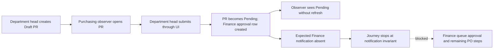

# PR-01 first process run

**Date:** 2026-11-03 UTC  
**Environment:** Dedicated `ogami-erp-e2e` Compose project; database `ogami_e2e`; baseline reset before run  
**Journey run ID:** `cab24dab-f92e-467c-9434-8531b75e5cb0`  
**Process:** PR-01 — direct-PO purchase request through supplier acknowledgement  
**Result:** Blocked at step 3 by finding [FND-PR-001](../FINDINGS.md#fnd-pr-001--pr-submission-creates-no-approval-notification)

## Run result

Playwright ran headless Chromium with one worker and retries disabled. The suite had three tests: role login setup passed (35/35 E2E actors signed in), platform controls passed, and the business journey failed at its notification invariant. Overall: **2 tests passed, 1 failed**. The process journey had **2 steps passed, 1 failed, 7 blocked**. A failed step was not retried or bypassed.

The baseline contained reference/master data only. The PR was created and submitted through the UI by its owner. The pending Finance step and notification absence were checked through the read-only E2E database account. No transactional write was made through the API or database.

## Steps and actors

| # | Actor | UI path / action | Expected | Result |
|---:|---|---|---|---|
| 1 | `department_head__hr` | Procurement → Purchase Requests → New PR → Save draft | Draft PR with unique number, RM-001 × 2, ₱240; database and audit actor agree | Passed. `PR-202611-0001`; status and estimated total verified. [Screenshot](2026-11-03-PR01-first-attempt/001-create-draft-pr.png) |
| 2 | `purchasing_officer__2` | Procurement → Purchase Requests → matching PR row | Observer opens the same draft record from the list | Passed. [Screenshot](2026-11-03-PR01-first-attempt/002-open-as-observer.png) |
| 3 | `department_head__hr` | PR detail → Submit → confirmation dialog | Pending Finance approval; requester cannot approve; intended Finance users are notified; second viewer updates live | UI action succeeded; requester status, pending Finance approval record, and observer status changed to Pending without refresh. **Failed** because no approval notification rows existed. See FND-PR-001. |
| 4 | `finance_officer` | Work → Approval Queue → matching PR card → approve | Finance approval is discoverable and moves PR to Approved | Blocked because step 3 failed. |
| 5 | `purchasing_officer` | Procurement → Purchase Requests → convert using qualified supplier | Approved PR converted through UI to draft PO | Blocked. |
| 6 | `purchasing_officer__2` | Procurement → Purchase Orders → matching PO row | Observer opens PO | Blocked. |
| 7 | `purchasing_officer` | PO detail → Submit | PO pending approval | Blocked. |
| 8 | `finance_officer` | Work → Approval Queue → matching PO card → approve | PO approved and issued | Blocked. |
| 9 | `purchasing_officer` | PO detail → PDF | Issued PDF contains the source values | Blocked. |
| 10 | `supplier_portal` | Supplier portal → Purchase Orders → matching PO → Accept | Supplier response acknowledges the PO | Blocked. |

## Side effects verified

- The PR and line item were created through the UI; database status was `draft`, quantity 2, estimated total ₱240, requester email matched the acting role.
- Draft audit actor matched the requester.
- On submission, PR status changed to `pending`; the current approval record was `finance_officer / pending`, with the VP step skipped under the configured threshold.
- The two Finance E2E accounts had the `purchasing.pr.approve` permission. A read-only query found no `approval.action_required` notification for the PR number.
- The other open viewer displayed Pending without refresh, confirming the no-refresh observer update in this run after the E2E broadcast worker was corrected to consume both `high` and `broadcasts` queues.
- Submission-step audit attribution, Finance queue discovery, emails, PO PDF, supplier response, and downstream inventory/ledger effects were not reached or verified.

## Actual observed flow

## Environment / limitations

- The isolated stack was reset before the run. No PHP test suite ran concurrently.
- Role login setup took 2.1 minutes; the journey failed after 19.6 seconds; the platform check passed in 545 ms. Total suite duration was 2.5 minutes.
- One attempt only. No retries, arbitrary sleeps, API mutations, or application fixes were used.
- Failure artifacts remain in the ignored Playwright output directory: `spa/test-results/process/purchasing.process-PR01-DI-f6491-to-supplier-acknowledged-PO-chromium-process/`.

