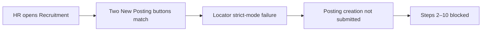

# HR02-HAPPY — attempt 02 (dashboard action locator)

- **Date:** 2026-11-04 UTC
- **Classification:** Test issue (ambiguous UI locator)
- **Actors:** HR Officer; System Admin was selected for the separate live observer session but the journey did not reach observer setup.
- **Command:** `E2E_AUTH_ACTORS=hr_officer,system_admin node scripts/e2e/runner.mjs test --grep HR02-HAPPY`
- **Environment:** Guarded `ogami-erp-e2e` Compose project; fresh baseline completed; one Playwright worker.
- **Result:** Auth setup passed for both selected actors. The single HR02 journey failed during step 1/10 at `Dashboard → Human Resources → Recruitment → New Posting`. The Recruitment dashboard renders two visible, identically named “New Posting” buttons (header action and empty-state action); the unscoped exact-role locator raised a strict-mode violation. The process runner marked the remaining nine steps blocked.
- **Expected / actual:** Expected one UI action target to open the posting form; actual locator matched two valid buttons. No posting form was opened and no create request or transactional record was produced.
- **Correction:** Scope the exact accessible button locator to `[data-layout="page-header"]`. This selects the dashboard's declared page-level action and keeps the UI action and expected process unchanged. Confirmation is pending the next fresh-baseline run.
- **Other checks:** No API/DB write was used. No product behavior, posting state, notification, mail, or real-time update was exercised. No application code changed.
- **Evidence:** [archived trace, error context, journey context, screenshots, and Playwright result](assets/hr02-happy-attempt-02-locator/). Journey context confirms step 1 failed and steps 2–10 were blocked.

## Journey as observed

