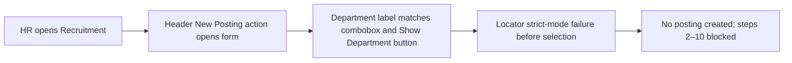

# HR02-HAPPY — attempt 04 (Department locator ambiguity)

- **Date:** 2026-11-04 UTC
- **Classification:** Test issue (ambiguous accessible locator)
- **Actors:** HR Officer; System Admin authenticated for the observer role, but observer actions were not reached.
- **Command:** `E2E_AUTH_ACTORS=hr_officer,system_admin node scripts/e2e/runner.mjs test --grep HR02-HAPPY` (started detached with `setsid` so the E2E stack remained available)
- **Environment:** Guarded `ogami-erp-e2e` Compose project; fresh baseline; one headless Chromium worker.
- **Result:** Both selected-role auth setups passed. HR navigated from Dashboard through Human Resources to Recruitment, used the header-scoped `New Posting` action, and reached the Create Job Posting form. Step 1/10 then failed while locating Department. The process runner marked steps 2–10 blocked.
- **Expected / actual:** Expected the visible Department input to be selected through its accessible label; actual `getByLabel('Department')` matched both the combobox and its suffix button named “Show Department”, causing a strict-mode failure before selection or submission.
- **Side effects:** No create-posting request or transactional row occurred. No process status, notification, badge, email, PDF, audit event, stock, finance, or real-time effect was produced. No API/DB mutation was used.
- **Correction:** The UI is a searchable combobox. The test now clicks `getByRole('combobox', { name: 'Department' })` and chooses the visible exact `Human Resources` option. This preserves the user-visible selection flow and does not relax any business assertion.
- **Evidence:** [archived trace, error context, journey context, screenshots, and Playwright result](assets/hr02-happy-attempt-04-department-combobox/). Journey context records step 1 failed and steps 2–10 blocked.

## Journey as observed

