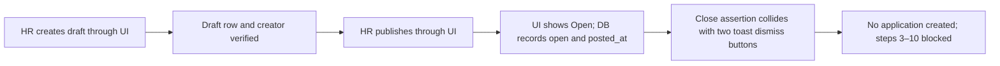

# HR02-HAPPY — attempt 05 (toast dismiss buttons match Close)

- **Date:** 2026-11-04 UTC
- **Classification:** Test issue (ambiguous accessible locator)
- **Actors:** HR Officer; System Admin authenticated for the observer role, but the public application and observer hand-off were not reached.
- **Command:** `E2E_AUTH_ACTORS=hr_officer,system_admin node scripts/e2e/runner.mjs test --grep HR02-HAPPY` (detached with `setsid`; fresh baseline seeded; one Chromium worker)
- **Result:** Both role-auth tests passed. HR created the one-slot posting through the UI (step 1/10), then published it through the UI. The publish action and visible `Open` status succeeded. The step stopped in its UI assertion because generic `Close` matched the posting action plus two toast dismiss buttons. The process runner marked steps 3–10 blocked.
- **Read-only verification:** Database row `JP-202611-0001` is `open`, has non-null `posted_at`, and is owned by the seeded HR actor. The visible UI also showed the Open status. The step's remaining DB/audit assertions were not reached because the preceding button assertion threw.
- **Side effects:** The UI-created posting and publish action are transactional process actions; no shortcut was used. No applicant/application, notification, badge, candidate email, or interview was created because the next step was blocked. No finance or inventory effect applies to this process step.
- **Correction:** Scope the Close action to `[data-layout="page-header"]`, the declared page action region. The role and expected action remain unchanged.
- **Evidence:** [archived trace, error context, journey context, screenshots, and Playwright result](assets/hr02-happy-attempt-05-close-locator/).

## Journey as observed

