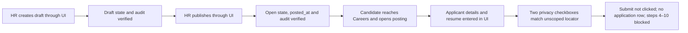

# HR02-HAPPY — attempt 09 (candidate privacy checkbox locator collision)

- **Date:** 2026-11-04 UTC
- **Classification:** Test issue (ambiguous checkbox locator)
- **Actors:** HR Officer created/published through the UI; public applicant navigated via Careers and completed the application form fields. System Admin was authenticated for the observer role, but hand-off was not reached.
- **Command:** `E2E_AUTH_ACTORS=hr_officer,system_admin node scripts/e2e/runner.mjs test --grep HR02-HAPPY` (guarded, fresh baseline, one headless Chromium worker)
- **Result:** Both selected-role logins passed. HR created the draft posting and published it; both process steps and their status, database, audit, and diagnostics assertions passed. The applicant navigated via the landing-page footer Careers link, opened the run-scoped posting, filled the application fields, and attached the resume through the UI. Step 3/10 stopped when the unscoped checkbox locator matched the required application privacy checkbox and the separate newsletter privacy checkbox in the footer. Steps 4–10 were blocked.
- **Expected / actual:** Expected to check the candidate's consent to use their application for candidacy assessment; actual Playwright strict mode found two checkboxes. The failure occurred before the Submit Application button was clicked.
- **Read-only verification:** `job_applications` contains zero rows for the run-scoped candidate email; the posting remains `open`. No application request, candidate email, application notification, or application audit event occurred.
- **Correction:** Select the checkbox by its full purpose text matching “We use your application only to assess your candidacy.” The candidate's privacy consent remains explicit; no assertion was loosened.
- **Evidence:** [archived trace, error context, journey context, screenshots, and Playwright result](assets/hr02-happy-attempt-09-privacy-checkbox-locator/).

## Journey as observed

