# HR02-HAPPY — attempt 10 (external OpenStreetMap tile DNS failures)

- **Date:** 2026-11-04 UTC
- **Classification:** Test issue (undocumented external network noise)
- **Actors:** HR Officer published the posting; public applicant submitted through Careers. System Admin logged in for the observer role, but the notification hand-off was not reached.
- **Command:** `E2E_AUTH_ACTORS=hr_officer,system_admin node scripts/e2e/runner.mjs test --grep HR02-HAPPY` (guarded fresh baseline; one Chromium worker)
- **Result:** Selected actor authentication passed. HR's create and publish steps passed, including their UI actions, status, audit, and read-only database assertions. The candidate followed the public Careers route, completed the form and uploaded a resume. The Submit Application action returned 201; the submitted page, new application row, posting count/status, and candidate confirmation email were verified. Step 3/10 was then marked failed by the page diagnostic invariant because nine public OpenStreetMap tile requests and matching console errors reported `ERR_NAME_NOT_RESOLVED`. Steps 4–10 were blocked.
- **Side effects:** The posting and candidate application were both created through their respective UIs. The application is `JA-202611-0001`, stage `new`, with tracking code `RCT-FHKFPT`; journey context captured confirmation email ID `3aLIaKLYDXtGD8onSLswRf`. The next-step notification recipients, click-through, HR stage action, and observer updates were not verified.
- **Failure scope:** The failed URLs were only `a.tile.openstreetmap.org`, `b.tile.openstreetmap.org`, and `c.tile.openstreetmap.org` raster tiles at `/16/...png`, loaded by the landing page's `PlantMap` when the candidate first visited `/`. No ERP API or application submission request failed. The backend behavior was verified through the successful 201 and read-only journey assertions.
- **Correction:** The E2E diagnostic capture now preserves the console source origin. The explicit known-noise file allows only these three OSM `/16/` tile host prefixes for console and failed-request diagnostics; the `http5xx` allowlist remains empty. This is test-only handling of an external map dependency, not an application behavior change.
- **Evidence:** [archived trace, error context, journey context, screenshots, and Playwright result](assets/hr02-happy-attempt-10-osm-tile-diagnostics/); source evidence: `spa/src/pages/landing/components/PlantMap.tsx`.

## Journey as observed

```mermaid
flowchart LR
  A[HR creates draft through UI] --> B[Draft state and audit verified]
  B --> C[HR publishes through UI]
  C --> D[Open state, posted_at and audit verified]
  D --> E[Candidate opens Careers and submits through UI]
  E --> F[201, new application, confirmation email verified]
  F --> G[Page diagnostics detect failed external OSM tiles]
  G --> H[HR notification hand-off and steps 4–10 blocked]
```

