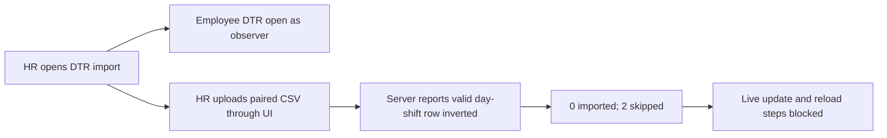

# HR03-CSV-VALIDATION — attempt 01

**Result:** Blocked at the paired CSV upload. The HR import page accepted the file, but the server reported the valid day-shift row as an inverted time range and imported zero rows. The Employee live-update and persistence steps were blocked after the failed import assertion. This is a product defect finding; no application change or retry was made.

- **Run ID:** `c95ceefb-9758-4df3-94e5-a9c4041e0790`
- **Started:** 2026-11-04 16:55:00 UTC
- **Actors:** HR Officer and Employee in separate browser contexts; both signed in through the UI.
- **Baseline:** Fresh guarded E2E seed. The initial read-only attendance snapshot and Employee DTR showed no attendance for the target date. The dedicated `ogami_e2e` database was used.
- **Input:** Employee `E2E-2FDC0177057D3A5`, work date `2026-11-06`, Day Shift 06:00–14:00 Manila; one unknown employee row `UNKNOWN-c95ceefb`; file `E2E-c95ceefb-975-biometric-dtr.csv`.
- **Execution:** 1/2 Playwright tests passed (selected-role login setup); the business journey failed at step 2. One headless Chromium worker, no retries; total command time 26.1 seconds.

## Steps and outcomes

| Step | Actor | UI path and action | Result |
|---|---|---|---|
| Open the DTR import and observer | HR Officer; Employee observer | Human Resources → Attendance & DTR → Import DTR; Employee Profile → DTR | Passed. Both pages opened through in-app navigation. The Employee DTR had no row for Nov 6; the read-only snapshot contained no attendance record. |
| Upload one valid and one invalid row | HR Officer | Import DTR → Browse files → select CSV → Import | Failed. The UI returned HTTP 200 with total 2, imported 0, skipped 2. Row 2, which used the target Employee and 06:00–14:00, was reported as `Time out (2026-11-05 14:00:00) must be after time in (2026-11-06 06:00:00).` Row 3 correctly reported `Unknown employee_no 'UNKNOWN-c95ceefb'.` The UI showed “2 rows had errors.” |
| Observe the imported record live | Employee observer | Already-open Employee Profile → DTR | Blocked because the upload step failed. No attendance record was created. |
| Reload and verify persistence | Employee | Reload the open DTR page | Blocked because the upload step failed. |

## Verification and evidence

- A read-only query against the dedicated database after the failure found zero attendance rows for employee `E2E-2FDC0177057D3A5` on `2026-11-06`. The pre-upload UI and snapshot also showed no existing row. No business record was created by the failed import.
- The upload response and UI summary are captured in the failure trace and screenshot. Notification, email, audit, realtime-update, and post-upload page-diagnostic invariants did not run because the response assertion stopped the journey; they are unverified for this attempt.
- The runtime symptom conflicts with the intended CSV anchoring in `api/app/Modules/Attendance/Services/DTRImportService.php:90-109`, and the valid time-out guard is in `api/app/Modules/Attendance/Services/DTRComputationService.php:184-191`. The underlying cause has not been established. The source-level paired CSV feature test was not run as part of this E2E work.

Artifacts: [journey context](assets/hr03-csv-validation-attempt-01/journey-context.json), [Playwright error context](assets/hr03-csv-validation-attempt-01/error-context.md), [trace](assets/hr03-csv-validation-attempt-01/trace.zip), [Employee DTR screenshot](assets/hr03-csv-validation-attempt-01/test-failed-2.png), and [HR import result screenshot](assets/hr03-csv-validation-attempt-01/test-failed-3.png).

## Observed process

