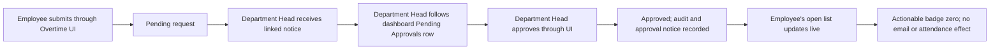

# HR03-OVERTIME-APPROVE — attempt 05

**Result:** The two test cases passed. The Employee submitted overtime through the UI; the Department Head followed the dashboard approval hand-off and approved through the UI. Read-only state, audit, notification, email, badge, and live-update assertions passed. One walkthrough screenshot was captured before its live-update assertion and still shows Pending; this is recorded as TST-HR-042 and will be corrected in the final run.

- **Run ID:** `4250c3e6-c6c1-4b00-8d65-9d26e19bce55`
- **Actors:** Employee and Department Head, separate Chromium contexts; both selected actors signed in through the real UI.
- **Baseline:** Fresh guarded baseline; zero existing overtime requests for the Employee.
- **Input:** 2026-11-05 Manila work date, 0.5 hours, run-scoped reason `E2E-4250c3e6-c6c OT approval journey`.
- **Execution:** 2/2 Playwright tests passed (auth setup and business journey), 1 worker, no retries; journey 19.4 seconds, command 32.2 seconds.
- **Environment:** Dedicated `ogami-erp-e2e` Compose project and `ogami_e2e` database.

## Steps and outcomes

| Step | Actor | UI action | Result |
|---|---|---|---|
| Submit overtime | Employee | Profile menu → Overtime → Apply for OT → Submit for approval | UI-created request became Pending. Employee could cancel; approval action was absent. Only the eligible Department Head received the linked submission notification. Read-only checks found one request, Employee creation audit, and no attendance row. |
| Find and approve | Department Head | Dashboard → Pending Approvals → linked Overtime row → Approve | The Department Head opened the linked record from the dashboard and approved through the confirmation dialog. Department Head actions disappeared; the open Employee list passed its auto-retrying Approved assertion without refresh. |
| Final invariants | Employee and Department Head | Read-only API/DB/Mailpit checks and page diagnostics | Read-only checks confirmed approved status, Department Head approval actor and audit entry, exactly the intended Employee/Department Head notification recipients and links, unchanged Mailpit IDs, zero actionable overtime badge, and no unexpected page diagnostics. Attendance remained unchanged. |

The Employee's list was checked before approval and again in the same open context. The passing live assertion is the evidence for the final status; screenshot 003 was taken just before that assertion and shows the intermediate Pending state. No process step was skipped or advanced through an API.

## Walkthrough images

1. Employee submits the request: [annotated screenshot](assets/hr03-overtime-approve-attempt-05/001-employee-submits-a-self-service-overtime-request.png)
2. Department Head follows the dashboard hand-off and approves: [annotated screenshot](assets/hr03-overtime-approve-attempt-05/002-department-head-opens-the-dashboard-hand-off-and-approves.png)
3. Employee's open list during the live-update wait: [screenshot](assets/hr03-overtime-approve-attempt-05/003-employee-sees-approved-overtime-without-refreshing.png) (shows Pending because capture preceded the successful auto-retrying assertion; TST-HR-042)

The [sanitized journey context](assets/hr03-overtime-approve-attempt-05/journey-context.json) is archived. The passing run produced no trace under the configured failure-only trace policy.

## Observed process

