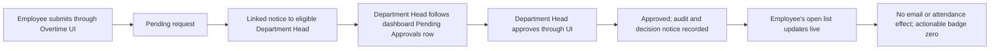

# HR03-OVERTIME-APPROVE — full run

**Result:** Passed. Employee submitted an overtime request through the UI; Department Head found it through Dashboard → Pending Approvals and approved through the UI. The same open Employee list updated to Approved without refresh. Final read-only checks for state, actors, notifications, email, badge, attendance, and page diagnostics passed.

- **Run ID:** `407b9493-5d83-498b-9d77-4299584bb828`
- **Started:** 2026-11-04 16:21:18 UTC
- **Actors:** Employee and Department Head, separate browser contexts; both signed in through the real UI.
- **Baseline:** Fresh guarded E2E seed; zero overtime requests for the Employee.
- **Input:** Work date 2026-11-05 (Asia/Manila), 0.5 hours, reason `E2E-407b9493-5d8 OT approval journey`.
- **Execution:** 2/2 Playwright tests passed (auth setup and business journey), one Chromium worker, no retries; journey 22.1 seconds and command 34.7 seconds.
- **Environment:** Dedicated `ogami-erp-e2e` Compose project and `ogami_e2e` database.

## Steps and outcomes

| Step | Actor | UI path and action | Result |
|---|---|---|---|
| Submit overtime | Employee | Profile menu → Overtime → Apply for OT → Submit for approval | The UI created one Pending request. Employee could cancel; Approve was absent. Only the eligible Department Head received the linked submission notice. Read-only checks found the Employee creation audit and no attendance row. |
| Find and approve | Department Head | Dashboard → Pending Approvals → linked Overtime row → Approve | Department Head found the work through the dashboard link, opened the pending detail, and approved in the confirmation dialog. Approve, Reject, and Cancel actions disappeared after the decision. |
| Verify live update and final effects | Employee and Department Head | Observe already-open Employee list; read-only API/DB/Mailpit assertions | Employee's list showed Approved and no cancel action without refresh. Read-only checks confirmed `pending → approved`, Employee creation and Department Head approval audit actors, exactly the intended submission/approval notices and links, unchanged Mailpit IDs, zero actionable overtime badge, zero attendance rows, and clean page diagnostics. |

The [sanitized journey context](assets/hr03-overtime-approve-full-run/journey-context.json) records both process steps as passed. The configured failure-only trace policy produced no trace for this passing run.

## Annotated walkthrough

1. Employee submits: [screenshot](assets/hr03-overtime-approve-full-run/001-employee-submits-a-self-service-overtime-request.png)
2. Department Head follows the dashboard hand-off and approves: [screenshot](assets/hr03-overtime-approve-full-run/002-department-head-opens-the-dashboard-hand-off-and-approves.png)
3. Employee sees the approved request in the already-open list: [screenshot](assets/hr03-overtime-approve-full-run/003-employee-sees-approved-overtime-without-refreshing.png)

Screenshot 003 was captured after the auto-retrying Approved assertion; it shows `0 pending · 1 past`, Approved, and the Department Head approver. This confirms the corrected artifact ordering recorded under TST-HR-042.

## Observed process

