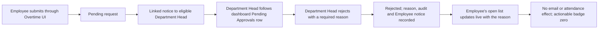

# HR03-OVERTIME-REJECT — full run

**Result:** Passed. Employee created the overtime request through self-service. Department Head found it through Dashboard → Pending Approvals and rejected it through the UI with a required reason. The already-open Employee list updated to Rejected and displayed the reason without a manual refresh.

- **Run ID:** `40d7b3d4-e87f-4c47-82ca-c05694a1d24c`
- **Started:** 2026-11-04 16:35:09 UTC
- **Actors:** Employee and Department Head in separate browser contexts; both signed in through the real UI.
- **Baseline:** Fresh guarded E2E migration and seed; no overtime requests for the Employee. The E2E seeder created 37 reference actors and no transactional demo records.
- **Input:** Manila work date 2026-11-05, 0.5 hours, request reason `E2E-40d7b3d4-e87 OT rejection journey`, rejection reason `E2E-40d7b3d4-e87 Coverage was already assigned.`
- **Execution:** 2/2 Playwright tests passed (selected-role auth setup and business journey); one headless Chromium worker, no retries. The business journey took 21.1 seconds; total command time was 32.9 seconds.
- **Environment:** Dedicated `ogami-erp-e2e` Compose project and `ogami_e2e` database.

## Steps and outcomes

| Step | Actor | UI path and action | Result |
|---|---|---|---|
| Submit overtime | Employee | Profile menu → Overtime → Apply for OT → Submit for approval | The UI created one Pending request. Employee could cancel; Employee did not see an approval action. The linked submission notice went only to the eligible Department Head. The creation audit actor was Employee. |
| Find and reject | Department Head | Dashboard → Pending Approvals → linked Overtime row → Reject → enter reason → Confirm reject | Department Head found the pending request in the linked dashboard hand-off. The rejection dialog kept Confirm reject disabled until a reason was entered. The UI returned HTTP 200 and showed Rejected with the recorded reason; decision actions disappeared. |
| Verify live update and final effects | Employee and Department Head | Observe the already-open Employee list; read-only API/DB/Mailpit assertions | Employee's list changed to Rejected and displayed the reason without reload. Read-only checks confirmed status, rejection reason, Department Head decision/audit actor, exactly the initial approver notice and final Employee notice with correct links, no new email to either journey actor, zero actionable overtime badge, zero attendance rows, and clean page diagnostics. |

The [sanitized journey context](assets/hr03-overtime-reject-full-run/journey-context.json) records both process steps as passed. The configured failure-only trace policy produced no trace for this passing run.

## Annotated walkthrough

1. Employee submits: [screenshot](assets/hr03-overtime-reject-full-run/001-employee-submits-a-self-service-overtime-request.png)
2. Department Head follows the dashboard hand-off and rejects with a reason: [screenshot](assets/hr03-overtime-reject-full-run/002-department-head-follows-the-dashboard-hand-off-and-rejects-with-a-reason.png)
3. Employee sees the rejection and reason in the open list: [screenshot](assets/hr03-overtime-reject-full-run/003-employee-sees-the-rejected-overtime-and-reason-without-refreshing.png)

## Observed process

