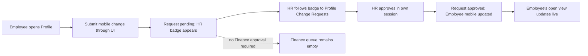

# HR07-PROFILE-ORDINARY — Full clean-baseline run

**Date:** 2026-11-04 UTC  
**Environment:** Guarded `ogami-erp-e2e` Compose project; isolated `ogami_e2e` database  
**Result:** **2/2 tests passed** (selected-actor UI auth setup and the process journey), one Chromium worker, no retries  
**Journey duration:** 28.1 seconds; Playwright command duration: 42.4 seconds  
**Journey run ID:** `988a2bb7-5758-42ac-928a-857ee84f12ea`  
**Run-scoped input:** mobile `09179949499`; profile request `j16KyzV0Xl`

## Outcome

The Employee submitted an ordinary mobile-number change from Profile. HR found the request through the live actionable badge and approved it from Profile Change Requests. The Employee's already-open Profile showed the approved contact value and closed request without refresh. The request followed `pending → approved` with `requires_finance = false`; Finance had no action or queue item.

The UI created and advanced the only transactional record. API and database access was used only to assert the UI result, actor/audit attribution, and absence of side effects.

## Steps and evidence

| Step | Actor and UI path | Observed status / actions | Verified effects |
|---|---|---|---|
| 1. Open the profile and reviewer queues | Employee → Profile; HR → Human Resources → Profile Change Requests; Finance → Payroll → Bank Account Changes | Clean baseline: all three views showed no requests. | No process request existed before the Employee action. Each actor used its own logged-in browser context. |
| 2. Submit the ordinary contact change | Employee → Profile → Contact → Edit → Submit for review | UI POST returned 201 and `pending`. Employee saw `Pending HR`; HR found the new row via its actionable badge; HR saw `Approve`. No Finance approval action appeared. | Read-only DB check found one request with `requires_finance = false`, unchanged Employee mobile, no reviewer, at least one request audit, and zero request notifications. Finance's queue remained empty. |
| 3. HR approves | HR → Profile Change Requests → Awaiting my action badge link → expand request → Approve | HR review returned 200; request became `approved`. Approve/Reject actions disappeared from HR's row. Employee's open request and Profile updated live. Finance still had no queue item/action. | Read-only checks confirmed the new Employee mobile, HR as reviewer, Employee as creator, HR as approver, and an Employee update audit attributed to HR. Request notifications stayed at zero and Mailpit's recipient message IDs did not change. Employee, HR, and Finance ended with zero actionable badges. |

No PDF/export is generated for this profile-change flow. No email or standard notification was produced. Console, uncaught-exception, and failed/5xx network diagnostics were clean for all three pages.

## Walkthrough screenshots

1. [Employee, HR, and Finance open their own views](assets/hr07-profile-ordinary-full-run/walkthrough/001-employee-hr-and-finance-open-their-own-profile-and-review-queues.png)
2. [Employee submits and HR receives the actionable queue item](assets/hr07-profile-ordinary-full-run/walkthrough/002-employee-requests-an-ordinary-contact-change-and-hr-receives-it.png)
3. [HR follows the badge hand-off to the request](assets/hr07-profile-ordinary-full-run/walkthrough/002-hr-opens-the-ordinary-contact-request-from-its-actionable-badge.png)
4. [HR approves the change](assets/hr07-profile-ordinary-full-run/walkthrough/003-hr-approves-the-contact-change-and-it-is-applied-without-finance-review.png)
5. [Employee sees the approved value and closed request](assets/hr07-profile-ordinary-full-run/walkthrough/003-employee-sees-the-approved-contact-value-and-closed-request.png)

Archived step context and Playwright JSON results: [journey context](assets/hr07-profile-ordinary-full-run/journey-context.json), [process results](assets/hr07-profile-ordinary-full-run/process-results.json).

## Observed process

## Coverage limits

This run covers the ordinary profile-change approval edge and the UI absence of a Finance action. It does not cover HR rejection, employee correction/resubmission, self-approval, out-of-order or direct API denial, stale-state/concurrent approval, or department-scope negative authorization; those remain planned for Phase 4 or their separate variants. No application code changed.
