# HR07-SALARY-APPROVAL — Blocked at missing salary-request UI

**Date:** 2026-11-04 UTC  
**Classification:** Process gap (GAP-UI-02, High)  
**Environment:** Guarded `ogami-erp-e2e` Compose project; fresh `ogami_e2e` baseline  
**Result:** HR UI login passed; salary journey stopped at its first transactional step using the documented `test.fixme`; PM and VP steps were blocked. No retries.
**Journey run ID:** `346b7a7c-d525-448c-bfb1-f2a00d457123`  
**Run-scoped baseline employee:** `E2E-2FDC0177057D3A5`

## Outcome

The `hr_officer` signed in through the real login UI, opened Human Resources → Employees from the sidebar, opened the seeded Employee's edit screen, and followed the Salary Adjustments link. The edit screen exposed the compensation-workflow guidance but no salary inputs or request action. The Salary Adjustments page showed “No adjustments” and exposed no request action. The journey stopped at that missing UI step under GAP-UI-02. The Production Manager and Vice President hand-offs were marked blocked in the saved journey context.

The run had one selected-actor auth test pass and one Playwright skipped journey. TypeScript validation completed before Playwright. There were no failed or flaky tests and no retries. The only actor session used was HR's own session. No salary adjustment was created through either the UI or API.

## Steps and evidence

| Step | Actor and UI path | Observed result | Verification |
|---|---|---|---|
| 1. Inspect compensation entry points | HR → Dashboard → Human Resources → Employees → seeded Employee → Edit | Compensation guidance was visible; Monthly salary and Semi-monthly rate inputs were absent. The edit page linked to Salary Adjustments but had no request action. | Web-first UI assertions passed. |
| 2. Inspect the salary queue | HR → Salary Adjustments | The queue displayed “No adjustments” and no Request/New salary adjustment button. | Web-first UI assertions passed; annotated screenshot captured. HR page console/network diagnostics were clean. |
| 3. Request a salary change | HR → Employee compensation / Salary Adjustments | Blocked at the first transactional step by `test.fixme` with GAP-UI-02. The PM and VP steps were recorded as blocked; neither actor was asked to approve an absent record. | Read-only PostgreSQL assertion after the run found 0 rows in `salary_adjustments` and exactly 1 target seeded Employee. No API write was made. |

No process status transition, approval hand-off, notification, audit action, email, PDF, or payroll side effect was exercised because the request could not be initiated. Their behavior remains unverified.

## Walkthrough and run artifacts

1. [Salary-adjustment queue with no request action](assets/hr07-salary-approval-blocked/walkthrough/001-salary-adjustment-queue-exposes-reviewers-but-no-request-action.png)

Archived [journey context](assets/hr07-salary-approval-blocked/journey-context.json) and [Playwright process results](assets/hr07-salary-approval-blocked/process-results.json). The journey context records the failed request step and blocked PM/VP steps; Playwright records the expected skip annotation for GAP-UI-02.

## Observed process

```mermaid
flowchart LR
    H[HR signs in through UI] --> E[Open Employee edit through sidebar]
    E --> N[Compensation fields and request action absent]
    N --> Q[Open Salary Adjustments queue]
    Q --> Z[No adjustments; no request action]
    Z --> G[Blocked at request step: GAP-UI-02]
    G -. prerequisite record absent .-> P[PM check blocked]
    P -. prerequisite record absent .-> V[VP approval blocked]
```

## Coverage limits

This run confirms the SPA initiation gap and covers no `SalaryAdjustment` status or approval transition. The active source-defined PM → VP chain, rejection paths, effective-date behavior, salary history, and payroll impact remain untested until the UI request step is available. No application code changed; the blocker was not bypassed with an API mutation.
