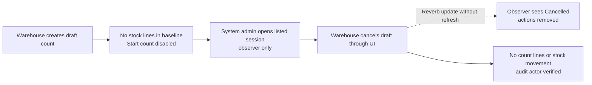

# INV01-COUNT-CANCEL — complete end-to-end run

**Date:** 2026-11-04 UTC  
**Journey:** `INV01-COUNT-CANCEL`  
**Environment:** Dedicated `ogami-erp-e2e` Compose project and `ogami_e2e` database  
**Result:** Passed  
**Command:** `node scripts/e2e/runner.mjs reset`, then `node scripts/e2e/runner.mjs test --grep INV01-COUNT-CANCEL`

The final screenshot-enhanced run used headless Chromium, one worker, and zero retries. Real UI setup signed in all **35/35** seeded actors. Both tests passed (auth setup and the business journey) in **2.6 minutes**; the three business steps took **21.9 seconds**. The journey began from a fresh baseline without stock levels or count sessions. Warehouse created and cancelled the only transactional record through the UI. A separate `system_admin` context only observed the record and did not perform an action.

## Process result

| Step | Actor and UI path | Result and verified effects |
|---|---|---|
| 1. Create draft count | `warehouse_staff`; Warehouse → Warehouse Map → Stock Count → New session → Create session | Passed. The UI created a draft warehouse-scope session. The session had zero count lines because the baseline has no stock items. The UI showed “No stock items are in this scope” and disabled Start count while keeping Cancel available. Read-only assertions confirmed the session creator, draft status, zero lines, zero stock movement, and Warehouse audit actor. |
| 2. Open as observer | `system_admin` (observer only); Warehouse → Warehouse Map → Stock Count → select the session in the list | Passed. The observer found the session through its list and opened the detail. It showed Draft and the empty-scope explanation. No observer action was taken. |
| 3. Cancel draft | `warehouse_staff`; open session → Cancel → confirm Cancel session | Passed. Warehouse cancelled through the UI. The still-open observer view changed to Cancelled without refresh or URL change. Start and Cancel actions disappeared. Read-only assertions confirmed `draft → cancelled`, zero count lines, zero stock movements, and the expected audit actor. |

The acting and observer pages passed console, uncaught-exception, and failed/5xx network diagnostics after each step. The cancellation path defines no email or PDF assertion; those effects were not verified.

## Annotated walkthrough

## Observed process

## Coverage limit and triage

This run covers the draft-cancellation variant, not the full count-and-variance path. The isolated baseline intentionally has no stock lines, and the UI correctly disables Start count. To test counting, variance approval, and generated adjustments, a future journey must create stock through its own UI prerequisite; it cannot add transactional opening stock through the seeder. This is a coverage dependency, not a product defect or process gap. No new product finding was added.

The earlier exact-label locator failure is recorded in the [first attempt report](2026-11-04-INV01-COUNT-CANCEL-first-attempt.md). The accessible-role selector passed in this clean-baseline run.
