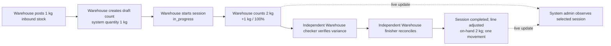

# INV01-COUNT-VARIANCE — complete end-to-end run

**Date:** 2026-11-04 UTC  
**Journey:** `INV01-COUNT-VARIANCE`  
**Environment:** Dedicated `ogami-erp-e2e` Compose project and `ogami_e2e` database  
**Result:** Passed  
**Run:** Headless Chromium, one worker, zero retries; targeted real-UI sign-in for the four actors below. The final Playwright invocation reported **2 passed** (auth setup and business journey); the process took **56.8 seconds**. The baseline was reseeded immediately before the journey.

The baseline has no transactional opening stock. Warehouse therefore created 1 kg of RM-001 through the Stock Adjustments UI before counting 2 kg. Warehouse maker/counter, independent Warehouse checker, and independent Warehouse finisher used three distinct logged-in sessions. A `system_admin` session observed the live record and took no action.

## Process result

| Step | Actor and UI path | Result and verified effects |
|---|---|---|
| 1. Open the live Stock Count list | `system_admin` observer; Warehouse → Warehouse Map → Stock Count | Passed. The list showed no sessions before work began. |
| 2. Create countable stock | `warehouse_staff`; Warehouse → Stock Adjustments → New adjustment → Submit | Passed. The low-value inbound adjustment auto-approved through the UI. Read-only checks confirmed one `adjustment_in` movement for RM-001, 1 kg / ₱120, and 1 kg on hand. |
| 3. Create a warehouse-scoped count | `warehouse_staff`; Warehouse → Warehouse Map → Stock Count → New session → Create session | Passed. Session `SC-202611-0001` reached `draft` with one RM-001 line at system quantity 1 kg. The observer found it in the updated session list and selected it to open the detail view. |
| 4. Start counting | `warehouse_staff`; selected count → Start count → Start counting | Passed. Session reached `in_progress`; the maker saw Count enabled. The already-open observer detail showed the status change without refresh. |
| 5. Record the physical count | `warehouse_staff`; count line → Count → Record | Passed. RM-001 reached `counted` with 2 kg counted, +1 kg variance, and 100% variance. The maker could not approve their own variance. The observer saw the counted line and variance without refresh. Stock remained at 1 kg until reconciliation. |
| 6. Verify the variance | `warehouse_staff__2`; Warehouse → Warehouse Map → Stock Count → select session → Approve | Passed. The independent checker changed the line to `verified`. Read-only audit checks identified the checker as the verifier; the observer saw the update live. |
| 7. Reconcile and complete | `warehouse_staff__3`; Warehouse → Warehouse Map → Stock Count → select session → Complete session | Passed. The independent finisher completed the session; the line reached `adjusted`, the session reached `completed`, and RM-001 on-hand became 2 kg. Read-only checks confirmed exactly one count-referenced `adjustment_in` movement for 1 kg / ₱120, created by the finisher, plus audit entries for all three Warehouse actors. The observer received the completed state without refresh. |

Final read-only reconciliation returned: `completed` session; RM-001 `adjusted`; 1.000 kg system quantity; 2.000 kg counted quantity; 1.000 kg / 100.00% variance; counter `warehouse_staff`; verifier `warehouse_staff__2`; completer `warehouse_staff__3`; and 2.000 kg on hand. No duplicate reconciliation movement was present.

No email or PDF is produced by the traced stock-count service path, and none was asserted. Hand-offs used the Stock Count session list and the application's available actions. This journey did not exercise Phase 4 direct-API denial, invalid/out-of-order transitions, concurrency, or department-scope negatives.

## Annotated walkthrough

## Observed process

## Attempt history and triage

The first attempt reached session creation but saw no POST and no created session. The next attempt exposed that the observer remained on the session list; the journey now follows the visible list-to-detail hand-off before asserting line updates. A subsequent run surfaced the periodic realtime-health GET being canceled during navigation; Nginx logged a 499 followed by a successful 200 health check, so that exact GET cancellation is documented in the E2E noise allowlist. Another attempt produced a confirmed Docker OOM event at the Playwright container's 768 MiB cap during annotated screenshot capture. The E2E runner cap was raised to 1280 MiB; the final run passed at a sampled 838 MiB during execution.

These were resolved test-readiness and E2E-resource issues. They did not produce an application finding, and no application code changed. See [platform diagnostics](../02-platform.md) and [findings](../FINDINGS.md).
