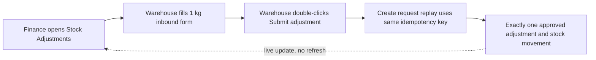

# INV-01: Duplicate submission protection — full run

**Result:** Completed; 2/2 Playwright tests passed (targeted real-UI auth setup and the business journey), zero retries, one worker. The business journey took 19.6 seconds; the run took 30.8 seconds. Playwright reports 0 skipped, 0 unexpected, and 0 flaky tests.

**Run ID:** `13de9ec6-51ef-48df-a647-c7db4a93117e`  
**Actors:** `warehouse_staff` submitted the adjustment through its own session; `finance_officer` opened Stock Adjustments in a separate session and observed it live. Both signed in through the real login UI.  
**Data:** Fresh isolated E2E seed, RM-001, 1.000 kg inbound at ₱120/kg, run-scoped reason.  
**Environment:** `ogami-erp-e2e` Compose project, `ogami_e2e` database, headless Chromium, one worker, zero retries. The Playwright environment guard ran.

## Journey steps

| Step | Actor | UI path and action | Result and assertions |
|---|---|---|---|
| 1 | Finance | Finance → Stock Adjustments | Opened the list before submission. The run-scoped reason was absent and the read-only database count was zero. |
| 2 | Warehouse | Warehouse → Stock Adjustments → New adjustment → Submit adjustment | Created a 1.000 kg inbound adjustment and double-clicked the real confirmation button. The request(s) observed by the browser carried one identical non-empty `Idempotency-Key`; all observed responses completed with HTTP 201. Finance's already-open list showed the approved record without refresh. Read-only DB assertions found exactly one approved adjustment, one `adjustment_in` movement, 1.000 kg on hand, the matching stored idempotency key and fingerprint, the Warehouse as requester/poster/audit actor, and zero notifications for the adjustment. |

The test confirms that the confirmation double-click has one idempotency key and one persisted stock effect. It bounds the observed create requests to the one or two clicks in the physical double-click; the exact request count is not persisted in the journey context. The database assertions verify the business outcome independently of that request count. The API and database readers were used only for observation.

## Observed flow

## Walkthrough screenshots

- [Finance opens the list](assets/inv01-duplicate-submit-2026-11-04/001-finance-opens-stock-adjustments-before-warehouse-submits.png)
- [Warehouse submits by double-click](assets/inv01-duplicate-submit-2026-11-04/002-warehouse-double-clicks-confirmation-finance-observes-one-posted-adjustment.png)
- [Warehouse sees one approved record](assets/inv01-duplicate-submit-2026-11-04/002-warehouse-sees-one-approved-record-after-double-click.png)
- [Journey context and timestamps](assets/inv01-duplicate-submit-2026-11-04/journey-context.json)
- [Playwright JSON results](assets/inv01-duplicate-submit-2026-11-04/process-results.json)

No PDF or email was generated in this variant. No product finding resulted. The initial invocation omitted `E2E_AUTH_ACTORS` and stopped before login; that invocation failure is recorded separately and the corrected invocation passed from a fresh seed.
