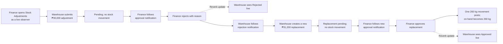

# INV-01 — high-value rejection and replacement process run

**Date:** 2026-11-04 UTC  
**Journey:** `INV01-HIGH-REJECT-RESUBMIT`  
**Environment:** Dedicated `ogami-erp-e2e` Compose project and `ogami_e2e` database; reset to baseline before the journey  
**Result:** Passed  
**Browser:** Headless Chromium, one worker, zero retries

After the full auth setup was interrupted during this baseline, the auth setup project signed in the two required actors, `finance_officer` and `warehouse_staff`, through the real login UI and saved their separate sessions. Both setup and the business journey passed. The journey took **57.3 seconds**. Finance and Warehouse performed each action in their own role session.

## Process result

| Step | Actor and UI path | Result and verified effects |
|---|---|---|
| 1. Prepare an observer | `finance_officer`; Finance → Stock Adjustments | Passed. The page was open before either request existed. |
| 2. Submit original high-value adjustment | `warehouse_staff`; Warehouse → Stock Adjustments → New adjustment → Submit | Passed. Warehouse created a ₱30,000 RM-001 inbound adjustment for 250 kg. It remained pending with no stock movement. Finance's open list showed it live; Approve and Reject were available to Finance and absent to Warehouse. The approval notification went to the configured Finance approver and system-admin audience. |
| 3. Reject with a reason | `finance_officer`; Work → Notifications → linked adjustment → Reject | Passed. Finance followed the in-app approval notice and rejected with the reason “Quantity needs a second physical count before posting.” The open Warehouse list changed to Rejected without refresh. Read-only checks confirmed the Finance resolver, rejection reason, no movement, and a rejection notice only for the Warehouse requester. |
| 4. Follow rejection and submit replacement | `warehouse_staff`; Work → Notifications → rejected adjustment → New adjustment → Submit | Passed. Warehouse followed the rejection notice to the original record, verified it remained rejected, then created a new ₱31,200 adjustment for 260 kg. The original record remained rejected with no movement. The new record was pending, had no movement, and generated the expected approval notice. Finance's open list received the replacement without refresh. |
| 5. Approve replacement | `finance_officer`; Work → Notifications → linked replacement → Approve | Passed. Finance followed the new approval notification and approved the replacement. Warehouse observed Approved without refreshing. The original adjustment stayed rejected; the replacement posted exactly one `adjustment_in` movement for 260 kg / ₱31,200, leaving 260 kg on hand. The completion notification went only to Warehouse. Audit checks confirmed Warehouse as creator and Finance as rejecter/approver. |

Browser diagnostics remained clean. Sidebar badge counts, email delivery, and PDFs were not asserted in this run; this path defines no PDF, and email is preference-controlled.

## Annotated walkthrough

## Observed process

## Triage

The E2E actor setup was interrupted before this journey by ENV-E2E-002. The isolated baseline remained clean. A targeted setup then signed in both required roles through the real UI, and the journey passed without retrying the process test. [Auth interruption record](2026-11-04-INV01-HIGH-REJECT-RESUBMIT-auth-interrupted.md). No product finding was added and no application behavior was changed.
