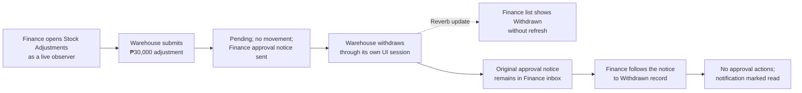

# INV-01 — high-value withdrawal process run

**Date:** 2026-11-04 UTC  
**Journey:** `INV01-HIGH-WITHDRAW`  
**Environment:** Dedicated `ogami-erp-e2e` Compose project and `ogami_e2e` database; reset to baseline before the journey  
**Result:** Passed  
**Browser:** Headless Chromium, one worker, zero retries

The targeted auth setup signed in `finance_officer` and `warehouse_staff` through the real login UI in separate contexts. Setup and the business journey passed; the journey took **30.1 seconds**.

## Process result

| Step | Actor and UI path | Result and verified effects |
|---|---|---|
| 1. Prepare a live observer | `finance_officer`; Finance → Stock Adjustments | Passed. Finance opened the list before the request existed. |
| 2. Submit a high-value request | `warehouse_staff`; Warehouse → Stock Adjustments → New adjustment → Submit | Passed. Warehouse submitted a ₱30,000 RM-001 inbound adjustment for 250 kg. It remained pending without a stock movement. Finance saw the row appear live. Finance had Approve/Reject; Warehouse had Withdraw and no approval actions. The approval notice went only to the configured approver audience. |
| 3. Withdraw as requester | `warehouse_staff`; Stock Adjustments row → Withdraw → Confirm | Passed. Warehouse withdrew its own pending request. The UI showed Withdrawn, and Finance's open list updated without refresh. Read-only checks confirmed the Warehouse resolver, no resolution reason, no stock movement, and zero on-hand stock. No rejection or completion notice was generated. |
| 4. Follow the original approval notice | `finance_officer`; Work → Notifications → linked adjustment | Passed. The original approval notice remained in Finance's inbox. Finance opened it and the linked record showed Withdrawn with no Approve/Reject action; the notice was marked read. The notice still carries its original “needs approval” title until opened. This is recorded as a low-severity UX observation pending the business rule for withdrawn requests.

Browser diagnostics remained clean. The test did not assert sidebar badge counts, email delivery, or PDFs; this path defines no PDF, and email is preference-controlled.

## Annotated walkthrough

## Observed process

## Triage

No process defect was found in the withdrawal transition. The unrevised approval-notice title is tracked as [UX-INV-001](../FINDINGS.md#ux-inv-001--withdrawn-adjustment-notice-retains-approval-title); business confirmation is needed on whether the notice should remain for history or change to an informational status. No application behavior was changed.
