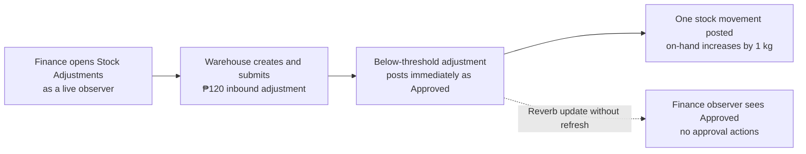

# INV-01 — low-value stock adjustment process run

**Date:** 2026-11-04 UTC  
**Journey:** `INV01-LOW-ADJUST`  
**Environment:** Dedicated `ogami-erp-e2e` Compose project and `ogami_e2e` database; reset to baseline before the run  
**Result:** Passed  
**Browser:** Headless Chromium, one worker, zero retries

The Playwright auth setup signed in all **35/35** seeded actors through the real login UI and saved separate role sessions. The business journey passed in **18.7 seconds**. The auth setup took **2.3 minutes**. Warehouse created and submitted the only transactional record through its own session; Finance opened the Stock Adjustments list through its own session before creation and observed the result without refreshing.

## Process result

| Step | Actor and UI path | Result and verified effects |
|---|---|---|
| 1. Prepare a live observer | `finance_officer`; Finance → Stock Adjustments | Passed. Finance reached the page through the Finance sidebar and the run-scoped adjustment was absent before submission. |
| 2. Post a below-threshold adjustment | `warehouse_staff`; Warehouse → Stock Adjustments → New adjustment → Submit | Passed. Warehouse submitted an inbound RM-001 adjustment for 1 kg at ₱120/kg. The UI posted it immediately as Approved. No approval action remained available. Finance's already-open list showed the approved record without refresh. |
| 3. Verify resulting state and side effects | Read-only database assertions after the UI action | Passed. The record is Approved, has one `adjustment_in` movement for 1 kg / ₱120, and leaves 1 kg on hand. Requester, approver/posting actor, and audit actor are the Warehouse account. No notification is associated with this stock-adjustment subject. Browser diagnostics reported no unexpected console, uncaught-exception, or failed/5xx network errors. |

The test does not define a PDF or email side effect for a below-threshold adjustment; neither was expected or verified. High-value approval and its notifications are covered separately by [INV01-HIGH-VALUE-APPROVAL](2026-11-04-INV01-full-run.md).

## Annotated walkthrough

## Observed process

## Triage

The first attempt's no-notification assertion counted unrelated notifications that shared the same numeric subject ID. It is documented as resolved test issue [TST-INV-006](../FINDINGS.md#tst-inv-006--low-adjustment-notification-assertion-matched-unrelated-numeric-ids). The corrected assertion scopes by the stock-adjustment subject type and passed from a fresh baseline. No product finding was added, and no application behavior was changed.
