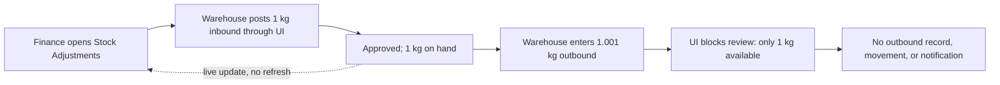

# INV-01: Negative stock prevention — full run

**Result:** Completed; 2/2 Playwright tests passed (targeted real-UI auth setup and the business journey), zero retries, one worker. The business journey took 20.4 seconds; the run took 30.7 seconds. Playwright's final result file reports 0 skipped, 0 unexpected, and 0 flaky tests.

**Run ID:** `651d4953-2713-4661-a8e2-06735d7eda70`  
**Actors:** `warehouse_staff` performed the UI actions in its own session; `finance_officer` used a separate session as a live observer. Auth setup signed in those two selected actors through the login UI.  
**Data:** baseline RM-001 at Main Warehouse; Warehouse created 1.000 kg of prerequisite stock and attempted to prepare a 1.001 kg outbound adjustment.  
**Environment:** dedicated `ogami-erp-e2e` Compose project and `ogami_e2e` database, headless Chromium, `workers: 1`, `retries: 0`. The Playwright global environment guard ran before the test.

## Journey steps

| Step | Actor | UI path and action | Result and assertions |
|---|---|---|---|
| 1 | Finance | Finance → Stock Adjustments | Opened the list before Warehouse acted. The run-scoped adjustment reasons were absent; read-only DB count was zero. |
| 2 | Warehouse | Warehouse → Stock Adjustments → New adjustment → Submit | Created a 1.000 kg inbound adjustment through the UI. It became Approved. Finance's already-open list showed the adjustment without refresh. Read-only DB checks found exactly one approved adjustment, one 1.000 kg stock movement, 1.000 kg on hand, and the correct Warehouse audit actor. |
| 3 | Warehouse | Warehouse → Stock Adjustments → New adjustment | Entered 1.001 kg outbound. The UI showed “Only 1 kg can be removed from this location,” disabled Review adjustment, and did not open a review dialog. Finance saw no row for the attempted adjustment. Read-only DB checks confirmed on-hand remained 1.000 kg, no attempted adjustment was created, there was no additional movement, and no adjustment notification was emitted. The prerequisite adjustment still had the correct Warehouse audit actor. |

The run-scoped negative attempt was never submitted; all transactional state changes in this journey were made through the Warehouse UI. The E2E DB and API helpers were used only for read-only assertions. Per-step browser diagnostics were clean.

## Observed flow

## Walkthrough screenshots

- [Finance opens the list](assets/inv01-negative-stock-final-2026-11-04/001-finance-opens-stock-adjustments-before-the-warehouse-attempt.png)
- [Warehouse posts prerequisite stock](assets/inv01-negative-stock-final-2026-11-04/002-warehouse-posts-1-kg-of-prerequisite-stock-through-the-ui.png)
- [UI blocks the outbound quantity](assets/inv01-negative-stock-final-2026-11-04/003-outbound-quantity-above-stock-is-blocked-in-the-ui.png)
- [Journey context and step timestamps](assets/inv01-negative-stock-final-2026-11-04/journey-context.json)

## Scope limits

This journey verifies client-side prevention and the absence of side effects when Review is disabled. It does not attempt a direct API authorization request or prove server-side rejection of a crafted outbound request; those belong to Phase 4. No PDF or email was generated by these steps. No application defect was found in this variant. Earlier selector and display-format mismatches are resolved test issues, including TST-INV-017.
