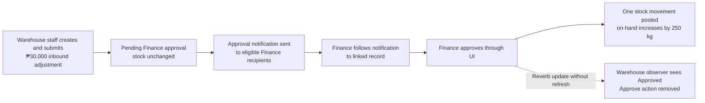

# INV-01 — first complete end-to-end run

**Date:** 2026-11-04 UTC  
**Journey:** `INV01-HIGH-VALUE-APPROVAL`  
**Environment:** Dedicated `ogami-erp-e2e` Compose project and `ogami_e2e` database  
**Result:** Passed  
**Command:** `node scripts/e2e/runner.mjs reset`, then `node scripts/e2e/runner.mjs test --grep INV01-HIGH-VALUE-APPROVAL`

Playwright ran headless Chromium with one worker and zero retries. The real login setup signed in all **35/35** seeded actors. Both tests passed: auth setup and the three-step business journey; total run time was **2.6 minutes**, with **20.6 seconds** for the journey. The baseline was reset before execution. The journey created and advanced its only transactional record through the UI in separate Warehouse and Finance sessions.

## Process result

| Step | Actor and UI path | Result and verified effects |
|---|---|---|
| 1. Create high-value inbound adjustment | `warehouse_staff`; Warehouse → Stock Adjustments → New adjustment → Submit | Passed. UI created a pending RM-001 inbound adjustment for 250 kg at ₱120/kg (₱30,000). The UI showed Finance approval required. Read-only assertions confirmed the ₱25,000 threshold, unchanged on-hand stock, no stock movement, correct Warehouse audit actor, and the approval notification went only to the seeded Finance approvers and system administrators. Warehouse had no Approve action. |
| 2. Find approval work | `finance_officer`; Work → Notifications → matching notice → linked Stock Adjustments record | Passed. Finance followed the generated notification link. The linked row was pending with Approve and Reject enabled. The notice was marked read. The Warehouse observer stayed on the open list; its status filter was cleared through the visible combobox option and the pending row remained visible. |
| 3. Approve and observe | `finance_officer`; linked Stock Adjustments row → Approve | Passed. Finance approved through the UI. The Warehouse observer received the approved status without refresh and its Approve action disappeared. Read-only assertions confirmed one `adjustment_in` stock movement for 250 kg / ₱30,000, on-hand 250 kg, the Finance approver and movement actor, audit entries for both actors, and the completion notification went only to the Warehouse requester. |

The journey's unexpected-console, uncaught-exception, and failed/5xx network diagnostics remained clean. No PDF or outbound-email assertion is defined for this stock-adjustment UI path; those effects were not verified in this run.

## Annotated walkthrough

## Observed process

## Triage

No product finding was added. This complete run resolves the outstanding INV-01 sidebar and searchable-combobox test issues and confirms the E2E Reverb path supports this observer update. The earlier failed attempts remain documented as history. Procurement finding `FND-PR-001` remains open; no application behavior was changed.
