# HR05-PARTIAL-PAYMENT — attempt 02: blocked at missing manual-repayment UI

**Result:** Blocked at step 6 by `GAP-HR-05-03`. The real-UI loan origination and approval chain passed; no repayment was submitted.

- **Run ID:** `3f7c7930-ceb2-4507-8e2d-abff4852b19c`
- **Started:** 2026-11-05 00:55:22 UTC
- **Environment:** Guarded E2E stack, `E2E_ENV=true`, database `ogami_e2e`, allowlisted browser origin `https://nginx`, fixed runtime Compose label `ogami-erp-e2e-session`; one headless Chromium worker, no retries.
- **Actors:** Employee, Department Head, HR Officer, Finance Officer, and Vice President each used a separate UI-authenticated session. The below-threshold VP step was skipped by workflow configuration, not performed by an admin substitute.
- **Record:** `LN-202611-0001`, company loan ₱29,999.99, run-scoped purpose `E2E-3f7c7930-ceb hr05-partial-payment company loan`.

## Steps

1. **Employee submitted the company loan through Profile → Loans.** The UI returned 201. Read-only assertions found `pending`, principal and balance ₱29,999.99, no payments, no journal, the Employee requester, and the ordered approval chain. The VP row was stored as `skipped`. [Screenshot](assets/hr05-partial-payment-attempt-02/walkthrough/001-employee-submits-a-company-loan-for-29999-99.png)
2. **Department Head found the request in Sidebar → Approval Queue → My action required and approved it.** The approval row and audit actor matched the Department Head; HR became the next step. [Screenshot](assets/hr05-partial-payment-attempt-02/walkthrough/002-department-head-finds-and-approves-the-request.png)
3. **HR Officer followed the in-app approval notice and approved.** Finance became the next step and the expected Finance recipients were checked. [Screenshot](assets/hr05-partial-payment-attempt-02/walkthrough/003-hr-officer-follows-the-approval-hand-off-and-approves.png)
4. **Finance Officer followed the in-app notice and approved.** The loan became `active`; the Employee's open self-service row updated live. Read-only checks confirmed the three approver/audit actors, VP skipped, one posted balanced disbursement journal, exact intended notices, no participant email, and no payment rows. [Screenshot](assets/hr05-partial-payment-attempt-02/walkthrough/004-finance-follows-the-approval-hand-off-and-approves.png)
5. **Finance navigated through Sidebar → Human Resources → Employee Loans and opened the active record.** The detail showed `Active`, “No payments yet,” and the balance. The Finance view had no “Record payment” or “Make payment” button. Read-only assertions still found zero payment rows, `total_paid = 0.00`, and the single disbursement journal. [Screenshot](assets/hr05-partial-payment-attempt-02/walkthrough/005-finance-opens-the-active-loan-and-checks-repayment-actions.png)
6. **Finance could not record the planned partial manual repayment.** The journey captured the active-loan detail and called `test.fixme` with `GAP-HR-05-03`. It made no API payment request. The Playwright result is `skipped` as an expected gap; the process context records the step as failed with the gap reason and the final-settlement step as blocked. [Screenshot](assets/hr05-partial-payment-attempt-02/walkthrough/006-manual-repayment-form-is-absent-from-the-active-loan-detail.png)

The full active loan detail was observed: status `Active`, total paid ₱0.00, balance ₱29,999.99, and no repayment action. No payment row or repayment journal was created. This confirms the missing Loans UI path in the browser. Payroll deductions remain a separate untested journey under HR-06.

## Mermaid walkthrough

```mermaid
flowchart LR
  EMP[Employee submits company loan] --> DH[Department Head approves from Approval Queue]
  DH --> HR[HR Officer approves from notification]
  HR --> FIN[Finance approves from notification]
  FIN --> ACTIVE[Active; disbursement journal posted]
  ACTIVE --> FINVIEW[Finance opens loan from sidebar]
  FINVIEW --> GAP{{GAP-HR-05-03: no manual repayment action}}
  GAP -. partial payment blocked .-> SETTLE[Final settlement blocked]
```

## What remains unverified

- No partial or final manual repayment, payment-ledger row, reduced balance, `active → paid` transition, repayment journal, or settlement notification can be verified until the Loans UI exists.
- Final aggregate diagnostics across every actor page were not reached after the expected `test.fixme`; Finance's step diagnostics and all preceding per-step invariants passed.
- The request did not exercise payroll-driven deductions, which belong to HR-06.

## Artifacts

- [Journey context](assets/hr05-partial-payment-attempt-02/journey-context.json)
- Six annotated screenshots under [the walkthrough directory](assets/hr05-partial-payment-attempt-02/walkthrough/)
- No trace was generated because the journey stopped at the expected fixme rather than an unexpected browser failure.
