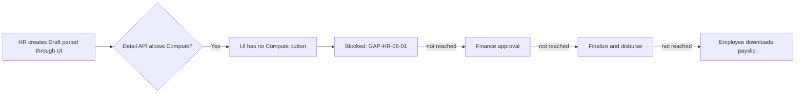

# HR06-HAPPY — attempt 01: payroll Compute action missing from the UI

**Date:** 2026-11-05 UTC  
**Journey:** HR-06 / `HR06-HAPPY`  
**Result:** Blocked at step 2 by `GAP-HR-06-01` / `FND-HR-009`  
**Environment:** Guarded isolated E2E stack (`E2E_ENV=true`, database `ogami_e2e`, allowlisted `https://nginx`); one headless Chromium worker.  
**Actors prepared:** HR Officer, Finance Officer, Finance Officer 2, Employee; each used its own UI-authenticated session.  
**Run ID:** `d2819f7d-f197-4238-a5b9-8450918d4f68`

## What ran

HR navigated through Human Resources → Payroll Processing → New Period and created `E2E-d2819f7d-f19`, scoped to Production, for 2026-11-01 through 2026-11-15. The period was created through the UI. A read-only database query confirmed `draft`, the HR creator, four eligible active employees, and no payroll rows. The UI's own detail request returned HTTP 200 and reported `available_actions.compute=true` and `permissions.compute=true` for the HR actor.

The next planned action was HR Compute on the period detail. The rendered page showed Draft, zero employees, and “No payroll rows yet,” but exposed no enabled Compute button. Playwright's accessible locator waited its bounded 8-second assertion and found no matching button. Step 2 was marked blocked; Finance approval, finalization, disbursement, bank proof, employee notification and payslip download did not run.

A previous partial payroll execution had shown Compute and advanced the queued calculation through `processing` to `computed`, but this behavior is inconsistent with the retained attempt. Its per-attempt artifacts were overwritten by this final run; the archived evidence below documents the current missing-action observation. This inconsistency is treated as a product finding and is not retried away.

## Evidence and limits

- [Failure screenshot: Draft period, zero rows, no Compute action](assets/hr06-happy-attempt-01/step-1-draft-period-no-compute-action.png)
- [Run-scoped context](assets/hr06-happy-attempt-01/journey-context.json)
- [Sanitized Playwright trace](assets/hr06-happy-attempt-01/trace-sanitized.zip)
- Current attempt's DB and detail-GET evidence: status `draft`; `available_actions.compute=true`; `permissions.compute=true`; no payroll rows or posted artifacts.
- The check was read-only. No API mutation or database write advanced the period.
- Console/network checks reached after the blocked assertion were not counted as passed. No emails, PDFs, GL, bank file, approval, or disbursement side effects were produced or verified in this attempt.

## Step outcome

| Step | Actor | Result | Evidence |
|---|---|---|---|
| Create scoped period | HR Officer | Passed; UI created a Draft period | Context and read-only state |
| Compute / Finance hand-off | HR Officer; Finance observer | Blocked: API detail allows Compute but UI control is absent | Screenshot, trace, detail response |
| Approve computed period | Finance Officer | Blocked by prior step | Not reached |
| Finalize and disburse | Finance Officer 2 | Blocked by prior step | Not reached |
| Download own payslip | Employee | Blocked by prior step | Not reached |

## Finding

`FND-HR-009` is classified High: a core payroll period cannot reliably advance from Draft when the API advertises an available Compute action but the SPA renders no action. The journey now marks this boundary with `test.fixme` and the gap ID. No application code was changed.
