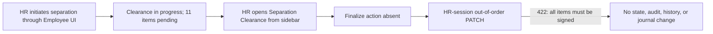

# HR08-CLEARANCE-BLOCKED — attempt 02: premature finalization was refused

**Result:** Passed both ordered process steps on a fresh baseline. HR initiated the clearance through the Employee UI. The same HR browser session then confirmed Finalize was absent and sent the permitted negative out-of-order request; the server returned the expected 422. Read-only verification found no finalization or financial side effect.

- **Run ID:** `5037ac4d-14a1-4cab-bf0c-20cd57668ed4`; clearance `CLR-202611-0001`.
- **Environment:** Guarded E2E stack; fresh migration and E2E reference-data baseline; database `ogami_e2e`, allowlisted `https://nginx`; one headless Chromium worker, zero retries. The PHP-test monitor remained clear. Services were stopped after the run and named volumes preserved.
- **Result:** Authentication setup passed; business journey passed both steps (32.8 seconds); 2 expected tests, 0 unexpected, 0 skipped, 0 flaky. The controlled effective date was 2026-11-06.

## Steps

1. **HR Officer started separation through Human Resources → Employees → Employee → Separate → Start separation.** The UI created the clearance. Read-only checks confirmed `in_progress`, all 11 checklist items pending, employee `on_leave`, employee account active, no final-pay computation or journal, one HR-attributed creation audit, and the configured separation-initiation notification recipients and links. HR’s Employee page showed the `On leave` badge. [Screenshot](assets/hr08-clearance-blocked-attempt-02/walkthrough/001-hr-starts-separation-and-leaves-the-configured-checklist-pending.png)
2. **HR Officer opened the clearance through Sidebar → Separation Clearance.** The UI showed `In progress` and no Finalize button. From HR’s authenticated browser session, the test made the allowed negative PATCH to `/api/v1/hr/clearances/{id}/finalize`. The API returned 422 with `All clearance items must be signed before finalization.` [Screenshot](assets/hr08-clearance-blocked-attempt-02/walkthrough/002-hr-cannot-finalize-through-the-ui-or-out-of-order-api-while-clearance-items-remain-pending.png)

Read-only checks after the rejected request confirmed the clearance and all 11 items remained unchanged; the employee stayed `on_leave` with an active account; final pay remained uncomputed with no amount or journal; employment history still contained only the initiation entry; and the clearance audit still contained only the creation entry. The configured separation-initiation notification recipients remained exact.

**Coverage note:** This run verified that the invalid action made no state, audit, employment-history or journal change. It checked the expected initiation notice audience; a later test revision adds a full before/after snapshot of every notification type for this clearance before this variant is counted complete.

## Mermaid walkthrough

## Artifacts

- [Journey context](assets/hr08-clearance-blocked-attempt-02/journey-context.json)
- [Two annotated walkthrough screenshots](assets/hr08-clearance-blocked-attempt-02/walkthrough/)
- No trace or video was generated because this run passed and video is disabled.

**Classification:** Journey run passed. TST-HR-080’s page-state locator correction is verified. A follow-up run is planned after adding the all-notification-type before/after assertion. No application code changed.
