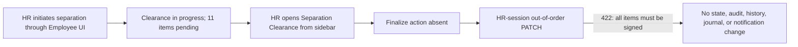

# HR08-CLEARANCE-BLOCKED — attempt 03: premature finalization was refused

**Result:** Passed both ordered process steps from a fresh E2E baseline. HR created the clearance through the Employee UI, then followed the Separation Clearance sidebar path. Finalize was unavailable while all checklist items were pending. The authenticated HR browser session's out-of-order finalize request returned the expected business-rule 422. Read-only checks confirmed that the refused request did not change notifications or any business state.

- **Run ID:** `b43ff985-7587-4b10-86e7-f58dcabb61b1`; clearance `CLR-202611-0001`.
- **Environment:** Guarded E2E stack; fresh migration and E2E reference-data baseline; dedicated `ogami_e2e` database; allowlisted `https://nginx`; one headless Chromium worker; zero retries. The test monitor found no PHP test process. Services were stopped after the run and named volumes preserved.
- **Result:** Authentication setup passed; the business journey passed both steps (20.4 seconds); 2 tests passed, 0 failed, 0 skipped, 0 flaky. The controlled effective date was 2026-11-06.

## Steps and evidence

1. **HR Officer initiated separation through Human Resources → Employees → Employee → Separate → Start separation.** The UI created clearance `CLR-202611-0001`. Read-only checks confirmed `in_progress`, all 11 configured checklist items pending, employee `on_leave`, account active, no final-pay computation or journal, and one HR-attributed creation audit. The configured initiation notification recipients matched exactly and queued email recipients were verified. HR's Employee page showed `On leave`. [Screenshot](assets/hr08-clearance-blocked-attempt-03/walkthrough/001-hr-starts-separation-and-leaves-the-configured-checklist-pending.png)
2. **HR Officer opened the clearance through Sidebar → Separation Clearance.** The UI showed `In progress` and no Finalize button. Before the negative request, a read-only snapshot captured all notifications for the clearance. Using HR's own authenticated browser session and CSRF token, the test sent the allowed negative PATCH to `/api/v1/hr/clearances/{id}/finalize`. The response was 422 with `All clearance items must be signed before finalization.` [Screenshot](assets/hr08-clearance-blocked-attempt-03/walkthrough/002-hr-cannot-finalize-through-the-ui-or-out-of-order-api-while-clearance-items-remain-pending.png)

After the refused request, the clearance and 11 pending items remained unchanged; the employee stayed `on_leave` with an active account; final pay remained uncomputed with no amount or journal; employment history still contained only the initiation entry; and the clearance audit still contained only the creation entry. The complete before/after notification snapshots were equal, and the configured initiation recipient set remained exact. HR's page continued to show `In progress` with no Finalize action. Page/network diagnostics found no unexpected console or HTTP 5xx errors.

## Mermaid walkthrough

## Artifacts

- [Sanitized journey context](assets/hr08-clearance-blocked-attempt-03/journey-context.json)
- [Two annotated walkthrough screenshots](assets/hr08-clearance-blocked-attempt-03/walkthrough/)
- No trace or video was generated because the run passed and video is disabled.

**Classification:** Journey pass. TST-HR-080's page-state locator correction and the expanded all-notification-type before/after assertion are verified. No application code changed.
