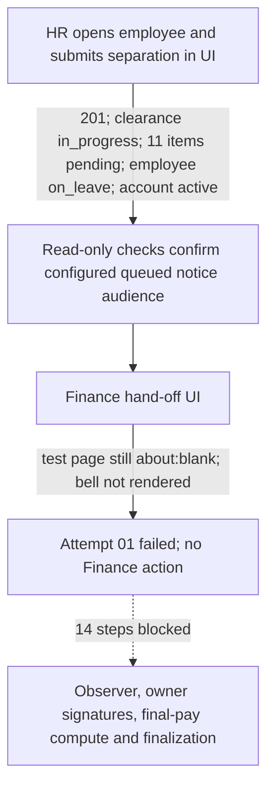

# HR08-VOLUNTARY — Attempt 01: Finance actor page remained blank

**Date:** 2026-11-05 UTC  
**Outcome:** HR initiated the separation and its read-only checks passed; the Finance hand-off step failed before the Finance UI was opened; 14 later steps were blocked.  
**Classification:** Test issue, `TST-HR-076` (the product notification itself was present in the verified recipient set).  
**Journey:** `HR08-VOLUNTARY`  
**Run mode:** Fresh guarded `ogami_e2e` baseline, TypeScript preflight, seven selected role logins through the real UI, one headless Chromium worker, `retries: 0`; the required 300-second PHP-test quiet interval completed.

## What ran

Playwright reported one auth-setup pass and one failed business journey. The selected sessions were HR Officer, Finance Officer, System Administrator observer, Production Department Head, IT Department Head, Warehouse Staff, and Maintenance Technician.

1. **HR Officer — initiate separation:** HR found the seeded E2E employee through Human Resources → Employees, opened the employee record, selected **Separate**, entered reason `resigned`, the controlled Manila effective date, and run-scoped remarks, then submitted the form. The browser observed HTTP 201. Read-only checks confirmed clearance `CLR-202611-0001` in `in_progress`, employee `active → on_leave`, employee account still active, all 11 configured checklist items pending, and the audit actor was HR. The configured in-app audience, queued delivery, and opted-in Mailpit email checks passed.
2. **Finance Officer — follow the notice:** The test looked for the notification bell before bringing this actor's new browser page into the application. The page was still `about:blank`, so no bell control existed. The timeout stopped the journey before a Finance click or record action. The business record was not advanced by Finance.

The failure screenshot shows the Finance page blank. The initiation screenshot shows the employee in `On leave` and the pending separation-clearance badge in HR's sidebar. The database notification assertion had already confirmed the configured audience, including Finance; this run therefore did not establish a missing-notification product defect.

## Process as observed

## Results and limits

- Playwright tests: **1 passed** auth setup, **1 failed** business journey.
- Journey steps: **1 passed**, **1 failed**, **14 blocked**.
- Confirmed: HR's UI-created clearance, initial employee/clearance states, pending checklist, audit actor, exact configured in-app recipient set, and opted-in email delivery assertions.
- Not verified: Finance opening the real notice; department signatures; IT scope check and HR fallback; clearance completion; account deactivation; final-pay formatting and computation; balanced journal posting; final employment history; observer real-time updates.
- No API or database mutation was used. The isolated E2E database will be reseeded before the next attempt.

## Evidence

- [Journey context](assets/hr08-voluntary-attempt-01/journey-context.json)
- [Sanitized Playwright trace](assets/hr08-voluntary-attempt-01/trace.zip)
- [Playwright error context](assets/hr08-voluntary-attempt-01/error-context.md)
- [Blank Finance page at failure](assets/hr08-voluntary-attempt-01/finance-page-blank-failure.png)
- [Annotated HR initiation screenshot](assets/hr08-voluntary-attempt-01/walkthrough/001-hr-initiates-voluntary-separation-from-the-employee-record.png)

The trace sanitizer reported zero credential-like values after redaction. No application code changed.
