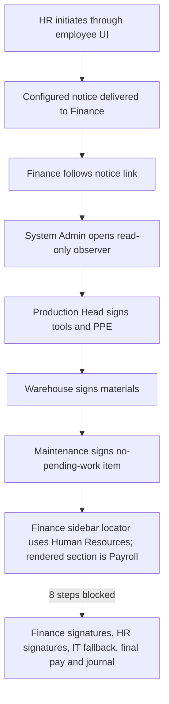

# HR08-VOLUNTARY — Attempt 02: Finance sidebar section label mismatch

**Date:** 2026-11-05 UTC  
**Outcome:** Seven ordered UI steps passed; Finance's first clearance-signature step failed in the test's sidebar-section locator; eight later steps were blocked.  
**Classification:** Test issue, `TST-HR-077`. The source config places Finance's Separation Clearance link under its renamed **Payroll** section.  
**Journey:** `HR08-VOLUNTARY`  
**Run mode:** Fresh guarded `ogami_e2e` baseline, TypeScript preflight, seven selected role logins through the real UI, one headless Chromium worker, `retries: 0`.

## What ran

Playwright reported one auth-setup pass and one failed business journey.

1. **HR Officer:** Created a voluntary separation from the employee detail through the UI. The browser observed HTTP 201. Read-only checks confirmed `in_progress`, employee `on_leave`, active account, all 11 checklist items pending, the HR audit actor, the configured in-app notification audience, queued delivery, and opted-in email delivery.
2. **Finance Officer:** Entered through `/sign-in`, followed the separation notification link, and opened the clearance through that link.
3. **System Administrator:** Opened the same clearance as a read-only observer and kept the record open.
4. **Production Department Head:** Signed `Tools returned` and `PPE returned` through the pending-clearance sidebar signal.
5. **Warehouse Staff:** Signed `Materials returned` through its pending-clearance signal.
6. **Maintenance Technician:** Signed `No pending maintenance work` through its pending-clearance signal.
7. **Finance Officer — first owned checklist item:** The test's navigation helper found the Clearance link in Finance's module navigation but looked for the collapsed group under `data-module="Human Resources"`. The app derives a different rendered group label for Finance: `Sidebar.tsx` renames that section to `Payroll` and explicitly keeps `/hr/separations` among Finance-visible links. The helper found no toggle under the old label and stopped before Finance signed either item.

The seven completed steps' UI, read-only state/audit checks, and live observer assertions passed. The failure came from the test using the source section's pre-transform label instead of Finance's rendered label. It does not establish a missing Finance permission or product hand-off defect.

## Process as observed

## Results and limits

- Playwright tests: **1 passed** auth setup, **1 failed** business journey.
- Journey steps: **7 passed**, **1 failed**, **8 blocked**.
- Confirmed: initiation, hand-off notification/email assertions, Finance's linked clearance access, observer access, four departmental item signatures (two Production, one Warehouse, one Maintenance), individual audit actors, and real-time updates to the open observer.
- Not verified: Finance signatures; HR-owned signatures; IT Department Head scope check and HR fallback; completion/deactivation; final-pay formatting and computation; journal posting; final employment history.
- No API or database mutation was used. The next attempt will start from a freshly seeded E2E baseline.

## Evidence

- [Journey context](assets/hr08-voluntary-attempt-02/journey-context.json)
- [Sanitized Playwright trace](assets/hr08-voluntary-attempt-02/trace.zip)
- [Playwright error context](assets/hr08-voluntary-attempt-02/error-context.md)
- [Failure screenshot](assets/hr08-voluntary-attempt-02/finance-sidebar-failure.png)
- [Seven-step visual walkthrough](assets/hr08-voluntary-attempt-02/walkthrough/)

The runner's trace sanitizer reported zero credential-like values after redaction. No application code changed.
