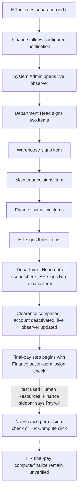

# HR08-VOLUNTARY — Attempt 03: Finance final-pay permission check used the wrong sidebar label

**Date:** 2026-11-05 UTC  
**Outcome:** Fourteen ordered UI steps passed through all clearance signatures and account deactivation; the final-pay step failed in its Finance permission-check navigation; finalization was blocked.  
**Classification:** Test issue, `TST-HR-077` (the prior correction updated the pending-work helper but missed the separate Finance list helper).  
**Journey:** `HR08-VOLUNTARY`  
**Run mode:** Fresh guarded `ogami_e2e` baseline, TypeScript preflight, seven selected role logins through the real UI, one headless Chromium worker, `retries: 0`.

## What ran

Playwright reported one auth-setup pass and one failed business journey.

1. **HR Officer:** Created the voluntary separation from the employee detail through the UI. The browser observed HTTP 201. Read-only checks confirmed clearance `in_progress`, employee `on_leave`, active account, all 11 checklist items pending, the HR audit actor, and the configured notification/email recipient checks.
2. **Finance Officer:** Entered through `/sign-in`, followed the real separation notice, and opened the clearance from its link.
3. **System Administrator:** Opened the same clearance as a read-only observer.
4. **Production Department Head:** Signed `Tools returned` and `PPE returned` through the pending-clearance signal.
5. **Warehouse Staff:** Signed `Materials returned` through the pending-clearance signal.
6. **Maintenance Technician:** Signed `No pending maintenance work` through the pending-clearance signal.
7. **Finance Officer:** Signed `No outstanding cash advance` and `No outstanding company loan` through the pending-clearance signal in the Finance actor's rendered Payroll section.
8. **HR Officer:** Signed `Company ID returned`, `201 file complete`, and `Exit interview done` through the pending-clearance signal.
9. **IT scope / HR fallback:** The IT Department Head could not find the Production employee's clearance in the UI. HR signed `IT equipment returned` and `System accounts disabled` through HR's clearance signal. Read-only assertions confirmed the correct HR signer, item audit actors, and live observer updates.
10. **Completion:** The eleventh signature changed the clearance to `completed`; the read-only state check and queued account-deactivation assertion passed. The employee account became inactive. The still-open System Administrator observer displayed the item changes and completed state without refresh.
11. **HR final-pay step:** Before HR clicked **Compute final pay**, the test opened Finance's clearance list to assert that Finance could not see the HR-only compute/finalize actions. This second helper still searched for the Finance section as `Human Resources`, so it timed out before reaching the negative-action assertions or HR's compute click. `Sidebar.tsx` renders that section as `Payroll` for Finance.

The test fix from attempt 02 updated Finance's pending-signal helper but missed `openClearanceFromList`, which the Finance permission-check helper also calls. The business process reached `completed`; final-pay computation and finalization were not attempted.

## Process as observed

## Results and limits

- Playwright tests: **1 passed** auth setup, **1 failed** business journey.
- Journey steps: **14 passed**, **1 failed**, **1 blocked**.
- Confirmed: all 11 role-owned UI signatures; correct signer/audit checks; the IT Department Head's UI scope boundary; HR fallback; completed clearance; inactive employee account; and live observer updates through completion.
- Not verified: Finance's absence of Compute/Finalize actions; HR's visible Compute action and peso formatting; final-pay computation breakdown; balanced final-pay journal; employment-history final status; finalization observer update.
- No API or database mutation was used. The next attempt will start from a fresh E2E baseline.

## Evidence

- [Journey context](assets/hr08-voluntary-attempt-03/journey-context.json)
- [Sanitized Playwright trace](assets/hr08-voluntary-attempt-03/trace.zip)
- [Playwright error context](assets/hr08-voluntary-attempt-03/error-context.md)
- [Failure screenshot](assets/hr08-voluntary-attempt-03/final-pay-precheck-failure.png)
- [Fourteen-step visual walkthrough](assets/hr08-voluntary-attempt-03/walkthrough/)

The runner's trace sanitizer reported zero credential-like values after redaction. No application code changed.
