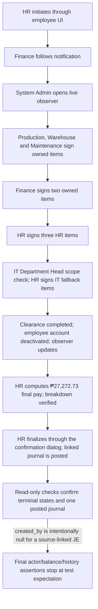

# HR08-VOLUNTARY — Attempt 04: Source-linked journal creator expectation

**Date:** 2026-11-05 UTC  
**Outcome:** All process actions completed through the UI. Fifteen ordered steps and their assertions passed; the final step failed when a read-only assertion expected the source-linked journal's `created_by` to be HR.  
**Classification:** Test issue, `TST-HR-078`.  
**Journey:** `HR08-VOLUNTARY`  
**Run mode:** Fresh guarded `ogami_e2e` baseline, TypeScript preflight, seven selected role logins through the real UI, one headless Chromium worker, `retries: 0`.

## What ran

Playwright reported one auth-setup pass and one failed business journey.

1. **HR Officer:** Initiated the separation through the employee detail UI. Read-only assertions confirmed clearance `in_progress`, employee `on_leave`, active account, 11 pending checklist items, HR audit actor, exact configured notification audience, queued delivery, and opted-in email delivery.
2. **Finance Officer:** Entered through `/sign-in`, followed the real separation notice, and opened the clearance from its notification link.
3. **System Administrator:** Opened the same record as a read-only observer and kept it open.
4. **Production Department Head:** Signed `Tools returned` and `PPE returned` from the pending-clearance signal.
5. **Warehouse Staff:** Signed `Materials returned` from the pending-clearance signal.
6. **Maintenance Technician:** Signed `No pending maintenance work` from the pending-clearance signal.
7. **Finance Officer:** Signed the cash-advance and company-loan checklist items from the pending-clearance signal in Finance's rendered Payroll section.
8. **HR Officer:** Signed the Company ID, 201 file, and exit-interview items from the pending-clearance signal.
9. **IT scope and HR fallback:** The IT Department Head could not find the Production employee's clearance. HR signed the IT equipment and accounts items through the HR clearance signal.
10. **Clearance completion:** The final signature changed the clearance to `completed`; the employee account became inactive; the still-open observer saw the item changes and completed status without refresh. Per-item status, signer, audit actor, and observer assertions passed.
11. **Final-pay computation:** HR computed final pay through the UI. Finance could not see Compute or Finalize. Read-only checks confirmed the computed amount and breakdown. The HR UI displayed **₱27,272.73**; the exact peso-format assertion passed.
12. **Finalization:** HR finalized through the confirmation dialog. The browser observed HTTP 200. Read-only checks confirmed `finalized`, employee `resigned`, inactive account, computed final pay, HR finalizer, and one linked journal in `posted` status. The next assertion expected the journal's `created_by_email` to equal HR, but the value was null.

Source confirms this is the intended journal attribution: `FinalPayService::postJournalEntry()` creates a source-linked entry with a Clearance reference and then calls `postSystem(..., $by->id)`. `JournalEntryService::create()` sets `created_by` to null for source-linked entries; `postSystem()` records the acting user in `posted_by`. The test must assert null `created_by` and HR `posted_by` before continuing with balance, audit, history, and final live-view checks.

## Process as observed

## Results and limits

- Playwright tests: **1 passed** auth setup, **1 failed** business journey.
- Journey steps: **15 passed**, **1 failed**, **0 blocked**.
- Confirmed: the complete UI process, all 11 role-owned signatures, clearance and employee terminal states, account deactivation, queued notification/email assertions, audit actors on each signature, real-time observer updates through completion, final-pay computation/breakdown, ₱ formatting, Finance's lack of HR final-pay actions, and one linked posted journal.
- Not verified after the creator assertion stopped the step: the journal `posted_by` read-only assertion, balanced totals/lines, finalization audit/history actor checks, and observer update after finalization. Source-derived attribution is HR `posted_by`; attempt 05 will verify it along with the remaining assertions.
- No API or database mutation was used. No application code changed.

## Evidence

- [Journey context](assets/hr08-voluntary-attempt-04/journey-context.json)
- [Sanitized Playwright trace](assets/hr08-voluntary-attempt-04/trace.zip)
- [Playwright error context](assets/hr08-voluntary-attempt-04/error-context.md)
- [Finalized clearance screen showing ₱27,272.73](assets/hr08-voluntary-attempt-04/finalized-clearance.png)
- [Fifteen-step visual walkthrough](assets/hr08-voluntary-attempt-04/walkthrough/)

The runner's trace sanitizer reported zero credential-like values after redaction.
