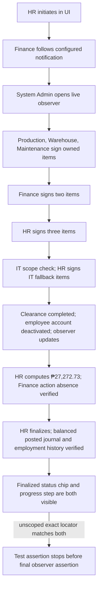

# HR08-VOLUNTARY — Attempt 05: Final status locator matched two UI regions

**Date:** 2026-11-05 UTC  
**Outcome:** All process actions completed through the UI. Fifteen ordered steps and all read-only state, journal, audit, and history assertions passed; the final UI invariant failed because the unscoped `Finalized` locator matched both the status chip and progress tracker.  
**Classification:** Test issue, `TST-HR-079`.  
**Journey:** `HR08-VOLUNTARY`  
**Run mode:** Fresh guarded `ogami_e2e` baseline, TypeScript preflight, seven selected role logins through the real UI, one headless Chromium worker, `retries: 0`.

## What ran

The journey repeated the complete UI path from a clean baseline:

- HR initiated the separation and the Finance Officer followed the configured notification to the clearance.
- A separate System Administrator observer kept the same record open.
- Production, Warehouse, Maintenance, Finance, and HR each signed their configured checklist items through their own role sessions and the actionable clearance hand-off. The IT Department Head could not see the Production employee clearance; HR completed the two IT items using the supported fallback.
- All 11 items cleared, the clearance reached `completed`, and the employee account became inactive. The open observer saw item and completion updates without refresh.
- HR computed final pay. Finance lacked Compute/Finalize actions; the breakdown and **₱27,272.73** display passed.
- HR finalized through the confirmation dialog. Read-only assertions passed for the finalized clearance, resigned employee, inactive account, final-pay amount, HR finalizer, exactly one posted journal, null source-linked `created_by`, HR `posted_by`, balanced totals and lines, final employment history, and audit actor.

The final `assertInvariants` then called `getByText('Finalized', { exact: true })` without a scope. Playwright found two intended occurrences: the clearance status chip in the page header and the `Finalized` step inside the accessible Document progress region. The strict locator failed before the later UI assertions checked the visible journal link and the second viewer's post-finalization status.

This is a test locator issue. The screen shows the clearance as Finalized, and the read-only terminal-state and journal assertions passed. Attempt 06 will scope the status-chip check to the page header and separately assert the progress tracker and live observer.

## Process as observed

## Results and limits

- Playwright tests: **1 passed** auth setup, **1 failed** business journey.
- Journey steps: **15 passed**, **1 failed**, **0 blocked**.
- Confirmed: every UI action; all role owners and audit actors; configured notification/email checks; clearance and employee terminal states; account deactivation; final pay breakdown and peso format; Finance's missing HR actions; exactly one posted, balanced journal; final employment history; and source-linked journal actor policy.
- Not verified after the unscoped locator stopped the final invariant: visible JE link assertion and the already-open observer's finalization update. These are retained for the next run.
- No API or database mutation was used. No application code changed.

## Evidence

- [Journey context](assets/hr08-voluntary-attempt-05/journey-context.json)
- [Sanitized Playwright trace](assets/hr08-voluntary-attempt-05/trace.zip)
- [Playwright error context](assets/hr08-voluntary-attempt-05/error-context.md)
- [Finalized clearance screen](assets/hr08-voluntary-attempt-05/finalized-clearance.png)
- [Fifteen-step visual walkthrough](assets/hr08-voluntary-attempt-05/walkthrough/)

The runner's trace sanitizer reported zero credential-like values after redaction.
