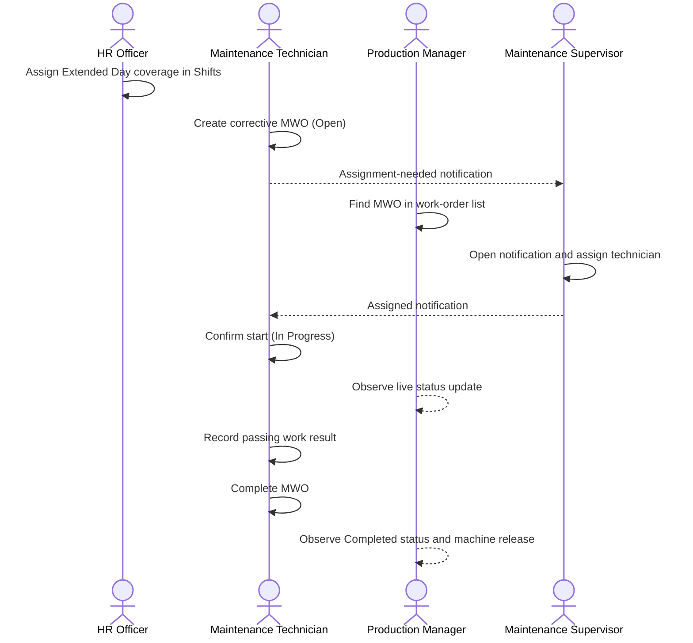

# MNT01-BREAKDOWN — attempt 25: corrective maintenance completed end to end

**Result:** Passed all 7 ordered steps in one headless Chromium journey. Every transaction was performed in the UI by the owning role in that role's own session. The test asserted status, role actions, notification recipients, audit actors, work records, machine state, and downtime after each relevant step.

- **Environment:** Fresh guarded E2E baseline; E2E TypeScript preflight and selected-role UI login setup passed; `workers: 1`, one journey, zero retries. The Playwright process result ran from 07:06:19.178Z for 82.56 seconds with 1 expected, 0 unexpected, 0 skipped, and 0 flaky tests.
- **Time and coverage fixture:** The test froze browser and backend time to 07:06 UTC, rounded to the current minute (15:06 Asia/Manila), and HR assigned the seeded Extended Day shift through the UI, effective 2026-11-05, for all seven weekdays.
- **Step 1 — HR Officer assigns Maintenance shift coverage:** Passed. The UI action, schedule row, weekday set, effective date, and audit actor were verified read-only. [Screenshot](assets/mnt01-breakdown-attempt-25/screenshots/001-hr-configures-maintenance-shift-coverage-for-the-work-period.png).
- **Step 2 — Maintenance Technician creates a corrective work order:** Passed. The technician created `MWO-202611-0001` for `IMM-01` through the work order form. It was Open, unique, and unassigned. The bounded exact notification poll found one `maintenance.assignment_needed` notification for the Maintenance Supervisor. [Screenshot](assets/mnt01-breakdown-attempt-25/screenshots/002-create-a-corrective-maintenance-work-order-for-a-free-machine.png).
- **Step 3 — Production Manager observes the work order:** Passed. The manager found the record in the work order list and saw Open status with no action buttons belonging to other roles. The already-open detail view updated as later transitions occurred. [Screenshot](assets/mnt01-breakdown-attempt-25/screenshots/003-production-manager-discovers-the-order-from-the-work-order-list.png).
- **Step 4 — Maintenance Supervisor assigns the technician:** Passed. The supervisor found the assignment-needed notification in the in-app tray, selected the technician, confirmed physical presence, and assigned. Read-only checks confirmed `open → assigned`, the correct assignee, supervisor audit actor, and exact notification recipients. [Screenshot](assets/mnt01-breakdown-attempt-25/screenshots/004-maintenance-supervisor-follows-assignment-needed-notification-and-assigns-the-technician.png).
- **Step 5 — Technician starts work:** Passed. The technician followed the assigned notification and confirmed start. Status changed `assigned → in_progress`; the machine entered maintenance and planned downtime began. The Production Manager's open view updated without refresh. [Screenshot](assets/mnt01-breakdown-attempt-25/screenshots/005-technician-follows-assignment-notification-and-starts-the-order.png).
- **Step 6 — Technician records the work result:** Passed. The technician submitted the finding, action taken, and passing result through the detail form. Read-only checks confirmed one structured maintenance log and the technician actor. [Screenshot](assets/mnt01-breakdown-attempt-25/screenshots/006-technician-records-the-passing-work-result.png).
- **Step 7 — Technician completes the work order:** Passed. The technician completed the order through the UI. Status changed `in_progress → completed`, the machine returned to idle, and downtime closed with a duration. The observer saw the final status without refresh; audit and recipient checks passed. [Screenshot](assets/mnt01-breakdown-attempt-25/screenshots/007-technician-completes-the-work-order.png).
- **Cross-step effects:** The supervisor received only the assignment-needed notice; the technician received the assigned notice. Audit status transitions were attributed to the Supervisor for assignment and to the Technician for start/completion. The work order stayed linked to `IMM-01`; a single maintenance log and a single planned-downtime record were verified. No financial entry, PDF, or email is produced by this work-order path.
- **Environment coordination:** The supervisor detected a host PHP-test process at the end of the run and stopped the dedicated E2E services. The Playwright journey result completed at 07:07:41.735Z; Docker records the E2E container stop at 07:07:42Z. The retained timestamps show the E2E journey completed before shutdown, and do not show overlap. The process-start timestamp was not captured. No PHP test was started by this run.
- **Screenshots:** The archive contains one annotated screenshot for each of the seven steps, plus the journey context and JSON result. No failure trace was generated because the test passed.
- **Diagram:**

- **Evidence:** [Sanitized seven-step walkthrough, journey context, JSON result, and runner output](assets/mnt01-breakdown-attempt-25/). All archive sanitizer checks passed with zero findings.

**Classification:** Journey pass. TST-MNT-002, TST-MNT-003, and TST-MNT-004 are verified resolved in E2E test code. No application code changed.
