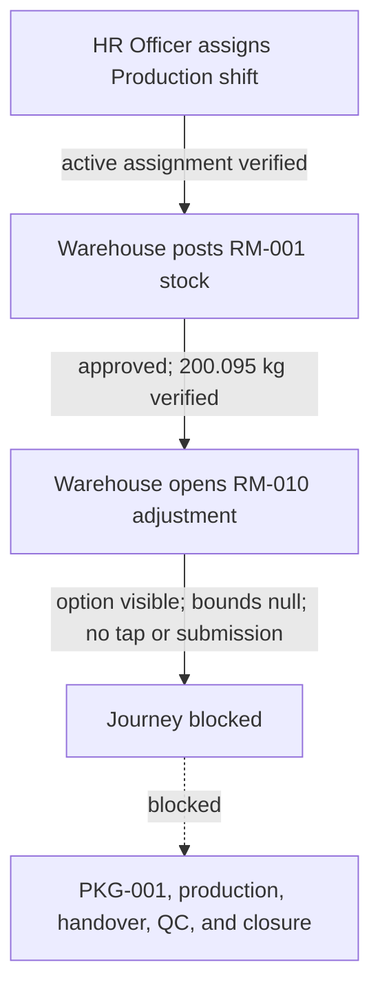

# PROD01-HAPPY — Attempt 22: visible location option returned no Playwright bounds

**Date:** 2026-11-05 UTC  
**Outcome:** Two process steps passed; Warehouse RM-010 location selection failed before submission; 18 later steps blocked  
**Classification:** Test interaction issue under investigation, TST-PROD-009  
**Journey:** `PROD01-HAPPY`  
**Run mode:** Fresh guarded E2E baseline, one headless Chromium worker, six selected real-UI actor logins. A five-minute PHP-test quiet interval completed after a filtered supplier RFQ test ended.

## What ran

The auth setup passed for all six selected actors. In the business journey:

1. **HR Officer:** Assigned the seeded Production shift through Human Resources → Attendance & DTR → Shifts → Bulk assign. The UI confirmed four employees received the shift. Read-only verification confirmed exactly one active matching assignment for the named E2E operator.
2. **Warehouse Staff:** Created and submitted the RM-001 opening-stock adjustment through Stock Adjustments. The step passed its status, actor, movement, and on-hand invariants. A later read-only query confirmed one adjustment totaling 200.095 kg.
3. **Warehouse Staff:** Opened the RM-010 adjustment form and located the Main Warehouse option. Playwright read the accessible option's label and passed `toBeInViewport()`. Its subsequent `locator.boundingBox()` returned `null`, so the direct touchscreen tap was not sent and the adjustment was not reviewed or submitted.

The remaining 18 steps, including PKG-001 opening stock, work-order planning, crew confirmation, handover, production, QC, and closure, were blocked by the failed RM-010 step. No work order was created.

## Verification and diagnosis

A transaction-read-only database query after the failure found one adjustment for the run-scoped RM-001 reason (200.095 kg) and zero adjustments for RM-010. The failed-step screenshot shows the RM-010 form with an empty Location field; the trace shows the accessible option was rendered during the locator checks. The UI was not tapped, so this run does not establish whether the application accepts or rejects a real touch on that option. No application defect is confirmed.

The failure is tracked as a test interaction issue. The test now reads the option's CSS rectangle in one locator evaluation, checks its dimensions and viewport point, then sends the same real touchscreen tap and verifies the selected combobox value. This preserves the intended user action and assertions; the result is pending a fresh-baseline run.

The run completed without a host PHP-test interruption or OOM event. Playwright produced one auth-setup pass and one failed journey test. Within the journey, two steps passed, one failed, and 18 were blocked. The runner sanitized its trace; the archived trace check found zero credential-like values.

## Process as observed

## Artifacts

- [Journey context](assets/prod01-happy-attempt-22/journey-context.json)
- [Playwright error context](assets/prod01-happy-attempt-22/error-context.md)
- [Sanitized trace](assets/prod01-happy-attempt-22/trace.zip)
- [Failure screenshot](assets/prod01-happy-attempt-22/test-failed-1.png), [HR shift screenshot](assets/prod01-happy-attempt-22/test-failed-2.png), [RM-010 form screenshot](assets/prod01-happy-attempt-22/test-failed-3.png)
- [Walkthrough: HR shift assignment](assets/prod01-happy-attempt-22/walkthrough/001-hr-assigns-production-shift-coverage-to-the-named-e2e-operator.png)
- [Walkthrough: RM-001 stock adjustment](assets/prod01-happy-attempt-22/walkthrough/002-warehouse-posts-baseline-rm-001-stock-through-stock-adjustments.png)
- Supervisor log: `/tmp/ogami-prod01-attempt-22-supervised.log`
