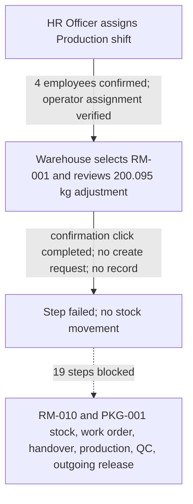

# PROD01-HAPPY — Attempt 24: stock-adjustment confirmation did not submit

**Date:** 2026-11-05 UTC  
**Outcome:** One process step passed; the RM-001 stock-adjustment step failed after confirmation; 19 later steps were blocked  
**Classification:** High-severity UI defect candidate, FND-PROD-001  
**Journey:** `PROD01-HAPPY`  
**Run mode:** Fresh guarded E2E baseline, TypeScript preflight, six selected real-UI actor logins, one headless Chromium worker, full `test --grep PROD01-HAPPY` invocation. The required 300-second PHP-test quiet interval completed.

## What ran

The guarded runner completed the baseline, TypeScript preflight, and real-UI auth setup. Playwright reported one auth-setup pass and one failed business journey. The PHP-test monitor did not interrupt the run.

1. **HR Officer:** Assigned the seeded Production shift through Human Resources → Attendance & DTR → Shifts → Bulk assign. The UI confirmed four employees received the shift; the read-only invariant passed for the named Production operator.
2. **Warehouse Staff:** Opened Warehouse → Stock Adjustments, entered an inbound RM-001 adjustment for 200.095 kg at ₱120.0000/kg, selected the Main Warehouse location using a real touchscreen tap, and confirmed the Location field displayed the selected value. The Review adjustment action opened the confirmation dialog. Playwright completed a click on “Submit adjustment,” but the expected navigation did not occur within eight seconds.

The remaining 19 process steps were blocked, beginning with the RM-010 baseline adjustment. No production work order, material handover, production output, inspection, or outgoing release was created.

## Verification and diagnosis

The final browser screenshot shows the confirmation dialog still open after the submit-button click. The sanitized trace records the locator click completing, but contains no stock-adjustment create request. A transaction-read-only PostgreSQL query against the dedicated `ogami_e2e` database found no adjustment with run reason `E2E-220ad69b-6d1 opening stock RM-001`; the RM-001 stock-level total remained 0.000. No stock adjustment or movement was created.

This is recorded as a UI submission defect because the intended action was performed through the Warehouse session and no request reached the backend. The precise frontend cause has not been root-caused. No application code was changed, and no follow-up click or retry was made. This failure blocks the dependent production journey until the approved fix loop.

The direct-touch selection correction did work for RM-001: the CSS rectangle was valid, the real `touchscreen.tap()` completed, and the selected location value assertion passed. It has not yet been exercised for RM-010 or PKG-001.

## Process as observed

## Result counts

- Playwright tests: **1 passed** auth setup, **1 failed** business journey.
- Journey steps: **1 passed**, **1 failed**, **19 blocked**.
- Process transactions: **0 stock adjustments** created by the failed step; no downstream process record was created.
- Not verified after the failed step: adjustment status/actions, ledger/movement, notification recipients, badges, audit row, finance approval, and subsequent production/quality side effects.

## Artifacts

- [Journey context](assets/prod01-happy-attempt-24/journey-context.json)
- [Playwright error context](assets/prod01-happy-attempt-24/error-context.md)
- [Sanitized trace](assets/prod01-happy-attempt-24/trace.zip)
- [Failure screenshot: submit confirmation still open](assets/prod01-happy-attempt-24/test-failed-3.png)
- [HR shift screenshot](assets/prod01-happy-attempt-24/test-failed-2.png)
- [Walkthrough: HR shift assignment](assets/prod01-happy-attempt-24/walkthrough/001-hr-assigns-production-shift-coverage-to-the-named-e2e-operator.png)
- Supervisor log: `/tmp/ogami-prod01-attempt-24-supervised.log`
- Trace sanitizer check: zero credential-like values after sanitization.
