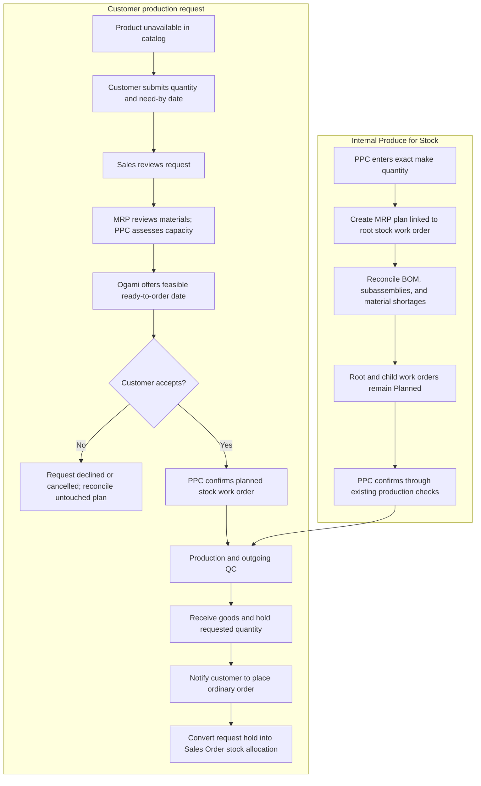

# Customer requests and stock production MRP plans

**Status:** Approved by the user on 2026-11-15.

## Capability

When a catalog product has no available finished-goods stock, a customer can request production without placing a Sales Order. Separately, when PPC uses **Produce for stock**, the exact quantity entered creates a stock-sourced MRP plan linked to a Planned stock work order. Sales and PPC review customer requests, use MRP to review material readiness and PPC to assess capacity, and offer a feasible ready-to-order date. After the customer accepts a customer-request offer, PPC confirms the planned production work. Once production passes outgoing QC and the goods are received, the portal notifies the customer and holds the requested quantity briefly so the customer can place an ordinary stock-backed order.

In this design, **MRP source** means the business record that explains why a plan exists. The customer creates only a production request. Authorized Ogami staff review it and initiate planning; the customer does not create, edit, or control an MRP plan.

## Why this change

The customer portal currently blocks ordering more than its available quantity for stock-limited products. Its “Request price and availability” path is a price negotiation: it requires a target price, does not collect a required delivery date, and does not create production demand or reserve stock. The existing **Produce for stock** flow creates a Planned stock work order and reconciles BOM component supply, but it does not create an MRP plan. Its quantity is already an exact PPC-entered make quantity.

The existing approved stock-production design explicitly rejects fake MRP plans attached to Sales Orders for inventory production. This proposal preserves that rule by giving internal stock work orders and customer production requests their own real MRP source identities.

## Fixed rules

- The portal's ordinary **Place an Order** flow still rejects quantity above current stock availability. The server remains authoritative.
- A production request is not a Sales Order. It creates no invoice, payment obligation, delivery, or customer order confirmation. Only authorized Ogami staff can start its MRP planning; the customer has no direct MRP access.
- The customer identifies the exact quantity they need. If some stock is available, the portal lets them order up to that available quantity and request production for the remainder. The request's quantity is the exact quantity to make; MRP does not silently reduce it because unrelated finished goods or open work orders may later become available. Customer-agreement minimum and maximum Sales Order quantity rules still apply to the production remainder. The internal **Produce for stock** quantity field also remains the exact pieces PPC chooses to manufacture.
- **Produce for stock** creates an MRP plan for the exact entered make quantity. A customer production request likewise creates a plan for its exact production quantity. MRP checks and reconciles BOM component requirements against eligible material supply; it does not change either finished-good make quantity.
- A requested need-by date is not promised until MRP reviews material readiness, PPC assesses capacity, and Ogami offers a feasible ready-to-order date. Delivery or pickup timing is confirmed through the later ordinary Sales Order process.
- Customer acceptance of a feasible offer is required before PPC confirms production. A work order remains Planned until its existing confirmation checks pass.
- Incoming production is never shown as available stock. Only outgoing-QC-released, received stock can satisfy an ordinary customer order.
- Once QC-released stock is held for an accepted request, hold the requested quantity for 48 hours after the ready notification. Expiry releases the hold to general availability.
- Existing Sales Order price rules are applied when the customer places the later order. The availability offer does not lock a price.

## Approaches considered

1. **Permit a Sales Order at zero stock and let Sales Order MRP create production.** This is rejected because the panel's requirement is that customers cannot order without available stock.
2. **Reuse the price request screen.** This is rejected because it is explicitly a pricing negotiation, requires a target price, lacks a requested delivery date, and does not begin production planning.
3. **Use explicit MRP sources for stock work orders and customer production requests.** Recommended. Both paths keep the exact make quantity entered by PPC or requested by the customer. MRP plans the BOM and material supply needed for that quantity. Both preserve traceability without inventing a Sales Order.

## Proposed flow

### Internal Produce for Stock flow

1. PPC enters the product, exact make quantity, and planning dates on the existing **Produce for stock** screen.
2. The system creates the root stock work order and its MRP plan in the same transaction. The root work order's `quantity_target` remains the exact quantity PPC entered.
3. The plan records the BOM requirements, recursively planned subassemblies, eligible material supply, shortages, and draft purchase requests through the existing stock-production reconciliation rules. The root and child work orders and generated purchase requests link back to this plan.
4. All created work orders remain Planned. Creating a plan does not confirm or start production. PPC explicitly uses the existing **Confirm** action after reviewing the plan.
5. Work-order confirmation continues to enforce existing material, machine, mold, schedule, crew, and dependency checks. Production, QC, and inventory receipt continue through current workflows.
6. MRP plan detail shows the exact make quantity, material plan, shortages, linked work orders, and purchasing records. Replanning is allowed only while related work and purchasing remain untouched; existing commitment and cancellation safeguards continue to apply.

### Customer production request flow

1. **Request:** For a stock-limited catalog item, the customer enters their total whole-piece need and requested need-by date. If some stock is available but less than their need, the portal lets them place an ordinary order up to the available quantity and records the remainder as the exact quantity requested for production. If no stock is available, the whole quantity is the production request. The portal confirms a production request is not an order or promised date. Requests are visible to the customer with status updates. Duplicate open requests for the same customer/product are prevented; the customer can cancel an unaccepted request.
2. **Review:** Sales validates customer/product access and commercial readiness, then asks PPC to plan the request. Sales/PPC can decline it with a reason.
3. **MRP proposal:** MRP creates a plan sourced to this production request for the exact production quantity recorded on it. It explodes the BOM for that quantity, nets component stock and eligible incoming material supply, and reports shortages. It does not net finished goods or unrelated open work-order output against the request; this preserves the requested make quantity and avoids promising the same future output to multiple requests. PPC reviews production capacity and offers a feasible ready-to-order date. The plan creates planned stock work orders and draft purchase requests using the existing stock-production rules. No plan quantity is treated as available stock.
4. **Offer and acceptance:** Sales sends the feasible date to the customer. The customer accepts or declines it in the portal. A declined plan can cancel only untouched planned work and draft requests; progressed commitments use existing production and purchasing cancellation controls.
5. **Production:** After acceptance, PPC explicitly confirms the planned work order. Existing material, machine, mold, crew, schedule, and dependency checks apply. Production, outgoing QC, and receipt continue through existing workflows. Partial production does not make the request ready for ordering.
6. **Ready to order:** Once the full remaining requested quantity is QC-released and received, the system holds it under the production request for the proposed 48-hour window and notifies the customer. The offered date means the quantity is expected to be ready for a normal order at Ogami; delivery or pickup is handled by the later Sales Order. The customer places an ordinary Sales Order using the request's ready quantity. The stock hold transfers atomically to Sales Order allocations without double-reserving.
7. **Expiry or cancellation:** If no order is placed by expiry, release the hold and mark the request expired. The goods remain ordinary available inventory. If the customer cancels before production is confirmed, reconcile only untouched planning artifacts. After work or purchasing has progressed, use existing cancellation controls.

## Request lifecycle

| State | Meaning / next action |
|---|---|
| `requested` | Customer submitted a quantity and need-by date; Sales review is due. |
| `planning` | Sales/PPC started an MRP feasibility plan. |
| `date_offered` | MRP produced a feasible date and Sales offered it to the customer. |
| `accepted` | Customer accepted; PPC can confirm planned work. |
| `in_production` | At least one linked stock work order is confirmed or active. |
| `ready_to_order` | Required quantity passed outgoing QC, was received, and is held for the customer. |
| `converted` | A customer Sales Order atomically consumed the request hold. |
| `declined`, `cancelled`, `expired` | Terminal outcomes with reason/timestamp and any safe hold/planning cleanup recorded. |

MRP plan, work-order, purchase-request, QC, and stock-hold statuses remain their own authoritative records; the request status summarizes them for the portal and Sales queue.

## Implementation contract

### Actors and surfaces

- Customer portal catalog: show **Request production** for an unavailable stock-limited product; keep **Add to order** disabled.
- Customer portal request list/detail: create, view progress, accept/decline a date offer, cancel while cancellable, and place an ordinary order from ready held quantity.
- Internal Sales queue: review/decline requests, initiate planning, offer MRP's feasible date, and see customer decisions.
- PPC / MRP: review plans for Sales Orders, customer production requests, and internal stock work orders; confirm planned stock work orders through the existing production confirmation gate.
- Production and Quality: use current work-order, output, outgoing inspection, and inventory receipt flows.

### Data and ownership

- Add a durable customer production request containing customer, portal user, product, requested quantity, requested/offered dates, notes, status, and transition history.
- Extend MRP plans to identify exactly one source: a Sales Order, a customer production request, or a root stock production work order. Make the existing `sales_order_id` nullable only with an enforced exactly-one-source constraint and update all MRP list/detail/rerun queries that currently assume a Sales Order.
- When **Produce for stock** creates a root work order, create its MRP plan in the same transaction. Link the root and child stock work orders and draft material purchase requests to that plan. Reuse existing `production_purpose=stock`, BOM, supply, child work-order, PR reconciliation, and cancellation rules; refactor those rules behind the plan so stock planning cannot create a second, conflicting material-shortage calculation.
- For internal stock plans, the root work order's exact `quantity_target` is the exact quantity to manufacture. For customer request plans, the request's production quantity is the exact quantity to manufacture. MRP does not automatically reduce either quantity based on finished goods or unrelated open work orders. If stock becomes available after a request is made, Sales can help the customer place a stock-backed order and cancel/replan only while production and purchasing commitments remain untouched; after commitments progress, the output remains ordinary inventory if the customer no longer needs it.
- Add request-owned finished-goods holds using the same inventory reservation service/counter as Sales Order allocations. On conversion, transfer the hold to Sales Order allocation in one locked transaction.
- Keep customer ownership checks on every portal endpoint. Internal mutations require existing Sales/PPC/MRP/production permissions; no portal endpoint can confirm production or modify stock.

### Core invariants

- An unavailable product never becomes orderable through a hidden Sales Order or direct API path.
- A request's requested need-by date and quantity remain visible after planning; the offered ready-to-order date is separately stored and cannot be silently substituted.
- A request becomes ready only when the full remaining requested quantity is QC-released and received; partial quantities cannot be converted into a Sales Order through this path.
- The request, plan, work orders, purchase requests, QC outputs, receipt, and final Sales Order remain linked for audit.
- Every new internal stock root work order has one linked MRP plan, and MRP cannot silently change its exact make quantity. PPC must explicitly edit and replan it while related commitments remain untouched. Existing historical work orders are not rewritten; any still-open legacy work must be reviewed and linked only if its current plan can be reconstructed safely.
- Concurrent requests and Sales Orders cannot double-promise the same finished goods, materials, or machine capacity.
- A customer hold is created only from QC-released and received stock. It expires deterministically and releases inventory exactly once.
- A plan or queue failure leaves the request visible with an actionable failed/review status; it never reports a promised date or completed order.

## Non-goals

- Backorders, zero-stock Sales Orders, payment collection, or invoice creation before stock exists.
- Automatic acceptance of customer dates, automatic work-order confirmation, overtime, or guaranteed delivery dates.
- Automatic demand forecasting or min/max replenishment. Internal **Produce for stock** remains driven by an exact PPC-entered quantity; customer production remains driven by an explicit customer request.
- Replacing pricing negotiations or changing the ordinary portal availability calculation.

## Approved decisions

- Use the **48-hour hold** after the ready notification.
- The customer can order available units and request production for the exact remainder. MRP preserves the exact stock or customer-request make quantity and plans its material needs. The offered date is when goods are ready for an ordinary order; delivery or pickup is set later.

## Handoff

Implementation plan: [Customer production requests and stock MRP](../plans/2026-11-15-customer-production-request-mrp-implementation.md). The work spans B2B portal requests, CRM/MRP source modeling, stock reservation, Production/Quality links, notifications, authorization, internal MRP views, and customer/internal UI. Preserve all current stock-production, Sales Order, and stock-availability invariants.
